# VSExtension: TypeScript Structure

WebStorm-style refactorings and test impact analysis for TypeScript, JavaScript and React in VS Code. Everything is deterministic, offline static analysis using the TypeScript Compiler API and Language Service. No AI and no network access.

All commands are in the Command Palette under **TypeScript Structure**, and in the editor's right-click menu under **TypeScript Structure**. **Analyze or Refactor This…** (`Ctrl+Alt+Shift+T`, `Cmd+Alt+Shift+T` on macOS) lists every refactoring, inspection and navigation for the cursor in one searchable picker.

| Area | Features |
| --- | --- |
| [Refactorings](#refactorings) | Change Signature, Safe Delete, Introduce Parameter, Move Members, 19 intention actions |
| [Inspections](#inspections) | Data Flow, Mutation Tracking, Nullability, Promise Rejections, Missing Await, Type Assertions, Dead Exports, Exception Flow, Structural Duplicates, Side Effects |
| [Navigation and search](#navigation-and-search) | Semantic Find Usages, Re-export Chains, Structural Search and Replace, Custom Inspections, Inheritance Hierarchy, Override Impact, Dependency Paths, Dependency Graph Diff, Argument Propagation |
| [Test Impact Analysis](#test-impact-analysis) | Tests affected by a symbol or file |

Analyses show their results in the **TypeScript Structure** view in the Activity Bar; live inspections report to the Problems panel. See [Working with results](#working-with-results) for what the view offers.

## Refactorings

### How refactorings are applied

Every refactoring is computed on an in-memory copy of the project, so nothing is written until you confirm:

- **Problems first.** Anything that could make the result wrong is listed before applying: usages that can't be updated automatically, and any type error the change would introduce that wasn't there before.
- **Refactor Preview.** By default changes open in VS Code's Refactor Preview, where you can review and untick individual edits. Set `tsStructure.previewRefactorings` to `false` to apply directly.
- **Stale protection.** If a file changes while a refactoring is being computed, nothing is applied and you're asked to run it again.
- **Undo.** Applied changes are ordinary edits, so a single undo reverts them in each file.

### Change Signature (`Ctrl+F6`)

Place the cursor on a function, method or function-valued variable, at its declaration or any call, and run **Change Signature…** from the lightbulb, the right-click menu or `Ctrl+F6` (`Cmd+F6` on macOS).

The dialog lets you:
- Rename the function and its parameters.
- Add, remove and reorder parameters, with a live preview of the new signature.
- Change parameter types, default values, the optional marker and the return type.
- For each new parameter, give the value inserted at existing call sites.

What gets updated:
- Every call site in the project, including calls nested inside other calls' arguments, multi-line argument lists, method calls and optional chaining.
- Imports and re-exports when the function is renamed, and uses of renamed parameters inside the body.
- Interface declarations, base-class methods and overriding methods of the same member, so calls through an interface stay consistent.
- Rest parameters, which keep collecting the remaining arguments.
- Skipped optional arguments, which become `undefined` when a later argument is added.

Reported as problems instead of guessed at:
- Calls with a spread argument (`fn(...args)`) whose positions would change.
- The function used as a value (passed as a callback, stored, or called through `.call`, `.apply` or `.bind`), and JSX usage.
- A removed parameter that the body still uses.
- A required parameter placed after an optional one.

Overloaded functions and class constructors are not supported yet.

### Safe Delete (`Alt+Delete`)

Place the cursor on a declaration or any usage of it and run **Safe Delete…** from the lightbulb, the right-click menu or `Alt+Delete`. For a whole file, right-click it in the Explorer and choose **Safe Delete File…**.

It supports:
- Functions, classes, interfaces, type aliases, enums and enum members.
- Variables, including one declarator of `const a = 1, b = 2`.
- Class and interface members, object-literal properties and namespaces.
- Parameters.

Before anything is deleted, every usage in the project is found:
- **Removed together with it:** imports and re-exports that only pass the symbol along, such as `import { x }`, `export { x } from`, renamed re-exports and `export default x`. Import lists are tidied, so `import d, { x }` keeps `d`.
- **Blocking usages:** calls, type references, JSX and anything else. These are listed with their source line, and you choose a usage to open it or **Delete Anyway**.
- **Not counted:** recursive and self-references inside the declaration.

The confirmation also shows:
- How many tests depend on the symbol, from Test Impact Analysis.
- A warning when the symbol is exported, because code outside the project could still use it.

The declaration is removed together with its JSDoc or line comments, without leaving doubled blank lines. Deleting a parameter goes through Change Signature, so the matching argument is removed from every call; uses of the parameter inside the body are listed as blocking. Deleting a file lists every module that imports or re-exports it; with **Delete Anyway**, those import and export statements are removed too.

### Introduce Parameter (`Ctrl+Alt+P`)

Select an expression inside a function, or place the cursor on one, and run **Introduce Parameter…** from the lightbulb, the right-click menu or `Ctrl+Alt+P` (`Cmd+Alt+P` on macOS). Choose a name (a suggestion is derived from the expression), then how existing callers supply the value:

- **Required.** Every call site passes the expression.
  - References to the function's own parameters become that call's arguments, so selecting `base * qty` in `price(base, qty)` turns `price(1 + 1, 3)` into `price(1 + 1, 3, (1 + 1) * 3)`.
  - `this` becomes the call's receiver, so `cart.total(4)` becomes `cart.total(4, cart.items)`.
- **Optional.** The expression becomes the parameter's default value, and callers are unchanged.

When the expression appears more than once in the function, you can replace every occurrence or only the selected one. The parameter's type is inferred, with literals widened (`0.2` → `number`). The parameter goes before a rest parameter if there is one.

It's built on Change Signature, so everything there applies: rewriting nested and multi-line calls, interface and overriding members, conflict reporting and new-error detection.

It refuses expressions that can't be evaluated by callers:
- Expressions that use local variables of the function.
- `arguments`, `await` or `yield`.
- `this` inside an arrow function.

It reports a call site when the expression uses a name that isn't imported there, or when `this` has no plain receiver.

### Move Members to Module

Run **Move Members to Module…** from the right-click menu or the Command Palette, or use **Move to Existing Module…** in the lightbulb on a top-level declaration.

1. Pick any number of top-level declarations: functions, classes, interfaces, types, enums, variables or namespaces. The one at the cursor is preselected.
2. Pick the target. Project modules are listed nearest folder first, and you can also create a new module or browse for one.
3. For exported declarations, choose between updating importers and also keeping a re-export in the source module, so its public API stays the same.

What it handles:
- **Imports.** Moves use the TypeScript compiler's own Move to file engine, so every import of the moved declarations is updated project-wide.
- **Private dependencies.** Anything the moved code still needs from the source module, even a non-exported constant, is exported and imported automatically.
- **Re-exports.** Barrel files such as `export { a, b as c } from './source'` are split, so moved names are re-exported from the new module. The compiler doesn't do this on its own. `export *` barrels are reported for review.
- **Several declarations at once.** Non-adjacent declarations move together.
- **Style.** Quote style and extension style (`./x` or `./x.js`) follow the project.

It refuses to proceed when:
- The target already declares one of the names.
- You select only part of a statement like `const a = 1, b = 2`.

Like the other refactorings, it reports any new type error before applying.

VS Code uses `F6` for accessibility navigation, so no key is bound by default. To use WebStorm's `F6`, add a keybinding for `tsStructure.moveMembers` with `"when": "editorTextFocus"`.

### Intention actions (lightbulb, `Ctrl+.`)

Contextual transformations that appear in the lightbulb menu when they apply at the cursor. They work on the syntax tree only, so they are instant and need no project. Each one checks that it preserves behaviour and isn't offered otherwise.

**Conditions**

| Intention | Example |
| --- | --- |
| Invert 'if' condition | `if (a === b) x(); else y();` → `if (a !== b) y(); else x();` |
| Replace 'if else' with '?:' | `if (c) { return a; } else { return b; }` → `return c ? a : b;` (also assignments, and `if (c) return a; return b;`) |
| Replace '?:' with 'if else' | for `return`, assignments and `const` initializers (`const` becomes `let`) |
| Flip '?:' | `a ? b : c` → `!a ? c : b` |
| Merge nested 'if's | `if (a) { if (b) {…} }` → `if (a && b) {…}` |
| Split '&&' into nested 'if's | the reverse |
| Replace 'if' chain with 'switch' | `if (k === 'a') … else if (k === 'b' \|\| k === 'c') … else …` |
| Replace '&&' with '\|\|' (De Morgan) | `!(a && !b)` → `!a \|\| b` |
| Flip comparison | `a < b` → `b > a` |

Negation is smart throughout: `!x` becomes `x`, comparisons flip (`===` ↔ `!==`, `<` ↔ `>=`), and `&&` and `||` follow De Morgan's laws, with parentheses added only where precedence needs them.

**Loops, functions and expressions**

| Intention | Example |
| --- | --- |
| Replace indexed 'for' with 'for...of' | `for (let i = 0; i < items.length; i++) use(items[i])` → `for (const item of items) use(item)` |
| Replace 'forEach' with 'for...of' | `return;` becomes `continue;`, and `(x, i)` uses `.entries()` |
| Replace '+' with template literal | `'Hi ' + name + '!'` → `` `Hi ${name}!` ``, keeping `1 + 2 + 'a'` numeric |
| Convert to arrow function | function expressions |
| Convert arrow function to block or expression body | both directions, handling object literals |
| Add / remove braces | `if`, `else`, `for`, `while`, `do` |
| Split into separate declarations | `const a = 1, b = 2;` |
| Split into declaration and assignment | `const x = f();` → `let x;` `x = f();` |

**Safety checks.** An intention is not offered when it would change behaviour or lose code:
- An `if` chain containing an unlabeled `break` is not turned into a `switch`.
- An index loop that uses the index for anything but reading the element is not converted.
- A `forEach` callback that is `async` or returns a value is not converted.
- A function that uses `this` or `arguments` is not made an arrow.
- Braces are not removed around `let`/`const` declarations, or where a dangling `else` would re-bind.
- Nothing is rewritten when that would drop comments.

Indentation follows the editor's tab settings. To hide individual intentions, list their ids in `tsStructure.intentions.disabled`.

## Inspections

Inspections explain *why* code behaves as it does, following values, promises and errors across functions and files instead of repeating single-file lint rules. Two of them run live on visible files; the others are analyses you run at the cursor, with results in the TypeScript Structure view.

### Live inspections

Findings appear in the Problems panel with quick fixes in the lightbulb, plus:
- **Fix all** problems of one inspection in the file, or every preferred fix with `"editor.codeActionsOnSave": { "source.fixAll.tsStructure": "explicit" }`.
- **Suppress** for a line (`// ts-structure-ignore-next-line missingAwait`) or a file (`// ts-structure-ignore-file missingAwait`). Without ids, every inspection is suppressed.
- **Explain**, which opens the matching analysis, for example the Promise Rejection Analyzer for a dropped promise.
- **Severity** per inspection in `tsStructure.inspections.severity` (`off` disables one); `tsStructure.inspections.enabled` turns them all off.

**Inspect Code…** runs every inspection, including custom ones, over the current file or the whole project, with cancellable progress. Results are grouped by inspection and file, and fixable rows have an **Apply Fix** button. The status bar shows the count for the active file; click it to inspect the file.

#### Inspections: missingAwait

The Interprocedural Missing Await detector flags promises that are created and then lost:
- A call statement whose promise nobody awaits, returns or `.catch()`es, naming the origin when it comes through wrapper functions: *loadUser() (from fetchUser()) is not awaited*.
- A promise handed to a helper whose parameter doesn't expect one and which never awaits it, following it through further helpers: *relay(value) → logLater(value) never awaits it*.
- A promise used as a condition (always truthy) or in a template or string (`[object Promise]`).
- `forEach(async …)`, and `map(async …)` whose promises are discarded.
- `return promise` inside `try` in an async function, which bypasses the `catch`.

Fixes add `await`, mark the call as intentionally not awaited with `void`, or wrap in `await Promise.all(…)`.

#### Inspections: typeAssertion

The Type Assertion Inspector classifies `as`, `<T>` and `!` assertions:
- **Unnecessary:** the value already has that type, or `!` on a value that is never null. Shown faded, with a fix to remove it.
- **Widening:** the value already fits the type. A fix switches to `satisfies`, which keeps the check.
- **Unchecked narrowing:** says exactly what it assumes, such as *the value is never number* or *properties radius exist*.
- **Unsafe:** `as any`, assertions on `any` values such as `JSON.parse(…) as T`, and double assertions through `unknown`.
- **Non-null `!`** on a nullable value: a hint, with a fix to use `?.` where it's a property access.

### Analyses at the cursor

| Analysis | Place the cursor on | What it shows |
| --- | --- | --- |
| **Data Flow Path Explorer** | a variable, parameter or property | Every definition, update, mutation (`push`, `.x = …`), condition, hand-off to a call and read, grouped by function in source order, with the narrowed type at each step. For a parameter, the values its call sites pass. |
| **Mutation Tracking** | anywhere in a file | Functions that change state they don't own, both by function and by the shared state (module variables, imports, `this`, globals) and who changes it. |
| **Side-Effect Analyzer** | a function or call | Mutations of arguments, the instance, module or imported state, closures and globals; I/O (console, network, storage, `fs`); timers; nondeterminism (`Math.random`, `Date.now`). Effects of called functions are included with the call chain, and argument mutations map onto what the caller passed. |
| **Nullability Path Explorer** | a variable, property access or call | Whether it can be null or undefined there, every path that produces it (declarations, `let x;`, assignments, optional parameters, call sites passing `undefined` or omitting the argument, nullable returns, falling off the end of a function, optional chaining), or the guards that rule it out. |
| **Promise Rejection Analyzer** | an async or promise-returning function | Throws, awaits and `Promise.reject` that can reject, then every path the promise takes through callers, `.then`/`.catch`/`.finally`, `Promise.all`/`allSettled`, variables and callbacks, ending in caught (and what the catch block does), handled, or unhandled. |
| **Exception Flow Visualizer** | a function | Errors thrown directly or by called functions (including `JSON.parse`, `new URL` and similar), how each `catch`, `finally` and `.catch()` treats them (swallows, logs, rethrows, transforms, recovers), and how callers handle what escapes. |
| **Dead Export Analyzer** | anywhere in the project | Modules no entry point reaches, exports nothing reachable uses, and exports only used in their own module. `export *` and renamed re-exports are followed. Rows offer **Safe Delete** and **Remove export Keyword**. |
| **Structural Duplicate Finder** | anywhere (file or project) | Runs of statements with the same structure even when variables are renamed and literal values differ, reported once at their largest extent, with the renamings between copies. **Compare Copies** opens them side by side. |

Entry points for dead exports come from `tsStructure.deadExports.entryPoints` (globs), or else `package.json` (`main`, `module`, `exports`, `bin`, mapped from `dist/` back to `src/`), or else conventional `index`/`main` files. Test files count as entry points unless `tsStructure.deadExports.testFilesAreEntryPoints` is off. The duplicate finder's sensitivity is set by `tsStructure.duplicates.minStatements` and `minTokens`; test files are skipped unless `ignoreTestFiles` is off.

Set `tsStructure.codeLens.sideEffects` to show a lens above each function: **pure**, or a summary like *mutates arguments · I/O*. Click it for the full analysis.

## Navigation and search

| Feature | What it does |
| --- | --- |
| **Semantic Find Usages** (`Alt+F7`) | References grouped into definitions, calls, JSX usages, writes, reads, inheritance, type references, imports and exports, per file, with test files marked. |
| **Re-export Chain Navigator** | Follows a name from the cursor through imports, renamed re-exports and `export *` barrels to its declaration, lists every module that exports it and under which name, and which paths importers use. |
| **Inheritance Hierarchy Explorer** | Supertypes and nested subtypes or implementations of a class or interface, and for each member, which subtypes override it and whether they call `super`. |
| **Override Impact Analyzer** | For a base member: what it overrides, overrides that call `super` (affected) or replace it, subtypes that inherit it unchanged, call sites split by the static type they dispatch through, `super` calls, and impacted tests. |
| **Dependency Path Finder** | Why module A depends on module B: every shortest chain of imports with the names each hop brings in, whether it is type-only (erased at runtime, with the longer runtime path if there is one), or the reverse direction when there is none. Also in the Explorer's right-click menu. |
| **Dependency Graph Diff** | Compares the project's import graph with a Git revision (HEAD, the branch point with `main`, recent commits, branches or any ref): new and removed cycles, added, removed and changed imports, added and removed modules, and the biggest changes in importers. |
| **Argument Propagation Explorer** | For a parameter, destructured prop or argument: where its values come from (literals, callers' parameters, locals and their assignments, JSX attributes) and where they go (other functions' parameters, component props, derived locals, returns and stores). Depth is set by `tsStructure.argumentFlow.maxDepth`. |

### Structural Search and Replace

**Structural Search…** opens a builder (prefilled with the selection, if any). Patterns are code with placeholders:

- `$name$` matches any expression, identifier or statement; using a name twice requires the same code (`$x$ === $x$`).
- `$name*$` matches any number of arguments, elements, parameters or statements (`console.log($args*$)`, `if ($c$) { $body*$ }`).
- `$_$` matches anything without binding.
- Several statements match consecutive statements.
- Formatting, parentheses and optional type annotations don't affect matching.

Each placeholder can be constrained by a regular expression on its **type** (`^Promise<`, `string|number`) or its **text**, optionally inverted. Results list in the builder and the TypeScript Structure view.

**Replace** uses the same placeholders in a template. All matches are rewritten in a copy of the project, which is type-checked first: any new error is listed before anything is written, and changes open in the Refactor Preview.

**Save as Inspection** turns the pattern into a live inspection with a message (placeholders are filled in from each match), a severity and, from the replacement, a quick fix and a fix-all. They are stored in `tsStructure.customInspections` and managed with **Manage Custom Inspections…**.

The builder starts from ten examples (async `forEach`, JSON deep clone, `== null`, promise conditions, `useEffect` without dependencies, …) and remembers your last 15 searches.

To run a search from a key, click **Copy as Keybinding** in the builder and paste the entry into `keybindings.json`, then fill in the key. The entry looks like this:

```json
{
  "key": "ctrl+alt+f",
  "command": "tsStructure.structuralSearch",
  "args": { "pattern": "$list$.find($callback$)", "constraints": [{ "name": "list", "type": "^LineItem\\[\\]$" }], "run": true }
}
```

## Working with results

The TypeScript Structure view keeps every analysis's report:
- **Back and forward** through the last 20 reports, and **re-run** the current one. Re-running follows the symbol through edits, and the last report is restored after a reload.
- **Filter** rows by text, **Show Groups…** to hide whole groups, and **go to the next or previous result**.
- **Highlights** of the result's locations in open editors: definitions outlined, writes and reads shaded (`tsStructure.highlightResults`).
- **Copy as Markdown** or **Export to Markdown…**, **Open to the Side**, and **Copy Location** on a row.
- A badge with the number of rows that need attention, how long the analysis took, and a banner when files change after the analysis. Opening a result in a changed file asks first.

`tsStructure.exclude` takes globs, such as `**/generated/**`, for files left out of inspections, Inspect Code, structural search, duplicates and dead-export results.

## Step-by-step guides

Each guide uses the small bookshop project in [`docs/demo`](docs/demo). Open that folder in VS Code to follow along. The screenshots are captured from a real VS Code session with `npm run screenshots`.

Every analysis can be started three ways: from the editor's right-click menu under **TypeScript Structure**, from the Command Palette (`Ctrl+Shift+P`, then type its name), or from **Analyze or Refactor This…** (`Ctrl+Alt+Shift+T`). Results open in the **TypeScript Structure** view in the Activity Bar.

### Data Flow Path Explorer

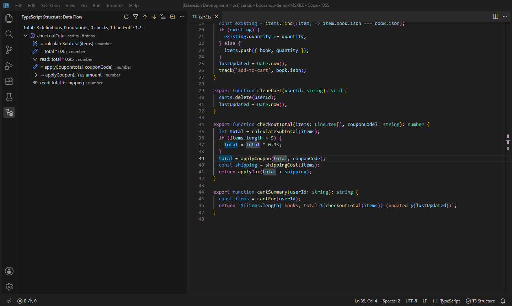

1. Put the cursor on a variable, parameter or property. In the demo, use `total` in `checkoutTotal` (`src/cart.ts`).
2. Run **Data Flow Path Explorer**.
3. Read the steps in the view, grouped by function in source order:
   - a pencil for each assignment;
   - an eye for each read;
   - an arrow where the value is passed to another function, with the parameter it becomes.

   Each function's row summarizes what happens there, for example *3 writes, 1 check*. Each step shows its line. A type is shown where it differs from the declared type, so narrowing stands out. The step under the cursor is selected and marked *at cursor*.
4. Click a step to jump to it, or use the up and down arrows in the view's title bar to walk through them. The editor shades writes and reads of the value while the report is open.
5. To keep tracing into a called function, click the arrow button (**Follow Into Call**) on a hand-off row. It runs Data Flow on the parameter there.
6. On a parameter, an extra **Incoming values from call sites** group lists what every caller passes, including omitted arguments and defaults.

### Mutation Tracking

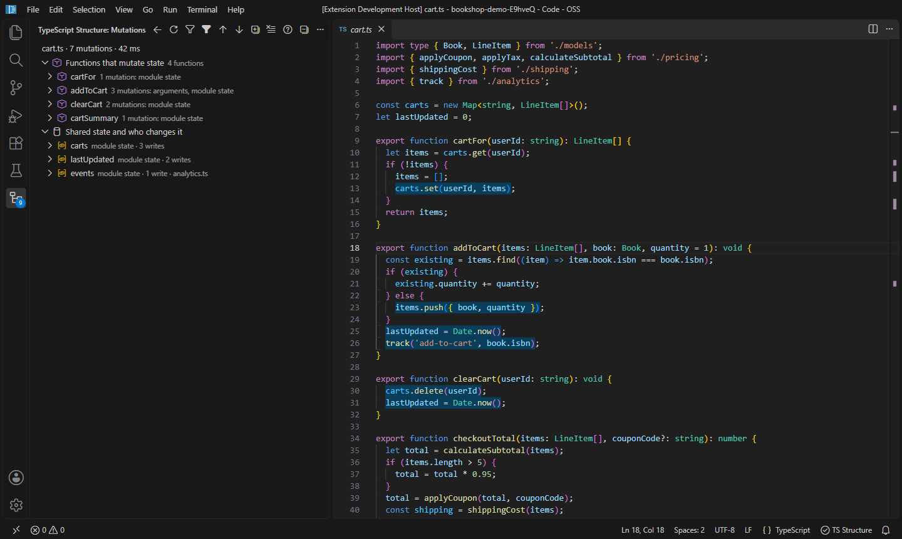

1. Open the file you want to audit, for example `src/cart.ts`. If the cursor is on a module variable or an import, that state is selected in the report.
2. Run **Mutation Tracking (Active File)**, or **Mutation Tracking (Project)** to cover every file. In the project report each function names its file.
3. **Functions that mutate state** lists each function that changes something it doesn't own. Expand one to see each change. A change made inside a called function shows the call chain, such as *changes module state events (.push()) via track()*.
4. **Shared state and who changes it** turns the same data around: one row per module variable, import, global or `this` field, with every function that writes it. Use it to find the unexpected writer of a piece of state.
5. Click any row to open the line. The editor shades every write while the report is open.
6. Click the lightning button (**Show All Side Effects**) on a function row to run the Side-Effect Analyzer on it. That also shows I/O, timers and other effects besides mutations.

### Nullability Path Explorer

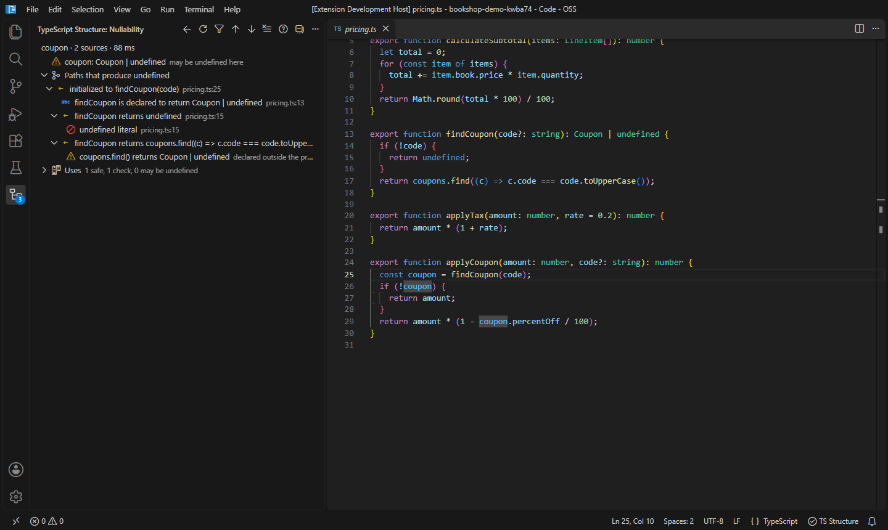

1. Put the cursor on a variable, property access or call that might be `null` or `undefined`. In the demo, use `coupon` in `applyCoupon` (`src/pricing.ts`). On a function's name, such as `findCoupon`, it explains which of its returns give `null` or `undefined`.
2. Run **Nullability Path Explorer**.
3. The first row gives the verdict: the type, and whether the value *may be null or undefined here* or is *never null or undefined here*.
4. **Paths that produce null or undefined** traces every source back to its origin. Examples: an optional parameter, a caller that omits an argument, a `return undefined`, a function that can reach its end without returning, or a library call such as `Array.find()`.
5. If the value is safe at the cursor, **Ruled out by** lists the checks that narrow it, such as `if (!coupon) return amount;`.
6. **Uses** lists every read of the variable and what it is at that point: *safe* (narrowed), *check* (a test such as `!coupon` or `coupon?.code`), or *may be undefined*. A use that may still be null is one that needs a guard.
7. You can also start from a TypeScript error. On *Object is possibly 'undefined'* or *'user' is possibly 'null'*, open the lightbulb (`Ctrl+.`) and choose **Explain why 'user' may be null or undefined**.

### Promise Rejection Analyzer

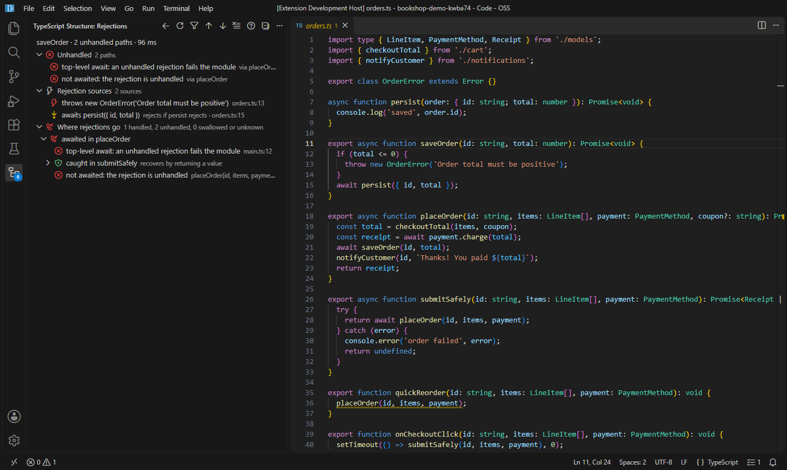

1. Put the cursor on an async function, or a function that returns a promise. In the demo, use `saveOrder` in `src/orders.ts`. On a call, such as `placeOrder(…)` in `quickReorder`, the report starts with **This call**, where that call's promise goes.
2. Run **Promise Rejection Analyzer**.
3. **Rejection sources** lists what can make the promise reject: `throw` statements, awaited calls that can reject themselves, and `Promise.reject`.
4. **Where rejections go** follows the promise through every caller, `.then()`/`.catch()`, `Promise.all`, variables and callbacks. Each path ends in one of these:
   - a red *unhandled* row: a call that is not awaited, a `void`, or a callback whose caller ignores returned promises, such as `setTimeout`;
   - a *caught in …* row that says what the catch block does: rethrows, recovers, logs, or swallows;
   - a green *handled* row.
5. **Unhandled**, at the top, lists every unhandled end with the callers it passes through. Click a row to go to the call that drops the rejection, or click its lightbulb button (**Show Fixes**) to open the fixes there: add `await`, mark it intentionally ignored with `void`, or wrap it.

### Missing Await (live inspection)

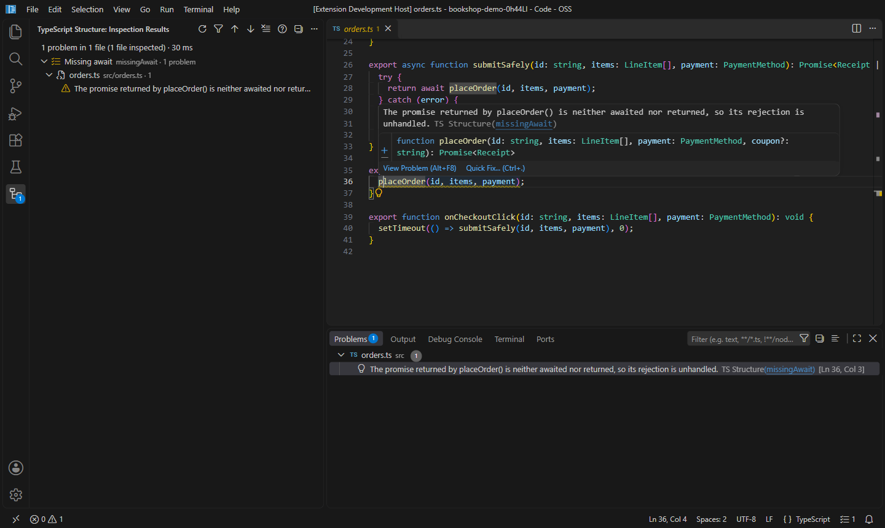

1. Nothing to run: the inspection checks every TypeScript and JavaScript file that is visible in an editor. Open `src/orders.ts` in the demo.
2. A dropped promise is underlined, here `placeOrder(id, items, payment);` in `quickReorder`. Hover it to read why. The message names the original function when the promise comes through wrappers.
   Async callbacks passed to APIs that ignore their promise, such as `setTimeout(async () => …)` or `.addEventListener('click', async …)`, are flagged too, unless the callback catches its own errors.
3. Press `Ctrl+.` on the underline for fixes:
   - **Add await**, in an async function, or **Make … async and await the call** elsewhere. That also wraps a declared return type in `Promise<…>`;
   - **Mark as intentionally not awaited (void)**;
   - **Handle the rejection with .catch()**, which works outside async functions too;
   - **Return the promise to the caller**, when the call is the last statement of a function without a declared return type;
   - **Trace where this promise's rejection goes…**, which opens the Promise Rejection Analyzer;
   - suppress the warning for the line or the file.
4. The Problems panel (`Ctrl+Shift+M`) lists the findings, and the status bar shows the count for the active file.
5. For helpers that are meant to run in the background, such as analytics or logging, list them in `tsStructure.missingAwait.ignore` instead of suppressing every call. For example, `["track", "logger.*"]`.
6. To check the whole project, run **Inspect Code…** and choose the project. Results open in the TypeScript Structure view, and fixable rows have an **Apply Fix** button.

### Type Assertion Inspector (live inspection)

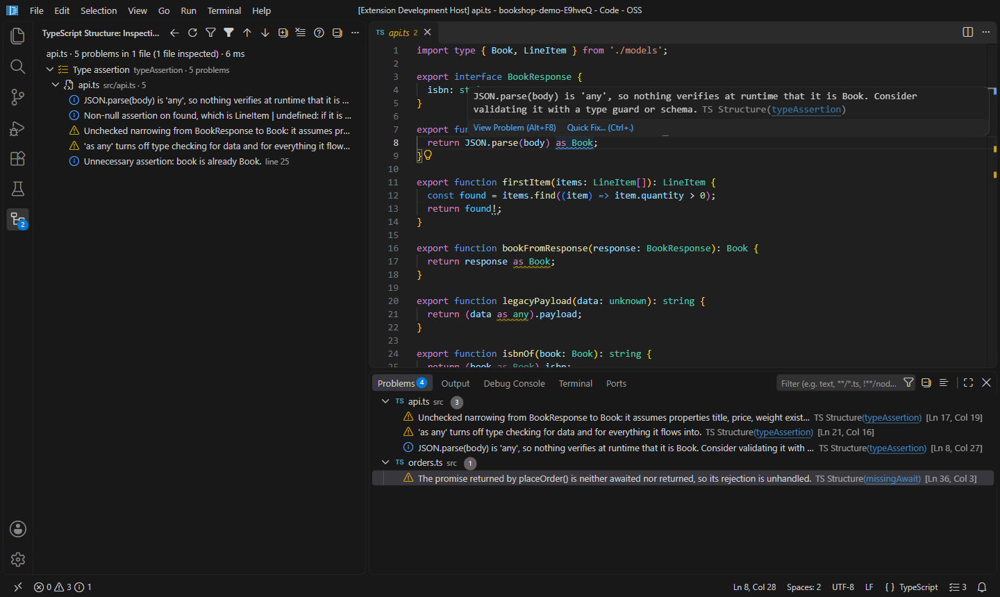

1. Like Missing Await, this inspection runs on every visible TypeScript or JavaScript file. Open `src/api.ts` in the demo.
2. Each `as`, `<T>` and `!` is classified:
   - **Unchecked narrowing** (warning), with what it assumes, such as *it assumes properties title, price, weight exist*;
   - **Unsafe** (warning): `as any`, double assertions through `unknown`;
   - **Unverified** (information): an assertion on an `any` value, such as `JSON.parse(body) as Book`;
   - **Widening** (information);
   - **Non-null `!` on a nullable value** (hint);
   - **Unnecessary** (hint, shown faded), such as `book as Book` when `book` is already a `Book`.
3. Hover a finding to read the explanation, or press `Ctrl+.` for fixes:
   - **Remove unnecessary assertion**;
   - **Use 'satisfies Shape'** for widening, which keeps the compiler's check;
   - **Use optional chaining '?.'** instead of `!`;
   - **Use 'as unknown'** instead of `as any`, so every use has to narrow the value;
   - **Show where … comes from…** runs Data Flow on the asserted value, and **Explain why … may be null or undefined…** runs the Nullability Path Explorer on a `!`;
   - suppression comments for the line or file.
4. Hints don't appear in the Problems panel. Run **Inspect Code…** on the file to list every finding, hints included, in the TypeScript Structure view. To review a codebase, run **Audit Type Assertions (Project)**. It groups every assertion from riskiest (*Unsafe*) to harmless (*Unnecessary*), one row per line, with the fix button where there is one.
5. Change how loud each inspection is with `tsStructure.inspections.severity`, for example `{ "typeAssertion": "info" }`, or `"off"` to disable it.
6. Tests often need assertions for mocks and fixtures. Turn on `tsStructure.typeAssertion.ignoreTestFiles` to skip test files, such as `*.test.ts` or files that import a test framework.

### Dead Export Analyzer

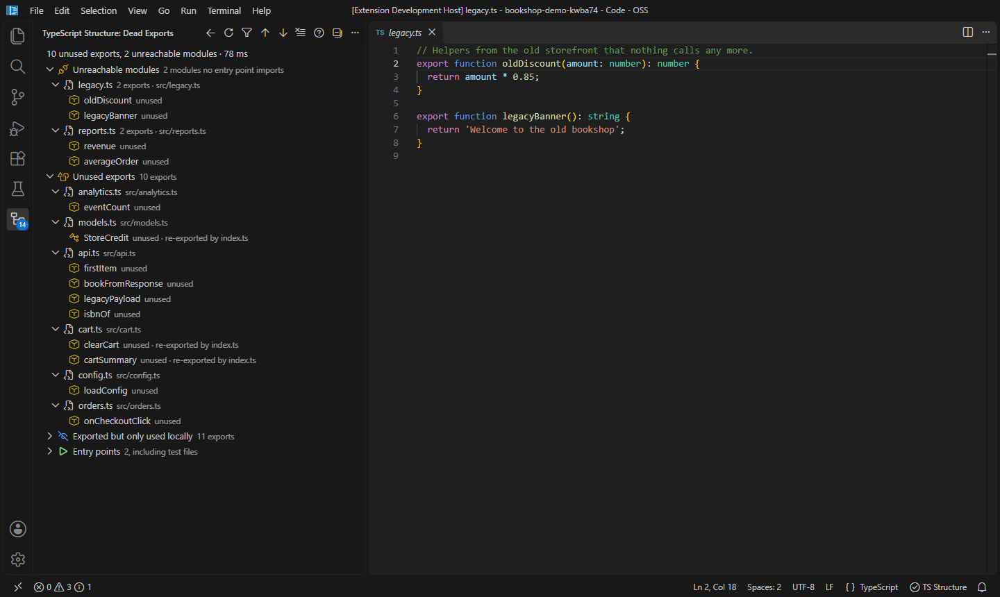

1. Open any file in the project and run **Dead Export Analyzer**. The whole project is analyzed.
2. Check **Entry points** at the bottom. The analyzer starts from the files named in `package.json` (`main`, `module`, `exports`, `bin`, here `src/main.ts`) and from test files. Without those it falls back to `src/index.ts`, `src/main.ts` and similar. Set `tsStructure.deadExports.entryPoints` (globs) if the guess is wrong.
3. **Unreachable modules** are files no entry point imports, directly or indirectly, such as `legacy.ts`. The trash button (**Safe Delete File…**) checks for remaining references before deleting.
4. **Unused exports** are exported names nothing reachable imports. Each row's trash button runs **Safe Delete…** on the declaration. Rows say what kind of declaration it is, mark interfaces and type aliases as *type*, and name any barrel that still forwards the name (*re-exported by index.ts*).
5. **Exported but only used locally** are names used inside their own module only. The button on the row (**Remove export Keyword**) keeps the code and drops `export`. The button on a file row removes every one in that file at once.
6. Exports reached through `export *` barrels, renamed re-exports, `import * as ns` and dynamic `import()` count as used. Turn off `tsStructure.deadExports.testFilesAreEntryPoints` to also find exports that only tests use.
7. To keep an export that is public API on purpose, such as a library function no code in the repository calls, document it with `/** @public */` or `/** @api */`. It is no longer reported.

### Exception Flow Visualizer

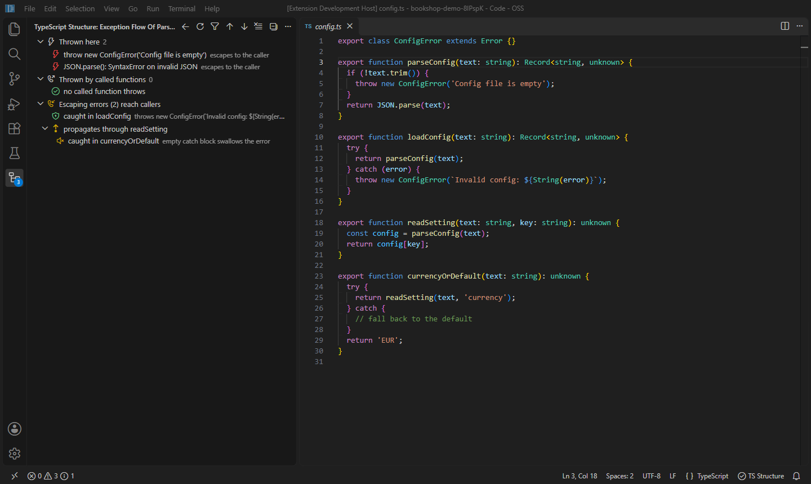

1. Put the cursor on a function or method. In the demo, use `parseConfig` in `src/config.ts`.
2. Run **Exception Flow Visualizer**.
3. **Thrown here** lists `throw` statements and library calls known to throw. Examples: `JSON.parse()` (*SyntaxError on invalid JSON*), `JSON.stringify()`, `new URL()`, `decodeURIComponent()`, Node's `fs.*Sync` file calls and `execSync()`.
4. **Thrown by called functions** lists errors that come out of functions this one calls, with the call chain down to the original `throw`. Each row says whether the error is caught here or *escapes to the caller*. Click the arrow button (**Follow Into Call**) to open the exception flow of the called function.
5. **Error types** names the error classes that can come out, such as *ConfigError, SyntaxError*. That's what a `catch` would need to handle. **Catch and finally blocks** says what each handler does: recovers, rethrows, transforms (throws a different error), logs and continues, or swallows (an empty `catch`).
6. **Escaping errors reach callers** follows what escapes up through every caller, until it is caught, or reaches code with no callers (*errors are uncaught*). When it enters an async function it becomes a rejection, and the report keeps following that promise through awaits, `.catch()` and dropped calls. In the demo, `currencyOrDefault` swallows `parseConfig`'s errors through `readSetting`, which is worth a look.
7. When some path ends uncaught, an **Uncaught** group at the top lists each one with the callers it passes through.

### Structural Duplicate Finder

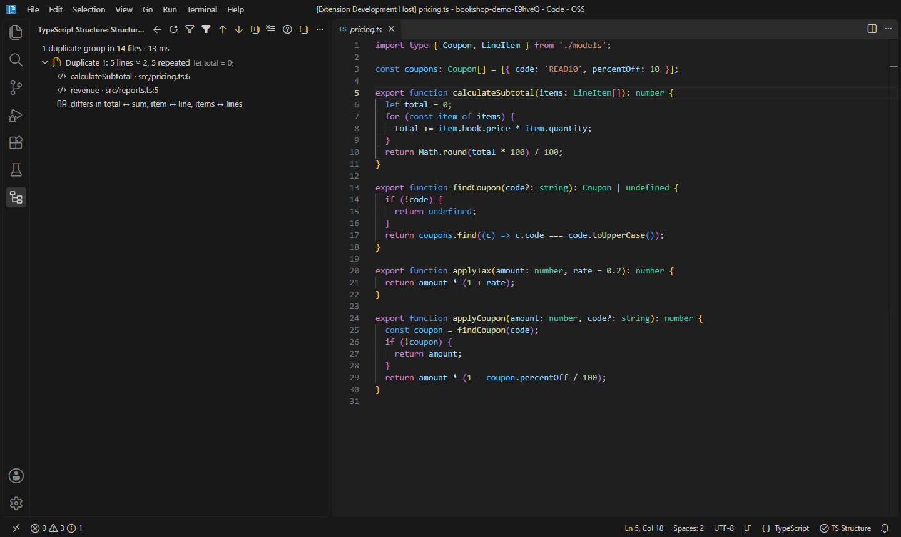

1. Open a file in the project and run **Find Structural Duplicates…**.
2. Choose **Whole Project** or **Active File**. With statements selected, **Copies of the Selection** instead lists every place in the project with the same structure as the selected code.
3. Each **Duplicate** group is a run of statements with the same structure. It shows the number of lines, the number of copies, and how many lines are repeated, which is what consolidating would remove. The biggest payoff is listed first. Copies count even when variables are renamed or literal values differ. In the demo, `revenue` in `reports.ts` is a copy of `calculateSubtotal` in `pricing.ts`.
4. Expand a group to see each copy and the function it's in. The last row says what differs between them, such as *total ↔ sum, item ↔ line*. Those are the parameters a shared function would need.
   The wrench button on a copy (**Refactor…**) selects that code and opens the refactor menu, where VS Code's **Extract to function** turns it into a shared function.
5. Click the diff button on a group (**Compare Copies**) to open the first two copies side by side. Common indentation is removed so they line up.
6. Tune sensitivity with `tsStructure.duplicates.minStatements` (default 3) and `minTokens` (default 40). Turn on `tsStructure.duplicates.matchRenamedProperties` to also match copies that use other property names. For example, `parcelWeight` in `shipping.ts` sums `.weight` the way `calculateSubtotal` sums `.price`. Test files are skipped unless `tsStructure.duplicates.ignoreTestFiles` is off.

### Side-Effect Analyzer

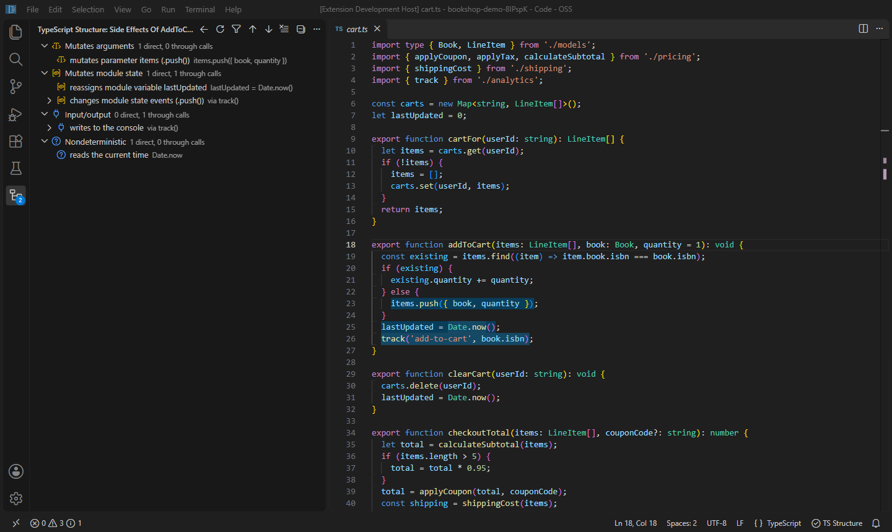

1. Put the cursor on a function name, inside a function body, or on a call. In the demo, use `addToCart` in `src/cart.ts`.
2. Run **Side-Effect Analyzer**.
3. Effects are grouped by kind, each with how many are direct and how many come through calls:
   - **Mutates arguments**, **Mutates the instance**, **Mutates module state** or **imported state**, **Mutates captured variables**, **Writes globals**;
   - **Input/output**: console, network, storage, `fs`, dialogs;
   - **Schedules work**: timers;
   - **Nondeterministic**: `Math.random()`, `Date.now()`, `new Date()`.
   - **Calls it could not follow**: calls to a callback parameter or a function-typed property, which could do anything. A function like that is never labeled *pure*.
4. An effect inherited from a called function says so (*changes module state events (.push()) via track()*). Expand it to see the call chain, or click its lightning button (**Show All Side Effects**) to analyze the function it comes from. A mutation of a parameter in a callee is mapped to what this function passed.
   **By call** lists the same inherited effects per call, such as *track() input/output, mutates module state*, to see which call to change or isolate.
5. To see this at a glance in the editor, turn on `tsStructure.codeLens.sideEffects`. Every function then gets a lens: **pure**, or a summary such as *mutates arguments · mutates module state · I/O*. That includes methods, class fields holding arrow functions (`handle = () => …`) and object properties holding functions (`{ onSave: () => … }`). Click a lens to open the full analysis. To keep lenses only on functions with effects, turn off `tsStructure.codeLens.sideEffectsShowPure`.

### Semantic Find Usages (`Alt+F7`)

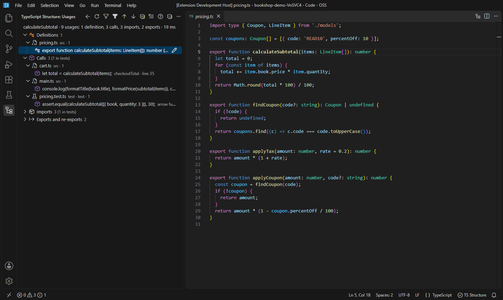

1. Put the cursor on any symbol: a function, variable, class, property or type. In the demo, use `calculateSubtotal` in `src/pricing.ts`.
2. Press `Alt+F7`, or run **Semantic Find Usages**.
3. References are grouped by what they do:
   - **Definitions**, **Calls**, **JSX usages**, **Writes**, **Reads**;
   - **Extended or implemented**, **Type references**;
   - **Imports**, **Exports and re-exports**.

   Each group shows its count, including how many are in test files. To see only some groups, such as just **Calls** and **Writes**, choose **Show Groups…** in the view's `…` menu. That works in every report.
4. Inside a group, references are listed per file. Each one shows its line of code and the function it's in. Test files have a beaker icon. Hover a row to see the lines around it. The usage you started from is selected and marked *at cursor*, and Next and Previous Result continue from it.
5. Usages through aliases count too. In the demo, `main.ts` calls `calculateSubtotal` as `subtotal`, imported from the `index.ts` barrel.
6. If nothing actually uses the symbol, because it is only declared, imported or re-exported, the view says so. Its definition then gets a trash button (**Safe Delete…**).
7. To rename the symbol after reviewing its usages, click the pencil button (**Rename Symbol**) on its definition.

### Re-export Chain Navigator

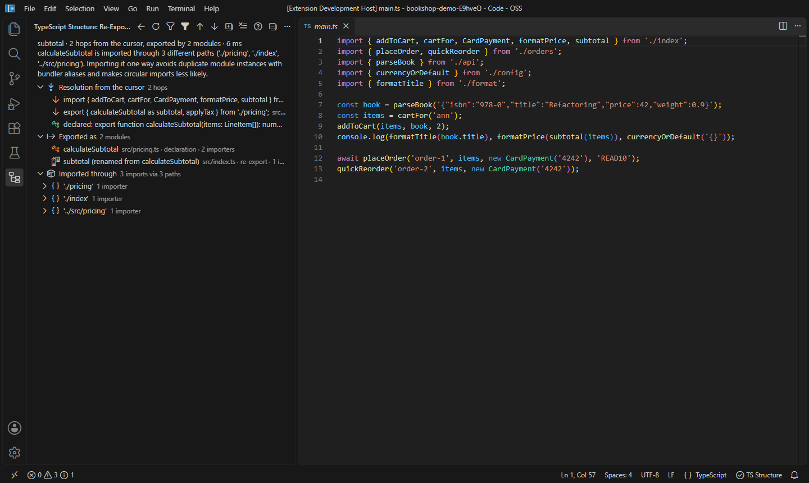

1. Put the cursor on an imported name, a re-export, or a usage of an imported symbol. In the demo, use `subtotal` in the first import of `src/main.ts`.
2. Run **Re-export Chain Navigator**.
3. **Resolution from the cursor** shows each hop the name takes: the import, every `export { … } from` or `export *` barrel on the way, and the declaration at the end. Renames are noted, such as *as subtotal*. The declaration's **Find Usages** button lists every usage under any of its names.
4. **Exported as** lists every module that exports the symbol, under which name, and how many files import it from there. Use it to decide which path to import from, or to find barrels with *no importers* left over after a move.
5. **Imported through** groups the project's imports of the symbol by the module path they use, here `'./pricing'` and `'./index'`. Mixed paths to the same declaration are a common source of circular-import trouble, so the view warns when there is more than one.
6. An importer that goes through a barrel has an **Apply Fix** button. It imports the symbol straight from the module that declares it, keeping any local name: `import { calculateSubtotal as subtotal } from './pricing';`.

### Structural Search Builder

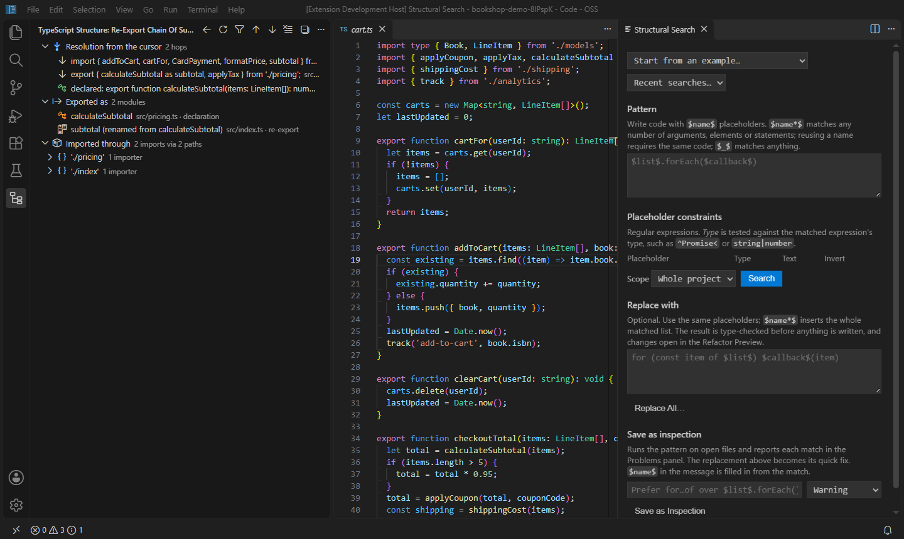

1. Open a file in the project and run **Structural Search…**. Selected code becomes the starting pattern. The builder opens beside the editor.
2. Write the **Pattern** as code with placeholders, or pick one from **Start from an example…**. In the demo, `$list$.find($callback$)` finds every `.find()` call. Problems, such as a pattern that isn't valid TypeScript or a broken regular expression, show under the box as you type.
3. Each placeholder gets a row under **Placeholder constraints**. **Type** is a regular expression tested against the matched code's type. Here `^LineItem\[\]$` keeps only searches through line item arrays and skips `coupons.find()`. **Text** tests the code itself; **Invert** negates either one.
4. Choose the **Scope** and click **Search**, or press `Ctrl+Enter` in the pattern. The scope is the whole project, the current file, or the code selected in the editor right now. A selection is handy for replacing inside one function.
5. Matches appear in the builder and in the TypeScript Structure view, grouped by file. Each shows what every placeholder matched, such as *$list$ = items*. Click one to open it.
6. **Recent searches…** brings back any of your last 15 searches with their constraints.

### Type-Safe Structural Replace

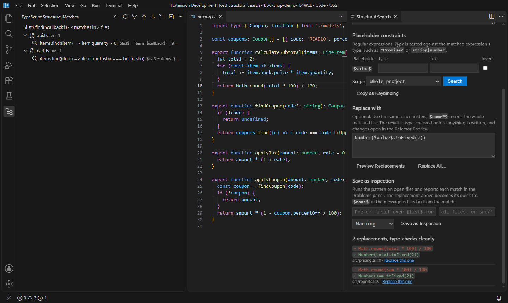

1. In **Structural Search…**, write the pattern to find. In the demo, use `Math.round($value$ * 100) / 100`.
2. Under **Replace with**, write the new code using the same placeholders: `Number($value$.toFixed(2))`. `$name*$` placeholders insert the whole matched list. A placeholder the pattern doesn't define, usually a typo, is flagged under the box.
3. Click **Preview Replacements**. Every match is listed with its old code (−) and new code (+). The summary says whether the result *type-checks cleanly* or lists each new type error, such as calling a method the value doesn't have. To change only some matches, click **Replace this one** under a match.
4. Click **Replace All…**, or press `Ctrl+Enter` in the replacement. The changes open in VS Code's Refactor Preview, where you can untick individual files or changes before applying them. Turn off `tsStructure.previewRefactorings` to apply directly.
5. A replacement that doesn't parse is refused before anything is written, with the file and line where it breaks. Use **Undo** (`Ctrl+Z`) in the edited files to revert an applied replacement.

### Custom Inspection Builder

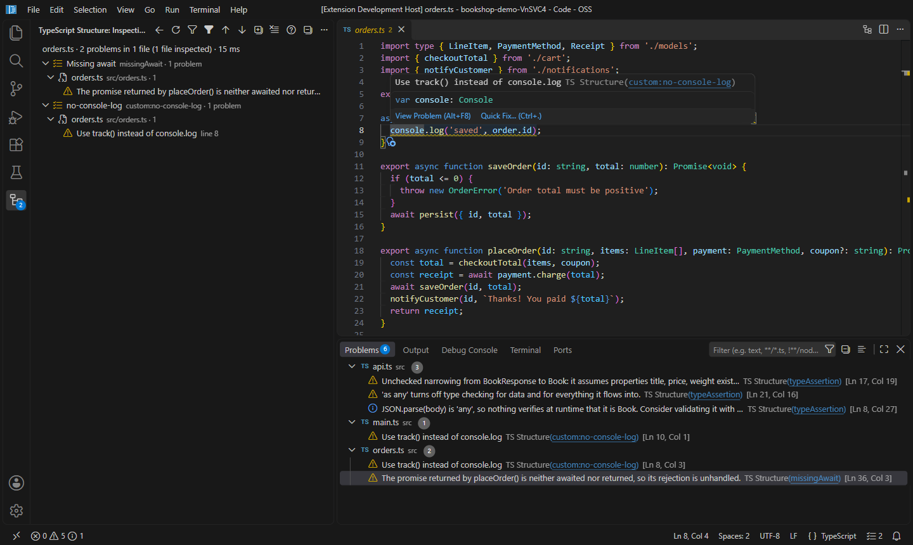

1. In **Structural Search…**, write and test a pattern until it finds exactly what you want to flag. For example, `console.log($args*$)`.
2. Optionally write a **Replace with** template. It becomes the inspection's quick fix.
3. Under **Save as inspection**, write the message, for example *Use track() instead of console.log*. Placeholders such as `$args$` are filled in from each match. Choose a severity and click **Save as Inspection**. To check only some files, fill in the glob box, such as `src/**` or `**/*.tsx`.
4. The inspection is saved in the workspace's `tsStructure.customInspections` setting, so it is shared through `.vscode/settings.json`. It runs live on visible files like the built-in inspections: an underline, a hover, the Problems panel, the quick fix and a fix-all for the file.
5. **Inspect Code…** includes custom inspections, so the whole project can be checked at once.
6. Run **Manage Custom Inspections…** to see them all. Press `Enter` to edit one in the builder, where **Update Inspection** saves over it. Use the buttons on each row to disable, enable or delete it, or pick **New inspection…** to start another. From a finding, the lightbulb offers **Edit custom inspection…** and **Disable custom inspection** directly.

### Inheritance Hierarchy Explorer

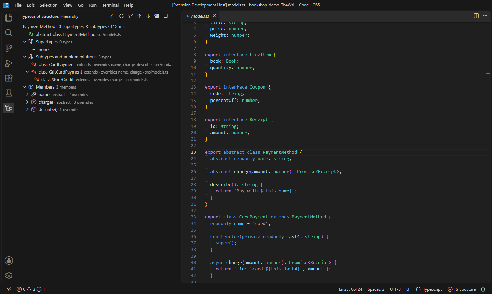

1. Put the cursor on a class or interface name, or anywhere inside its body. In the demo, use `PaymentMethod` in `src/models.ts`.
2. Run **Inheritance Hierarchy Explorer**.
3. **Supertypes** lists what the type extends and implements, nested up to the top.
4. **Subtypes and implementations** lists every class or interface that extends or implements it, nested down through the project. Each one says which of this type's members it overrides, such as *overrides name, charge, describe*.
   Click the hierarchy button on any supertype or subtype (**Show Hierarchy of This Type**) to re-center the report on it.
5. **Members** lists the type's own members. Each one says whether it is abstract, which supertype it comes from, and how many subtypes override it. Expand a member to see each override and whether it *calls super*. Run it with the cursor on a member's name, and that member opens selected. The button on a member (**Override Impact of This Member**) shows what changing it would affect.
6. **Inherited members** lists what the type gets from its supertypes without redeclaring it, each with the type it comes from. That's the full API of a subclass in one place.

### Override Impact Analyzer

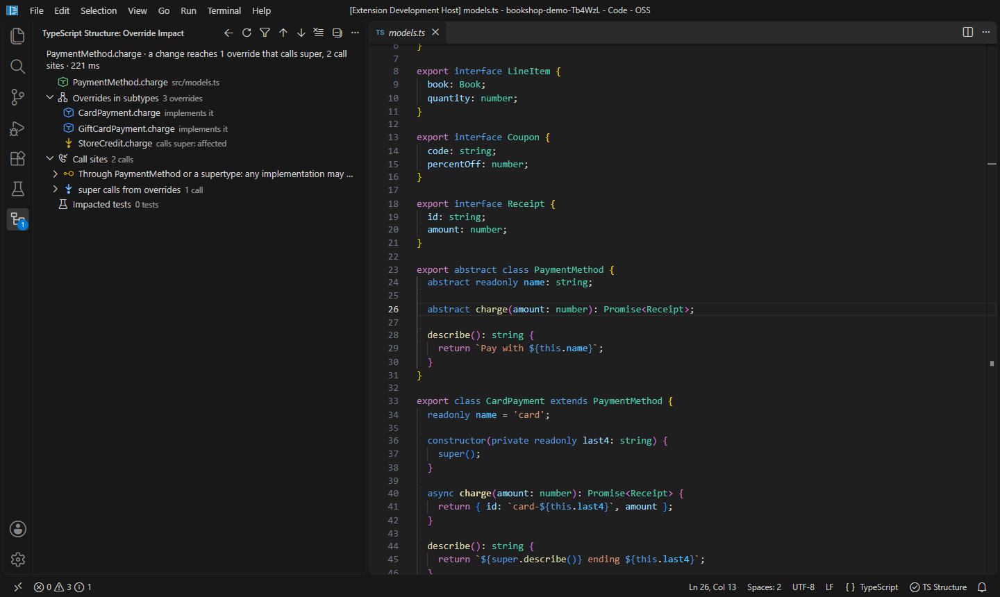

1. Put the cursor on a method or property of a class or interface. In the demo, use `charge` in `PaymentMethod` (`src/models.ts`).
2. Run **Override Impact Analyzer**.
3. The first row names the member and anything it overrides higher up.
4. **Overrides in subtypes** says how each override relates to it: *calls super: affected*, *replaces it: not affected by body changes*, or *implements it* for abstract and interface members.
5. **Subtypes that inherit it unchanged** are affected by any change to its body.
6. **Call sites** are split by the static type they call through. Calls through the base type may run any implementation, so they are the riskiest. **Impacted tests** lists the tests that reach the member.

## Test Impact Analysis

### Usage

1. Open a TypeScript or JavaScript file and place the cursor on a symbol.
2. Run **TypeScript Structure: Test Impact Analysis** from the Command Palette or the editor's right-click menu.
3. Choose a scope:
   - **Function or Symbol at Cursor**: tests that depend on the selected symbol.
   - **Active Module**: tests that depend on anything in the current file.
4. A searchable picker lists each affected test, its file and the dependency chain that explains the match. Select one to open its registration. The **Impacted Tests** view in the Testing sidebar keeps the results as a tree, with each step of the chain clickable.

Tests never run automatically. Use the play buttons in the picker or the view, or **Run Impacted Tests**, to run them through Jest, Vitest, Mocha, Playwright or `node --test` with name filtering.

#### Try it

Press F5 to open the `sample` project. In `src/impactSource.ts`, place the cursor on `formatImpactLabel` and choose **Function or Symbol at Cursor**. The two label tests in `impactSource.test.ts` appear, one of them through `displayImpactLabel`, and the unrelated totals test is excluded. **Active Module** includes all three. In `src/discount.ts`, `calculateDiscount` reaches tests through `calculateTotal` and `checkout`.

### How it works

- **Symbol resolution.** The symbol at the cursor is resolved through imports, aliases and re-exports to its declarations. If the cursor is not on a name, the enclosing function, method, class or test is used.
- **Reference index.** Every runtime reference in the project is indexed by the declaration it resolves to. Type-only positions (annotations, interfaces, `implements`) are skipped, while `class X extends Y` counts.
- **Caller tracing.** A breadth-first walk goes from each reference up to the code that contains it, which is a test body, a hook, test-file initialization, or the next declaration whose callers are followed. Visited declarations end cycles, and each test keeps its shortest explanation.
- **Confidence.**
  - *Confirmed* means a resolved chain of references reaches the test body.
  - *Possible* means the chain depends on a conservative assumption: calls through an interface or base class, shared hooks, test-file initialization, or module top-level code.
- **Stale results.** Results record a hash of every file they point into. Navigation is refused, with an offer to re-run the analysis, if a file changed after the analysis ran.
- **Caching.** Parsed files are reused across analyses while their text is unchanged. A project whose files are all unchanged is reused whole, including its reference index. Unsaved editor text is analyzed.

#### Test discovery

- Test files are recognized by `.test.*` or `.spec.*` names, by `test/`, `tests/` or `__tests__/` directories, and by imports of `node:test`, `vitest`, `@jest/globals`, `@playwright/test` or `mocha`.
- Recognized registrations:
  - `test`, `it`, `describe`, `suite`, `context` and Mocha TDD names, including imported aliases (`import { test as check }`) and namespace imports.
  - Modifiers such as `.only`, `.skip`, `.todo` and `.concurrent`, and Playwright's `test.describe` and `base.extend`.
  - `.each(...)` and `.for(...)`. Parameterized registrations are listed once.
- A reference in a shared hook or in test-file initialization conservatively includes every case in that file.
- A test file with no static registrations is listed as a whole-file entry.

## Limitations

- Source and tests must be in the same compiler project. Excluded test projects are not scanned. If the application's `tsconfig` excludes tests, open a test file under a config that includes them and select the imported symbol there.
- Static analysis cannot see dynamic dispatch through untyped values, runtime dependency injection, string-based lookups or module mocks. Mocked modules are still reported as impacts.
- Analysis runs on the extension host thread. Very large projects may pause the editor for the first analysis while the index is built. Live inspections only run on files that are on screen.
- The inspections and navigation features follow calls the compiler can resolve. Callbacks passed to library functions, dynamic property access and values that escape into untyped code are reported as unknown rather than guessed.
- Dependency Graph Diff needs `git` on the `PATH`. It resolves imports in both revisions with the current compiler options.
- The extension depends on TypeScript 6.0.3, the latest release with the stable JavaScript Compiler API. TypeScript 7 only exposes an unstable API.

## Development

```bash
npm install
npm test                  # compile and run the analyzer tests
VSCODE_EXECUTABLE="/path/to/Code.exe" npm run test:integration   # run inside a real VS Code
```

- The engine has no `vscode` dependency and is unit-tested directly:
  - `src/analysis/` is test impact analysis.
  - `src/refactor/` and `src/intentions/` are the refactorings.
  - `src/inspect/` holds the inspections, `src/navigate/` the navigation features, and `src/search/` structural search.
  - `src/structure/` holds the shared report model and helpers.
- `src/extension.ts`, `src/resultsView.ts`, `src/runner.ts` and `src/ui/` are the VS Code layer.
- `test-fixtures/` holds a small project per area. For example, `edge` covers re-exports, interface dispatch, cycles, hooks, `.each`, aliased imports, Jest globals and `node:test`.
