# Code X-Ray

See inside your TypeScript, JavaScript and React code. Put the cursor on something and ask: where does this come from, what runs here, what breaks if I change it? Every answer comes from the TypeScript compiler on your machine: offline, no AI, and nothing leaves your computer.

**At a glance**, grouped the way the Actions view is:

- **Values**: Data flow, Why this value, What feeds this value, What this value feeds, Null checks, Changes to this variable and Race conditions.
- **Flow and errors**: a Flowchart of any function with every path listed, compared and filtered; What depends on what, Error paths, Promise rejections and Side effects.
- **Finding your way**: Find usages, Callers and calls, Arguments passed in, Family tree, Override reach and Re-export trail.
- **Imports**: Who imports this, Why this import, Import loops and Import changes since.
- **Health check**: Inspect code, Type assertions, Déjà vu for copied code, Ghost exports, Pattern spotting and Shared state changes.
- **Tests**: Affected tests, and Tests for my changes before you commit.
- **Edit**: Change parameters, Make it a parameter, Move to another file, Delete safely, 70 quick rewrites, Search by shape and Your own checks.
- **Around it all**: an Actions view you can search, pin and trim, a shortcut for everything (the Cheat codes), Ask the rubber duck when you don't know which to pick, the Toolshed of optional tools, charts you can save as Mermaid, SVG or PNG, and screen reader, keyboard and high contrast support.


## Getting started

1. Open a TypeScript or JavaScript file and put the cursor on a symbol.
2. Right-click: **Find usages**, **Find usages in this file**, **Data flow** and **Analyze or refactor this…** are at the top of the menu. Everything else is under **Code X-Ray**.
3. Or open **Code X-Ray** in the Activity Bar: the **Actions** view at the top lists every analysis and edit in **Analyze** and **Edit** tabs, and every chart in the **Charts** tab (the Graph Explorer), with a search box, your **Pinned** and **Most used** actions first and the rest by category. Results open in the **Analysis** view below it.

**Arranging the Actions view**

- Hover an action, or move to it with the keyboard, to see its full shortcut (for example `Ctrl+Alt+S` then `1`) and its tools: **ⓘ** explains what it does, how often you used it and its shortcut; the pin keeps it at the top.
- Pin the actions you use and drag them into the order you like, or press `Alt+Up` and `Alt+Down`.
- Right-click an action (or press `Shift+F10`) to run, pin, move or hide it, change or add its shortcut, or copy its command ID. `Delete` hides the focused action; hidden actions wait in a folded **Hidden** section, ready to show again.
- Fold any section by its heading; the view's title bar folds them all, or hides the descriptions for a one-line list. Its **…** menu hides Most Used, shows every hidden action, or resets the view.
- Type anywhere in the list, or press `/` or `Ctrl+F`, to search. Search covers every tab, hidden actions and shortcuts (try `F7`), and marks the matching words.
- Shortcuts you changed in your own keybindings are the ones shown. Your arrangement is kept across windows and synced with Settings Sync.
- The action whose result is on screen stands out: its row is raised with a colored bar on its left, its tab has a dot, and the action you ran before it says **last run**. It is cyan; pick pink or your theme's focus color with `tsStructure.actions.accentColor`.

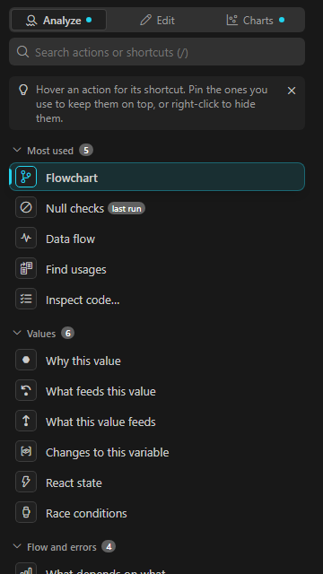

Not sure which analysis answers your question? Run **Ask the rubber duck…** (`Ctrl+Alt+S /`) and pick a question such as *Where does this value come from?*

The first time the extension starts, the **Welcome to Code X-Ray** page opens: the title in a pixel font over a moving field of ASCII characters, then eight short steps as panels, each with its buttons and a picture. A step is ticked once you try it. Reopen the page with **Guided tour** (the **?** in the view); VS Code's own walkthrough of the same steps is a button at the bottom, or **Guided tour in VS Code’s walkthrough** in the Command Palette. The animation stops while the tab is hidden and is a still picture when your system asks for reduced motion.

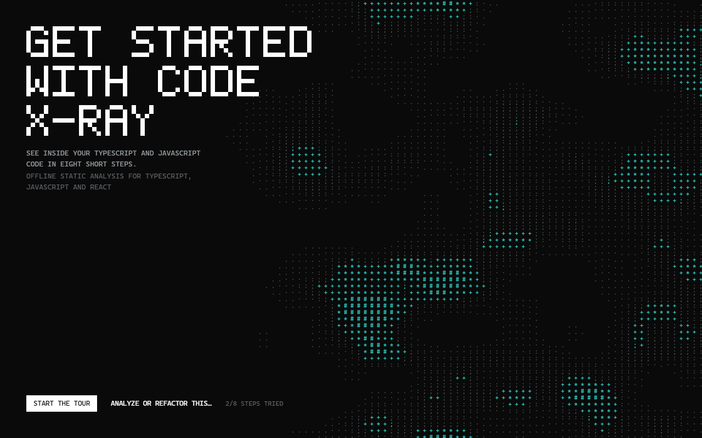


### Plain names

Everything is named the way you would say it: **Flowchart**, **Who imports this**, **Delete safely**, **What feeds this value**, in sentence case, without analysis jargon. The old, technical names still work in every search box, so typing *control flow graph* finds **Flowchart** and *safe delete* finds **Delete safely**.

A few side rooms have a playful name with a plain line under it: the **Toolshed** of optional tools, the **rubber duck** that answers *how do I…?*, the **Cheat codes** for shortcuts, **Ghost exports** that nothing uses and **Déjà vu** for copied code. And a few things are in no menu at all. Be nice to the duck.

## Shortcuts

Every analysis has a shortcut: `Ctrl+Alt+S` (`Cmd+Ctrl+S` on macOS), then a letter. **Cheat codes** (`Ctrl+Alt+S K`) lists them all; change any of them with **Keyboard shortcuts…**, or the keyboard button next to each entry in **Analyze or refactor this…**.

| Key | Runs | Key | Runs |
| --- | --- | --- | --- |
| `Space` | Analyze or refactor this… | `X` | Error paths |
| `D` | Data flow | `A` | Arguments passed in |
| `U` | Find usages (also `Alt+F7`; in the file `Shift+Alt+F7`) | `H` | Family tree |
| `N` | Null checks | `O` | Override reach |
| `E` | Side effects | `C` | Re-export trail |
| `M` | Shared state changes | `P` | Why this import |
| `R` | Promise rejections | `G` | Import changes since… |
| `Y` | Pattern spotting | `S` | Search by shape |
| `I` | Inspect code | `F` | Déjà vu |
| `T` | Affected tests | `Z` | Ghost exports |
| `V` | Results view | `L` | Run the last analysis again |
| `K` | Cheat codes | `/` | Ask the rubber duck… |
| `W` | Rewrites here | `B` | Move to another file |
| `J` | Who imports this | `Q` | Import loops |
| `2` | Type assertions | `3` | Shared state changes (project) |
| `4` | Tests for my changes | `5` | Next inspection problem |
| `6` | Changes to this variable | `7` | Race conditions |
| `1` | Flowchart | `0` | Why this value |
| `8` | Data flow chart | `9` | Draw the results as a chart |
| `Escape` | Stop | | |

Refactorings: **Change parameters** `Ctrl+F6`, **Delete safely** `Alt+Delete`, **Make it a parameter** `Ctrl+Alt+P`.


## Understand code

### Data flow

Where a variable, parameter or property comes from, every place it changes, and where it goes. **Design patterns** names the patterns the value passes through, such as a Strategy, Factory or Observer, recognized from the shape of the code. Hover a pattern for its **ⓘ** button (what it means) and its **Learn more** button, which opens the pattern on refactoring.guru, patterns.dev, react.dev, the TypeScript handbook or Martin Fowler's catalog. Click **Trace this value** on a row to follow the value into a called function. A pattern found in several places is one row, with the places below it.

The functions that write the value sit under **Flows in** and those that read it under **Flows out**, so each side folds away as one. **Flows in** also covers React state (the initial value and every `setCount(…)` call), destructured props and options (what each call site passes, or that it leaves them out), and flags incoming values that may be null or undefined. **Flows out** includes JSX props (`<Price amount={total} />`, which Trace This Value follows into the component), and each receiving variable shows, folded, where it sends the value next (**Group by function** in the **...** menu goes back to one group per function; `tsStructure.dataFlow.groupByDirection`).


#### Data flow chart

**Data flow chart** (`Ctrl+Alt+S 8`) draws the same flow as a chart in the editor: the variable in a circle in the middle, with a port where values come in and one where they go out, where its values come from on the left and where they go on the right. Click a box to open its code, click its round button to fold or unfold what is behind it, drag to move around and scroll to zoom. Right-click a box to check it for null, find its usages, follow its data flow or run another analysis there. **Draw as chart** in the results view (`Ctrl+Alt+S 9`) draws any analysis this way, and the chart follows the results view as you run more. Large charts stay quick: only what is on screen is drawn, and a chart of more than 150 boxes opens with its deepest levels folded.

- Boxes are as wide as their text and carry the same icon as their row in the results view (a pencil for a write, an eye for a read, books for design patterns); the bar under the chart shows the whole text, file, line and line of code of the box under the mouse.
- Design patterns are purple hexagons on dotted lines, since they describe the code rather than carry the value. Boxes that only group others are dashed outlines.
- Boxes that read exactly the same, such as one call made on several lines, are stacked into one with a **×2** badge; unfold it to see each one with its line.
- Right-click the subject circle to animate every flow, fold or unfold everything, or fit; right-click the background for fitting, folding, the minimap and export. While lines flow, the ring around the subject runs with them: in at the left port, round both sides and out at the right.
- Double-click a box (or press `B`) to see only its branch; `Escape` shows the whole chart again. A minimap appears when the chart is bigger than the window.
- **Find** (`Ctrl+F`) highlights matching boxes and unfolds the ones hiding a match; `Enter` goes to the next.
- Resting the pointer on a box (or moving to it with the keyboard) opens its **hover card**: what it is, its file and line, its code with syntax colors (up to 12 lines, scrollable), the report's details, the way from the subject to it, and the keys that act on it. The card stays open while the pointer is on it, its pin keeps it open to compare boxes, and `Escape` closes it.
- Hovering a box highlights its way to the subject. Selecting a row in the results view marks its box, and clicking a box selects its row.
- Keys: `Tab` to the subject, arrow keys between boxes, `Enter` to open, `Space` to fold, `+` `−` to zoom, `0` to fit, `Home` to return.
- Zoom, position and folding are kept when the same analysis runs again.
- **Copy as Mermaid** copies the chart as a Mermaid flowchart for Markdown, GitHub issues and pull requests; **Save as SVG** and **Save as PNG** save it as an image.
- **?** explains the colors, arrows and keys.
- An animated dot grid sits behind the chart and bends around every box: it glows and moves aside around the pointer and the hovered box, and clicking a box sends a wave across it. Every line is a blue wire with soft cyan pulses travelling along it the way the value goes; clicking a box keeps the pulses to the lines between it and the subject (clicking the background brings them all back). Boxes are rounded cards with a soft shadow, their border brightening on hover. The **Grid** and **Flow** buttons turn each off; both stay still when your system asks for reduced motion. (The grid, the flowing lines and the box style are adapted from [robot-components](https://github.com/dashrobotco/robot-components); see Credits.)

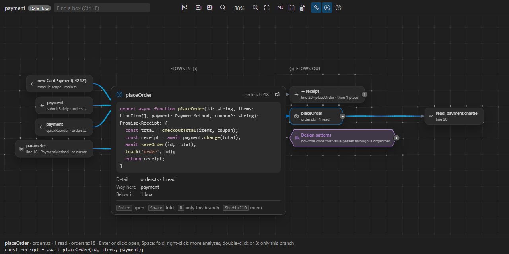

### Flowchart and path list

**Flowchart** (`Ctrl+Alt+S 1`) draws the function at the cursor as a flowchart beside the code: statements in the editor font, decisions as hexagons with **yes** and **no** edges, switch cases (including fall-through), loops with their way back, returns and throws, and code nothing reaches drawn dashed. Put the cursor on a call to draw the called function instead.

The **path list** lists every path through the function with the branches it takes, in words (*user.active → user.role is 'member' → not sensitive*), and what it returns. Pick a path to light up its route; click a branch label (yes, no, case…) to keep only the paths through it. Paths that test the same unchanged condition both ways cannot happen and are hidden unless you ask for them. Click a box to open its code; the box your cursor is in is outlined, and the chart redraws as you edit.

**Why this value** (`Ctrl+Alt+S 0`) answers *why does this variable have this value here?*: every value it can have at the cursor, with the conditions that lead to each. At the final `return permission` of a permissions check it lists `'write'` (active admin), `'limited'` (active member, sensitive), `'read'` (active member, not sensitive) and `'none'` (anyone else).

The answer also shows as a **Value path** card at the bottom of the Actions view: each value on a timeline with how many ways lead to it and what has to be true, how long the analysis took, and buttons to copy it or open it in the Results view. Click a value to open its code; **Next** runs another analysis at the cursor.

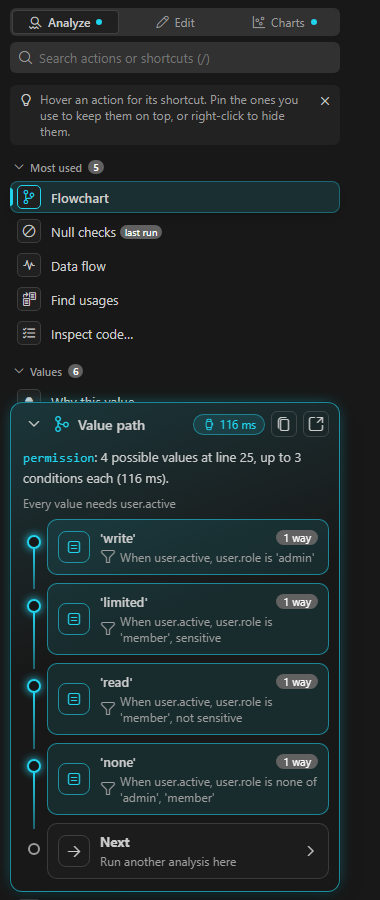

- **Expand calls in place**: a box that calls a function of your project has an **ƒ+** button. It splices the called function into the chart, in a labeled frame, with its returns leading on to what followed the call; paths then run through it.
- **Compare two paths**: Shift+click a second path. The shared route is purple, the first path's own branches blue and the second's orange, with a summary of where they part and how each ends.
- **Slices**: **What feeds this value** (backward slice) lights up the statements and decisions a variable depends on at the cursor; **What this value feeds** (forward slice) lights up everything it flows into or decides.
- **Export**: copy the chart as a Mermaid flowchart (with the picked path drawn thick) or save it as SVG or PNG.

Finding your way around a large function:

- **Start and end are circles**: start is a filled circle with a play mark and the function's name beside it, end a ring around a dot. Each box shows the line it starts on, and an icon for its kind: **?** for a decision, a loop arrow, a return arrow, an error mark for a throw. Yes and no labels carry a ✓ and ✕ as well as their color.
- **Right-click** a box to open its code, animate the paths through it, keep only the paths through it, zoom to it, expand or fold its calls, see what affects it or what it affects, run Data Flow, Find Usages or another analysis there, or copy its code. Right-click a branch label to filter by it or go to either end, a path in the list to pick, compare or copy it (as text or Mermaid), and the background to fit, expand or fold every call, go to unreachable code, or export.
- A **minimap** appears when the function is bigger than the window, with the picked path lit up; click or drag in it to move.
- **Find** (`Ctrl+F`) outlines the boxes whose code matches and fades the rest; `Enter` goes to the next match.
- **Hover cards**: rest the pointer on a box, or focus it, for a card with its kind, file and line, its whole code with syntax colors, how many paths pass through it, what it reads and sets, which boxes it controls, and when it runs (*switch (user.role) → case 'member'*), with the keys that act on it. Pin the card to keep it open; `Escape` closes it. The bar under the chart shows the same box in one line, and hovering a path in the list previews its route.
- **Long code**: long lines wrap instead of being cut off, and a box with more than four lines shows its first lines and a **+ N more lines** chip: click it, or press `U`, to unfold that box in place (its chip then folds it back). **Code in boxes** in the toolbar switches to **Show all code** in every box. Zoomed far out, each box shows one large line instead (*Decision*, *8 lines*) so the shape of the function stays readable.
- Keys: `Tab` to the chart, `↑` `↓` to follow the flow, `←` `→` along a row, `Enter` to open, `F` to animate, `T` to filter by the box, `Shift+F10` for its menu, `C` for the box at the editor's cursor, `P` to show or hide the path list, `Home` and `End` for start and end. Shift+wheel scrolls sideways, double-click zooms to a box, and **?** explains every shape, color and key.
- Zoom and position are kept per function, as is whether the path list is open.
- Paths that end the same way are grouped under that ending (*returns permission · 4 paths*); hover a group to see all its paths at once, open it to pick one. Hovering a box lights up the lines into and out of it; while lines flow, the rings around start and end run from top to bottom, the way the lines go.

Both charts:

- **Search the right-click menu**: the menu opens with a search field at the top. Type to filter its actions (every word counts, in any order: *dep sho* finds **What it depends on**), use the arrow keys to move, `Enter` to run the first match, `Escape` to clear the search and then to close. Shortcuts are listed on the right, the actions you used last come first under **Recent**, and a line at the bottom says where you are (*Line 16 · control.ts · 2 paths through*).

- You can't lose the chart: dragging, zooming and scrolling always keep part of it in the window. Double-click the background, or press `0`, to fit it again; the chart refits when you resize the tab, until you move it yourself.
- Click the zoom level for 50%, 75%, 100%, 150%, 200% or Fit. Fit and moving to a box glide there (at once when your system asks for reduced motion).
- Click the background and use the arrow keys to pan (`Shift` for bigger steps); `M` hides or shows the minimap, and the choice is kept.
- Right-click a box for **Copy text** or **Copy location** (`file:line:column`).

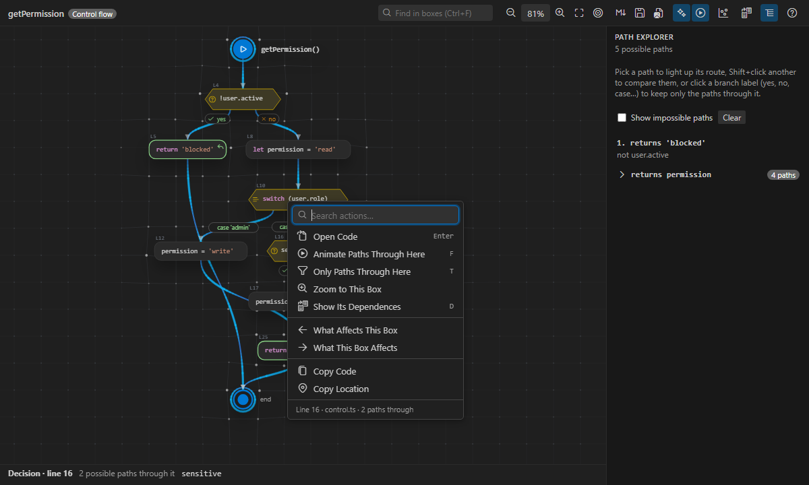

The chart has the same animated grid as the data flow chart, bending around every box, and clicking a box makes pulses flow along every possible path through it; a picked path pulses the same way. The **Grid** and **Flow** buttons turn each off, and both stay still when your system asks for reduced motion.

Each loop is taken zero or one times, and branches inside expressions (`&&`, `||`, `?:`) and exceptions thrown by called functions are not followed.

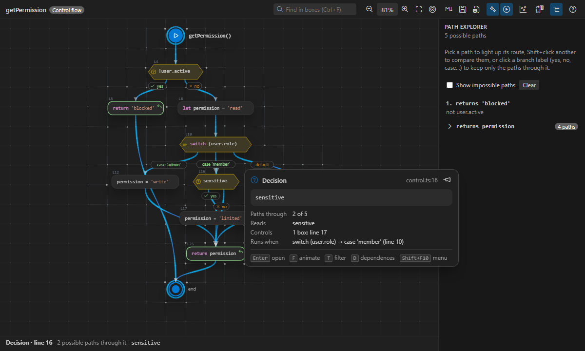

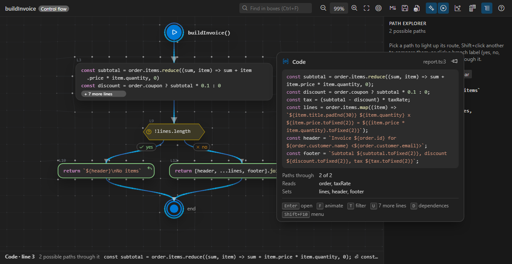

#### What depends on what

**What depends on what** (`Ctrl+Alt+S Shift+D`), or the **Dependences** button (`D`) in the Flowchart view, draws the function's dependences on its flowchart: purple arcs on the left run from where a variable is set to each place that value is read, named by the variable; orange dashed arcs on the right run from a decision to each statement that runs only for some of its branches. Together they answer *why can this line run, and where did its values come from?*

- **Levels**: **Calls expanded** in the toolbar (0 to 3) draws the functions it calls inside the chart, and their calls, so dependences follow values into them; the **ƒ+** buttons still expand single calls.
- Parameters come from the start circle (blue arcs). Changing a property (`x.a = 1`) or calling `push` changes a value without replacing it, so earlier assignments still reach later reads. Arcs that go back up a loop are dotted: the value is read the next time round.
- Hover or focus a box to keep only its arcs (in a large function they stay faint until you do), and the bar under the chart lists them in words: what it reads and from where, which decisions it depends on, and who reads its values. Right-click a box for **What it depends on**, or press `D` on it.
- Click an arc to light up both its boxes and read what it means; every arc has a tooltip. Search (`Ctrl+F`) for a variable to keep only its arcs. The background menu turns data or control arcs off, and **Copy as Mermaid** includes the arcs while they show.

### Callers and calls

**Callers and calls** (`Ctrl+Alt+S Shift+C`) draws the function at the cursor as a butterfly: who calls it on the left (and who calls them, further out), what it calls on the right (and what those call).

- **Levels** (1 to 5) and **Show** (Callers, Both, Callees) in the chart's toolbar, or the layers button of the results view, run it again deeper, shallower or one-sided. The starting depth is `tsStructure.callGraph.depth`.
- Calls are resolved with the type checker: methods, imported functions, React components rendered in JSX and functions passed through variables are followed, and a call through an interface or abstract method leads to each implementation that may run. A call made inside a callback, such as `setTimeout(() => submit())`, belongs to the function that set the callback up.
- Each box says where the function is, the line the call is on, how many calls there are, and whether it is async, a generator, a test, recursive or an implementation. Callees are listed in the order they are called; callers by how often they call.
- A function that appears again is drawn once and then marked *shown above*, so the chart doesn't repeat whole branches. The top of each chain is marked as an entry point, and a function nothing calls is flagged unless it is exported.
- Each side sums up its callers and callees and the files they are in; callers in test files have a beaker. Calls into libraries are counted in one box.

### React state

**React state** (`Ctrl+Alt+S Shift+R`) shows how a React component or hook fits together. Its props and context are on the left; on the right are its state (`useState`, `useReducer`), refs, memoized values and callbacks, custom hooks, effects, and the child components it renders.

- **Child levels** (0 to 3) in the toolbar shows the components it renders, the props it gives each (`title ← label`) and, a level further, what those render.
- For each value: where it is set (in which handler or effect), where it is read or rendered, which child component it is passed to and as which prop, and which effects and memos it triggers. `useReducer` dispatches list their action types (*dispatches 'add' in inline handler*).
- Each effect says when it runs (*when userId changes*, *after every render*, *once*), what it sets and reads, and whether it cleans up.
- It points out: dependencies an effect reads but doesn't list; dependencies it lists but doesn't read; functions or objects in a dependency list that are new on every render (so the effect runs every time); effects that only copy other values into state (compute them while rendering instead); state set while rendering; state that is never updated; `useState(compute())` that computes its initial value on every render; and `ref.current` read while rendering.

### Pattern spotting

The design patterns and architecture of a file, folder or the whole project, 75 in all, each recognized from the shape of the code, with a link to learn more about each:

- **Creating objects:** Singleton, module-level singleton, Factory, Abstract factory, Builder, Prototype, Object pool, Lazy initialization, Dependency injection, Service locator.
- **Structure:** Adapter, Bridge, Flyweight, Facade, Proxy, Decorator, Composite, Barrel module, Module pattern, Mixin, Value object, Null object, Fluent interface, layered folders.
- **Behavior:** Observer, Event bus, Mediator, Memento, Strategy, Strategy map, Command, State, State machine, Template method, Chain of responsibility, Visitor, Iterator, Specification, Plugin registry, Middleware.
- **Data and async:** Repository, Unit of work, API client, Reducer, Store, Result type, Memoization, Pipeline, Promise chain, Retry, Debounce or throttle, Circuit breaker, shared module state.
- **TypeScript:** Discriminated union, Type guard, Assertion function, Branded type, Constant object as enum, Exhaustive check.
- **React:** components with hooks, Custom hook, Context provider, Reducer with context, Higher-order component, Render props, Compound components, Container and presentational components, Controlled component, Error boundary, Memoized component, Lazy-loaded component, Portal, Forwarded ref, Polymorphic component, plus higher-order functions.

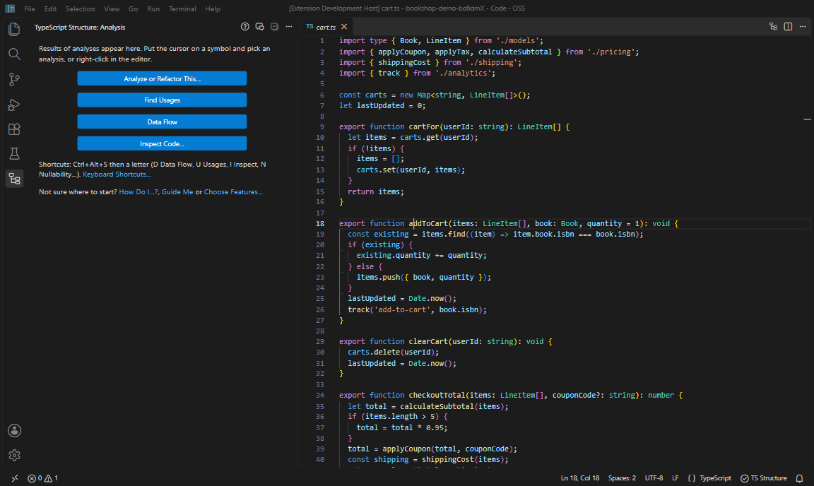

### Find usages

References grouped by what they do: definitions, calls, writes, reads, type references, imports and exports, per file, with test files marked. **Find usages in this file** shows only the usages in the file you are in.

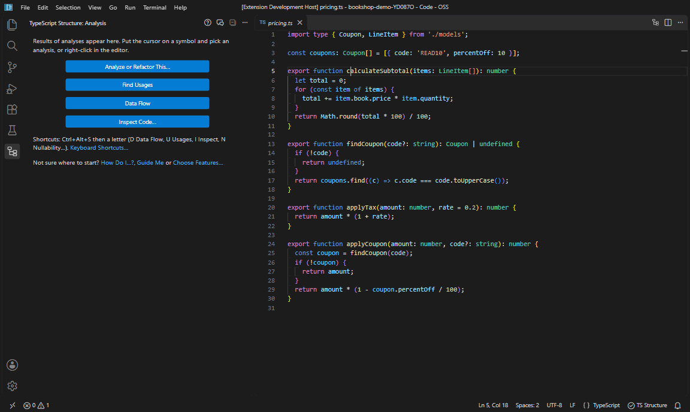

### Null checks, side effects, changes, errors and arguments

| Analysis | Put the cursor on | Shows |
| --- | --- | --- |
| **Null checks** | a variable or call | whether it can be null or undefined there, every path that makes it so, and the uses that need a guard |
| **Side effects** | a function | what it changes besides its result: arguments, shared state, I/O, timers, randomness |
| **Shared state changes** | anywhere in a file | functions that change state they don't own, and who changes each piece of state. The first row explains what a mutation is |
| **Changes to this variable** | a variable or property | every function that changes it across the project, marking async functions, callbacks (setTimeout, then, event handlers) and changes after an `await` |
| **Race conditions** | a variable or property | whether an `await` falls between reading or checking shared state and writing it (`total += await price()`, `if (!cache) cache = await load()`), and whether several async writers replace it. Data Flow shows the same findings |
| **Promise rejections** | an async function | where its rejections are caught, handled or lost |
| **Error paths** | a function | what it can throw, and what each `catch` does with it |
| **Arguments passed in** | a parameter | every value that can arrive, and where it goes |

The **ⓘ** button in the results view explains the analysis on screen. Rows that name a language construct, such as *destructured*, `?.`, `||`, *narrowing* or *import type*, have a **?** button: a plain explanation, an example and a link to MDN, the TypeScript handbook or react.dev. Reports that find problems end with a **How to fix** group. Each report ends with a **Next** group: click a row to run a related analysis on the same symbol, such as Nullability after Data Flow. When an analysis doesn't fit the symbol, the error offers one that does.

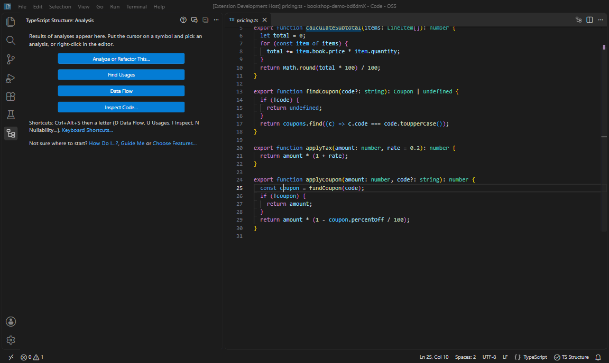
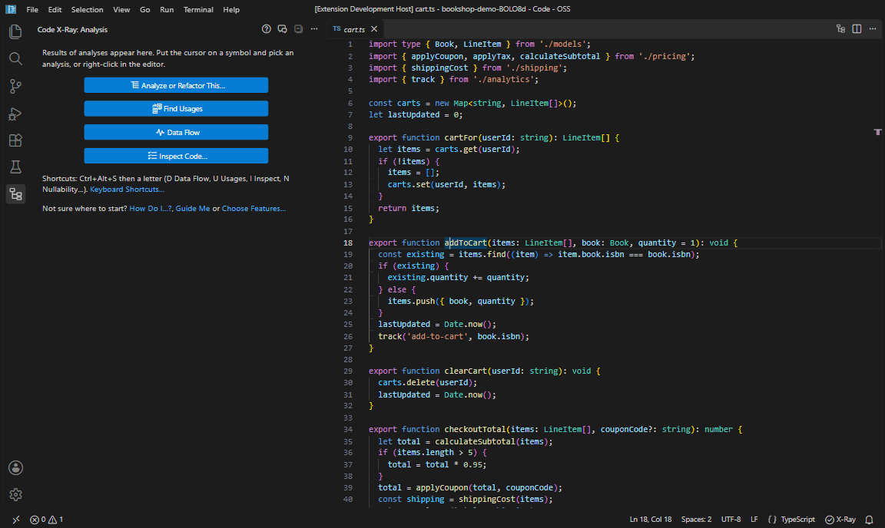
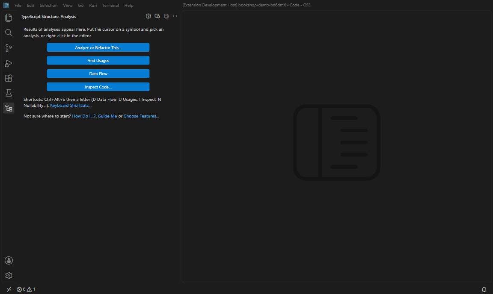

### Types, modules and tests

- **Family tree** and **Override reach**: supertypes, subtypes and overrides, and what a change to a member reaches.
- **Re-export trail**: follow a name through barrel files to its declaration.
- **Why this import**: why one module imports another. **Who imports this**: every module that imports it, directly or through others, nearest first. **Import loops**: every group of modules that import each other at run time. **Import changes since…**: how imports changed since a Git revision, including new cycles.
- **Affected tests**: the tests that depend on a symbol or file, to run only those. The status bar shows how many. Cancel in the progress notification stops it. **Tests for my changes** finds the tests for every uncommitted change; **Open affected test files** opens them. It understands Jest, Vitest, Mocha, Playwright, `node:test`, Bun, AVA, tape, Deno, Cypress and Jasmine, and runs tests with pnpm, yarn or bun when the project uses them.

**What the analyses recognize.** Side effects knows browser APIs (storage, workers, notifications, messaging), Node modules, and packages for HTTP, databases, cloud SDKs, email, logging, telemetry, queues and payments. Exception Flow knows which library calls throw, including methods judged by their receiver's type, such as `reduce()` on an empty array or `toISOString()` on an invalid date. Nullability says why a library call can be empty, such as *undefined when nothing matches* for `find()`. Dead Exports treats framework entry points as used: Next.js pages and app routes, Remix, SvelteKit and Nuxt routes, Storybook stories, config files, test setup files and workers.

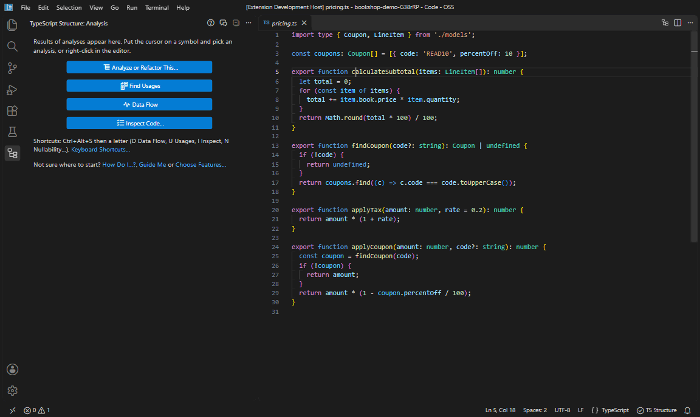
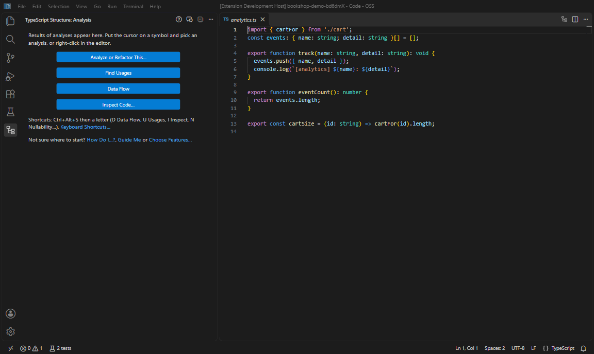

## Refactor

- **Change parameters** (`Ctrl+F6`): rename, add, remove and reorder parameters, updating every call. Problems are flagged as you type, the preview shows the signature before and after, `Ctrl+Enter` previews the edits and `Ctrl+Delete` removes a parameter.
- **Delete safely** (`Alt+Delete`): deletes after checking every usage, or lists what still uses it (and copies their locations). Select several files in the Explorer to delete them one after another.
- **Make it a parameter** (`Ctrl+Alt+P`): turns the selected expression into a parameter; **Make it an optional parameter** skips the question.
- **Move to another file** (`Ctrl+Alt+S B`): moves declarations to another file and fixes imports.
- **Intention actions** in the lightbulb (`Ctrl+.`), or all at once with **Rewrites here** (`Ctrl+Alt+S W`): 70 rewrites, each offered only where it keeps the behavior. Some examples:
  - `a != null ? a : b` to `a ?? b`, and `user && user.name` to `user?.name` in conditions.
  - `indexOf(x) !== -1` to `includes(x)`, and `let` to `const`.
  - `switch` to an `if` chain and back, early returns, and two independent `await`s into `Promise.all`.
  - JSX: self-closing tags, `&&` and `?: null`, and string attributes.

Changes open in VS Code's Refactor Preview first (`tsStructure.previewRefactorings`); `Ctrl+Z` undoes them.

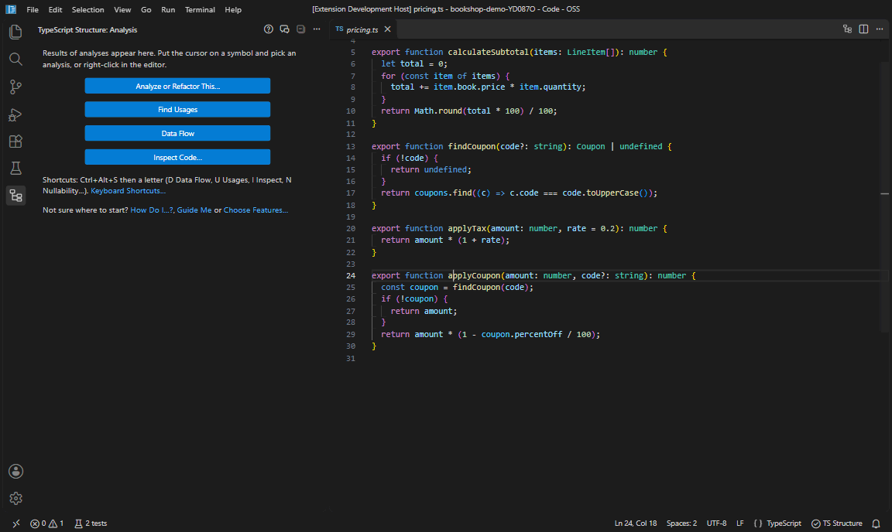

## Find problems

- **Live inspections** report problems in the Problems panel, with quick fixes. Besides missing `await`s and risky type assertions, 55 smaller checks catch slips, such as:
  - `x === NaN`, `typeof x === 'strng'`, `if (x = 1)`, a repeated `else if` condition;
  - a loop counting the wrong way, `replaceAll(/a/)` without `g`, numbers sorted without a compare function;
  - a `map()` callback that never returns, a list item without a `key`, an async `useEffect`;
  - `JSON.stringify` of a Map, `throw 'text'`, `delete` on an array.

  Style checks such as `console.log`, `==` and `await` in loops are off until you turn them on in **Inspection settings…**. The status bar shows error, warning and info counts; click it for the file's problems and a menu. `Ctrl+Alt+S 5` jumps to the next one, and **Copy problems in this file** copies them.
- **Inspect code…** runs every inspection over a scope you choose; **Fix all** fixes a whole group. **Inspect changed files** and **Inspect open files** skip the scope question.
- **Ghost exports**, **Déjà vu** and **Type assertions** clean up a project or folder.
- **Search by shape** finds code by shape with `$placeholders$`, and can save a pattern as your own inspection.

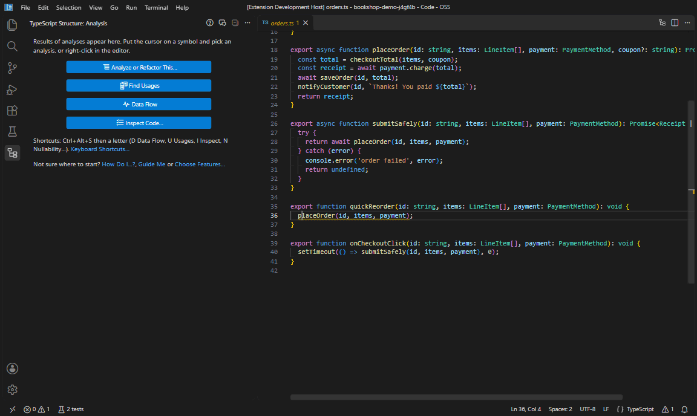
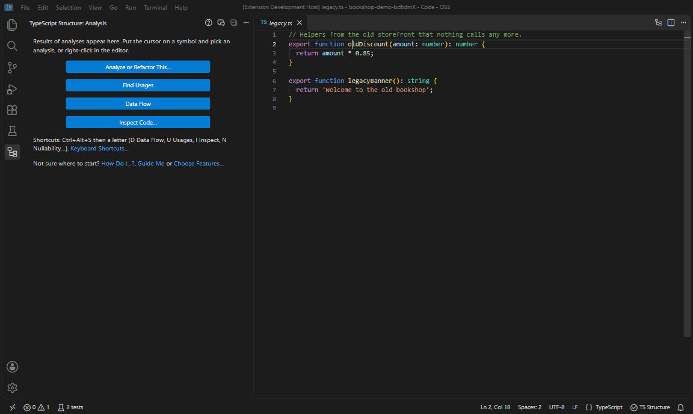
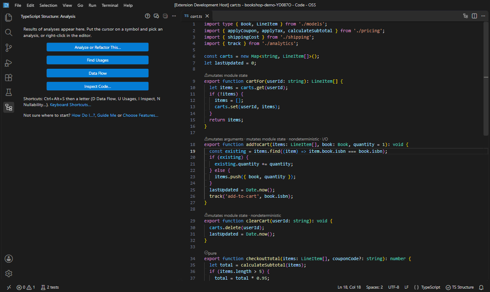

Analyses over many files ask where to look: the whole project, a folder, the open editors, the changed files, the current file, function or selection. While one runs, the results view shows a progress bar and a stop button (`Ctrl+Alt+S Escape`). In the Explorer, right-click folders to analyze only those.

### Charts tab

The **Charts** tab of the Actions view (**Charts tab**) lists every chart Code X-Ray draws, by what it shows: **How it runs** (Flowchart, Callers and calls, Error paths, Promise rejections), **How values move** (Data flow, What depends on what, Changes to a variable, Arguments passed in, React state) and **How it is built** (Family tree, Override reach, Who imports this, Why this import). Each one starts from the cursor and opens as a chart, with the same rows in the results view.

- **For the cursor** at the top lists the graphs that fit what the cursor is on, and follows it as you move.
- Each graph's tooltip says what it starts from and, for graphs that go deeper, what its levels control. With no source file open, the tab says what to open.
- **Open a chart…** (`Ctrl+Alt+S Shift+G`) picks one from the Command Palette, those that fit the cursor first.
- **Other charts** (`G`) in a chart's toolbar draws the same subject another way, such as the call graph of the function whose control flow is on screen.
- An analysis in the Analyze tab that can be drawn has **Open as chart** in its menu.

## Working with results

- **Clear** (the orange button) goes back to the start page. Too many buttons? **Fewer buttons** in the **...** menu keeps only the essentials (`tsStructure.results.toolbar`), or right-click the title bar to hide single buttons.
- **Back and forward** through earlier reports, **re-run** (`F5`, or `Ctrl+Alt+S L` from anywhere; the button turns into a warning when files changed).
- **Filter** rows (`Ctrl+F`): text, `file:cart` for rows in matching files, `is:warning` (or `is:error`, `is:info`) by tone, `-test` to drop matches. Also **Only in…** and **Groups…**; `Escape` shows every row again.
- `F4` / `Shift+F4` walk through the results; the selected row follows your cursor.
- `Ctrl+C` copies rows; right-click a row for **Find usages here**, **Data flow here**, **Null checks here**, and **More here** (Changes to this variable, Race conditions, Side effects, Error paths, Arguments passed in).
- Green checks mark what was found safe, such as a value that is never null or undefined.
- Graphs that can go deeper have a **Levels and options…** button (layers icon) in the title bar.
- **Draw as chart** in the title bar is a switch: turn it on and every new result also opens as a chart, until you turn it off (`tsStructure.results.alwaysShowDiagram`). `Ctrl+Alt+S 9` shows a single result as a chart.
- Each report puts what matters first: Find usages starts with the file you are in and the busiest files, in line order, and says how many functions use it, which calls are recursive, and when only tests use it; Inspect Code starts with the files with the most problems and names the most common one; unsafe Nullability uses, unhandled rejections and new import cycles come first. Rows in test files are marked across reports.
- When an analysis can't start, the message says why and offers the way forward as links right after the text: **Choose a variable…** (or a function, class or parameter, whichever the analysis needs) lists the file's declarations that fit; another analysis that does fit the symbol at the cursor is offered by name; **Go to syntax error** appears when broken code is the likely cause; a library symbol offers **Go to definition**; a file outside the project offers its tsconfig.json; and unexpected failures offer **Log**, **Copy details** and **Report issue**.
- Copy or export a report as Markdown, CSV or JSON, open it as a Markdown preview, or **Copy all locations**. Remove reports from **History…** with their trash button.

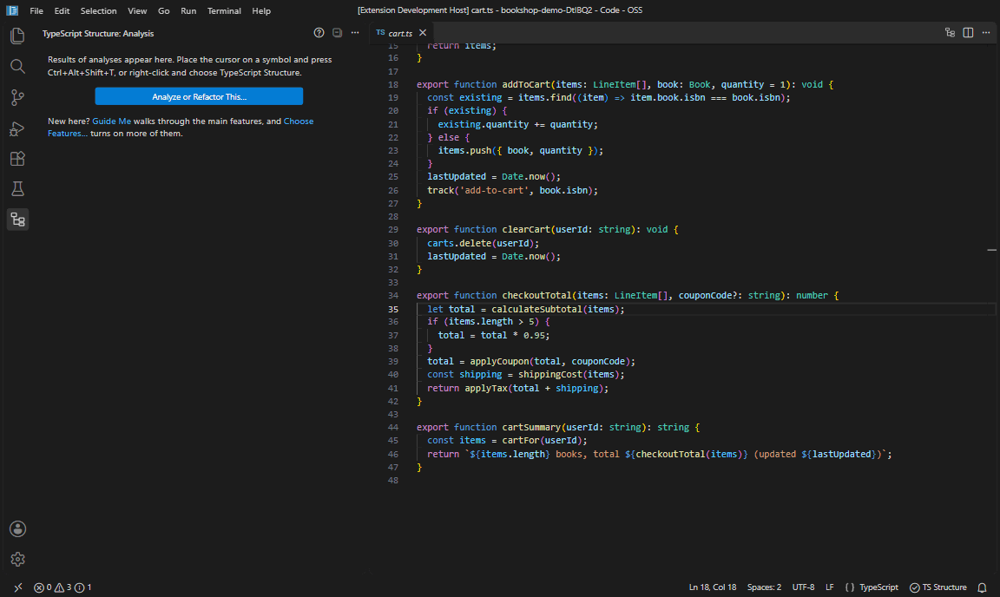

## Accessibility

The extension follows the W3C's Web Content Accessibility Guidelines (WCAG 2.2) where it draws its own interface:

- **Screen readers** hear what colors and icons show: result rows say "Warning:", "Safe:" or "Problem:", their file and line, and whether a fix or an explanation is available; Test Impact rows say whether a test is confirmed or possible; the status bar items read as counts with their kind.
- **The diagram** is a tree of boxes you can walk with the arrow keys, each with a spoken label; toned boxes also show a symbol (✓ ! ✕ i), fold buttons are 24 pixels, and Windows high contrast uses system colors.
- **Change parameters** and **Search by shape** name every field, mark invalid input, announce problems and result counts without interrupting, keep keyboard focus when rows move, and open search results with Enter.
- Animations stop when your system asks for reduced motion.

## Settings

Run **Code X-Ray: Settings**. The ones you are most likely to change:

| Setting | Default | |
| --- | --- | --- |
| `tsStructure.features.<name>` | core features on | turn features on or off, also with **Toolshed…** |
| `tsStructure.include` / `exclude` | | files left out of analysis; right-click **Leave out of Code X-Ray** in the Explorer |
| `tsStructure.askForScope` | `true` | ask where to look before project-wide analyses |
| `tsStructure.contextMenu.topLevel` | `true` | the common analyses at the top of the right-click menu |
| `tsStructure.results.progress` | `statusBar` | or `notification` |
| `tsStructure.lightbulbAnalyses` | `true` | analyses in the lightbulb's refactor menu |
| `tsStructure.results.alwaysShowDiagram` | `false` | every new result also opens as a chart |
| `tsStructure.actions.accentColor` | `cyan` | the color of the action on screen and the Value path card in the Actions view: `cyan`, `pink` or `theme` |

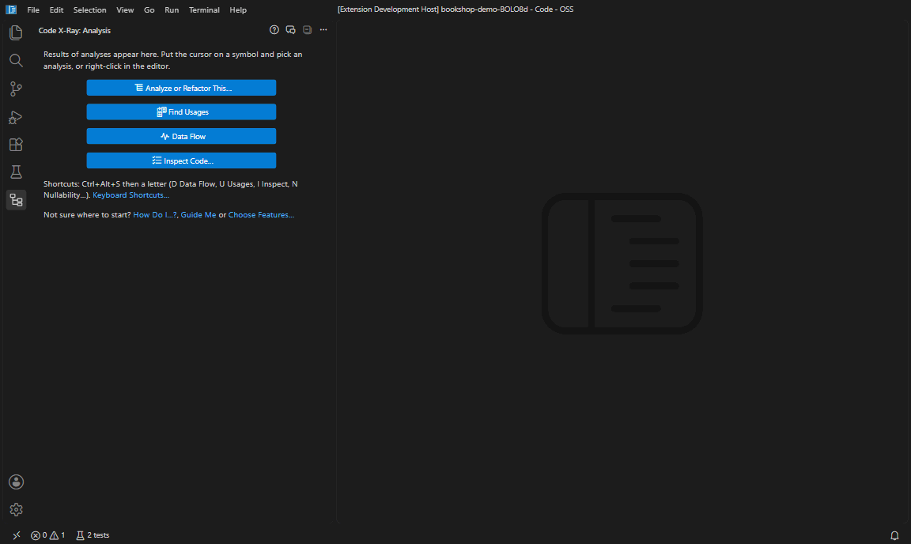

## Speed

The first analysis of a project parses all its files. Code X-Ray does this in the background a moment after you open a TypeScript or JavaScript file (`tsStructure.warmUp`), and every feature (analyses, live inspections, test impact, the CodeLens) shares that one parse, so later analyses start at once and only re-read files that changed.

## Development

```bash
npm install
npm test                  # compile and run the unit tests
npm run bundle            # bundle the extension into dist/extension.js (packaging does this, minified)
VSCODE_EXECUTABLE="/path/to/Code.exe" npm run test:integration   # run inside a real VS Code
VSCODE_EXECUTABLE="/path/to/Code.exe" npm run screenshots        # record the docs/images GIFs from docs/demo
```

The analysis engine (`src/analysis`, `src/refactor`, `src/intentions`, `src/inspect`, `src/navigate`, `src/search`, `src/structure`) has no `vscode` dependency and is unit-tested directly; `src/ui` is the VS Code layer. The extension ships as one esbuild bundle (`scripts/bundle.js`), with TypeScript kept as its own dependency, so it loads in a fraction of the time of the compiled files.

## Credits

The Welcome page's ASCII field and pixel-font title are original code and glyphs written for Code X-Ray in the style of Framer University's ASCII Shader component (no code or font taken from it).

The animated graphs (the dot grid behind the charts, the flowing lines and the box style) are adapted from the node grid demo of [robot-components](https://github.com/dashrobotco/robot-components) by Robot FZCO, used under the MIT License. Its copyright and license notice is in [THIRD_PARTY_NOTICES.md](THIRD_PARTY_NOTICES.md), which ships with the extension.
