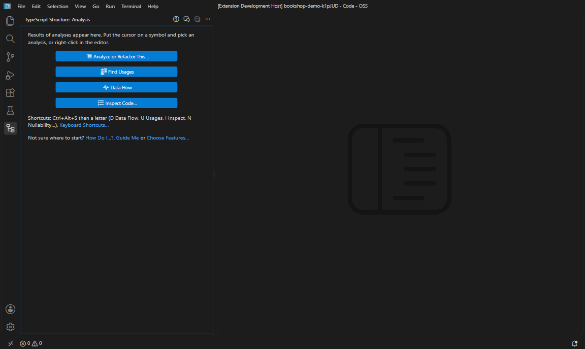
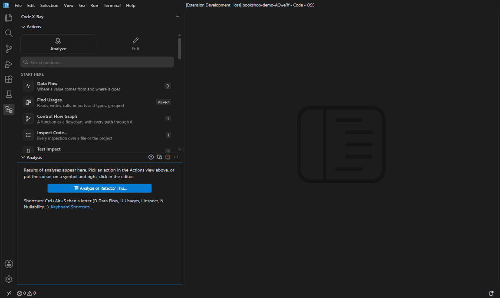

# Code X-Ray

Refactorings, inspections and code navigation for TypeScript, JavaScript and React in VS Code, in the style of WebStorm. Everything is offline static analysis with the TypeScript compiler: no AI, no network.


## Getting started

1. Open a TypeScript or JavaScript file and put the cursor on a symbol.
2. Right-click: **Find Usages**, **Find Usages in Current File**, **Data Flow** and **Analyze or Refactor This…** are at the top of the menu. Everything else is under **Code X-Ray**.
3. Results open in the **Code X-Ray** view in the Activity Bar.

Not sure which analysis answers your question? Run **How Do I…?** (`Ctrl+Alt+S /`) and pick a question such as *Where does this value come from?* The first time the extension starts, a short walkthrough opens; reopen it with **Guide Me** (the **?** in the view).


## Shortcuts

Every analysis has a shortcut: `Ctrl+Alt+S` (`Cmd+Ctrl+S` on macOS), then a letter. **Shortcut Cheat Sheet** (`Ctrl+Alt+S K`) lists them all; change any of them with **Keyboard Shortcuts…**, or the keyboard button next to each entry in **Analyze or Refactor This…**.

| Key | Runs | Key | Runs |
| --- | --- | --- | --- |
| `Space` | Analyze or Refactor This… | `X` | Exception Flow |
| `D` | Data Flow | `A` | Argument Propagation |
| `U` | Find Usages (also `Alt+F7`; in the file `Shift+Alt+F7`) | `H` | Inheritance Hierarchy |
| `N` | Nullability | `O` | Override Impact |
| `E` | Side Effects | `C` | Re-export Chain |
| `M` | Mutation Tracking | `P` | Dependency Path |
| `R` | Promise Rejections | `G` | Dependency Graph Diff |
| `Y` | Design Patterns | `S` | Structural Search |
| `I` | Inspect Code | `F` | Duplicates |
| `T` | Test Impact | `Z` | Dead Exports |
| `V` | Show the results view | `L` | Re-run the last analysis |
| `K` | Shortcut Cheat Sheet | `/` | How Do I…? |
| `W` | Show Rewrites Here | `B` | Move Members to Module |
| `J` | Who Imports This File | `Q` | Find Import Cycles |
| `2` | Audit Type Assertions | `3` | Mutation Tracking (Project) |
| `4` | Test Impact of Changed Files | `5` | Next inspection problem |
| `6` | Mutation Tracking for This Variable | `7` | Race Conditions |
| `1` | Control Flow Graph | `0` | Explain Value Path |
| `8` | Data Flow Diagram | `9` | Show the results as a diagram |
| `Escape` | Stop the running analysis | | |

Refactorings: **Change Signature** `Ctrl+F6`, **Safe Delete** `Alt+Delete`, **Introduce Parameter** `Ctrl+Alt+P`.


## Understand code

### Data Flow Path Explorer

Where a variable, parameter or property comes from, every place it changes, and where it goes. **Design patterns** names the patterns the value passes through, such as a Strategy, Factory or Observer, recognized from the shape of the code. Hover a pattern for its **ⓘ** button (what it means) and its **Learn More** button, which opens the pattern on refactoring.guru, patterns.dev, react.dev, the TypeScript handbook or Martin Fowler's catalog. Click **Trace This Value** on a row to follow the value into a called function. A pattern found in several places is one row, with the places below it.

The functions that write the value sit under **Flows in** and those that read it under **Flows out**, so each side folds away as one. **Flows in** also covers React state (the initial value and every `setCount(…)` call), destructured props and options (what each call site passes, or that it leaves them out), and flags incoming values that may be null or undefined. **Flows out** includes JSX props (`<Price amount={total} />`, which Trace This Value follows into the component), and each receiving variable shows, folded, where it sends the value next (**Group Data Flow Steps by Function** in the **...** menu goes back to one group per function; `tsStructure.dataFlow.groupByDirection`).


#### Diagram view

**Data Flow Diagram** (`Ctrl+Alt+S 8`) draws the same flow as a chart in the editor: the variable in the middle, where its values come from on the left and where they go on the right. Click a box to open its code, click its round button to fold or unfold what is behind it, drag to move around and scroll to zoom. Right-click a box to check it for null, find its usages, follow its data flow or run another analysis there. **Show as Diagram** in the results view (`Ctrl+Alt+S 9`) draws any analysis this way, and the chart follows the results view as you run more. Large charts stay quick: only what is on screen is drawn, and a chart of more than 150 boxes opens with its deepest levels folded.

- Boxes are as wide as their text; the bar under the chart shows the whole text, file, line and line of code of the box under the mouse.
- Design patterns are purple hexagons on dotted lines, since they describe the code rather than carry the value. Boxes that only group others are dashed outlines.
- Double-click a box (or press `B`) to see only its branch; `Escape` shows the whole chart again. A minimap appears when the chart is bigger than the window.
- **Find** (`Ctrl+F`) highlights matching boxes and unfolds the ones hiding a match; `Enter` goes to the next.
- Hovering a box highlights its way to the subject. Selecting a row in the results view marks its box, and clicking a box selects its row.
- Keys: `Tab` to the subject, arrow keys between boxes, `Enter` to open, `Space` to fold, `+` `−` to zoom, `0` to fit, `Home` to return.
- Zoom, position and folding are kept when the same analysis runs again.
- **Copy Mermaid** copies the chart as a Mermaid flowchart for Markdown, GitHub issues and pull requests; **Save SVG** and **Save PNG** save it as an image.
- **?** explains the colors, arrows and keys.
- An animated dot grid sits behind the chart and bends around every box: it glows and moves aside around the pointer and the hovered box, and clicking a box sends a wave across it. Clicking a box also makes pulses flow along the lines between it and the subject. The **Grid** and **Flow** buttons turn each off; both stay still when your system asks for reduced motion. (The grid is adapted from [robot-components](https://github.com/dashrobotco/robot-components), MIT.)



### Control Flow Graph and Path Explorer

**Control Flow Graph** (`Ctrl+Alt+S 1`) draws the function at the cursor as a flowchart beside the code: statements in the editor font, decisions as hexagons with **yes** and **no** edges, switch cases (including fall-through), loops with their way back, returns and throws, and code nothing reaches drawn dashed. Put the cursor on a call to draw the called function instead.

The **Path Explorer** lists every path through the function with the branches it takes, in words (*user.active → user.role is 'member' → not sensitive*), and what it returns. Pick a path to light up its route; click a branch label (yes, no, case…) to keep only the paths through it. Paths that test the same unchanged condition both ways cannot happen and are hidden unless you ask for them. Click a box to open its code; the box your cursor is in is outlined, and the chart redraws as you edit.

**Explain Value Path** (`Ctrl+Alt+S 0`) answers *why does this variable have this value here?*: every value it can have at the cursor, with the conditions that lead to each. At the final `return permission` of a permissions check it lists `'write'` (active admin), `'limited'` (active member, sensitive), `'read'` (active member, not sensitive) and `'none'` (anyone else).

- **Expand calls in place**: a box that calls a function of your project has an **ƒ+** button. It splices the called function into the chart, in a labeled frame, with its returns leading on to what followed the call; paths then run through it.
- **Compare two paths**: Shift+click a second path. The shared route is purple, the first path's own branches blue and the second's orange, with a summary of where they part and how each ends.
- **Slices**: **What Affects This Value** (backward slice) lights up the statements and decisions a variable depends on at the cursor; **What This Value Affects** (forward slice) lights up everything it flows into or decides.
- **Export**: copy the chart as a Mermaid flowchart (with the picked path drawn thick) or save it as SVG.

Each loop is taken zero or one times, and branches inside expressions (`&&`, `||`, `?:`) and exceptions thrown by called functions are not followed.



### Detect Design Patterns

The design patterns and architecture of a file, folder or the whole project, 75 in all, each recognized from the shape of the code, with a link to learn more about each:

- **Creating objects:** Singleton, module-level singleton, Factory, Abstract factory, Builder, Prototype, Object pool, Lazy initialization, Dependency injection, Service locator.
- **Structure:** Adapter, Bridge, Flyweight, Facade, Proxy, Decorator, Composite, Barrel module, Module pattern, Mixin, Value object, Null object, Fluent interface, layered folders.
- **Behavior:** Observer, Event bus, Mediator, Memento, Strategy, Strategy map, Command, State, State machine, Template method, Chain of responsibility, Visitor, Iterator, Specification, Plugin registry, Middleware.
- **Data and async:** Repository, Unit of work, API client, Reducer, Store, Result type, Memoization, Pipeline, Promise chain, Retry, Debounce or throttle, Circuit breaker, shared module state.
- **TypeScript:** Discriminated union, Type guard, Assertion function, Branded type, Constant object as enum, Exhaustive check.
- **React:** components with hooks, Custom hook, Context provider, Reducer with context, Higher-order component, Render props, Compound components, Container and presentational components, Controlled component, Error boundary, Memoized component, Lazy-loaded component, Portal, Forwarded ref, Polymorphic component, plus higher-order functions.


### Semantic Find Usages

References grouped by what they do: definitions, calls, writes, reads, type references, imports and exports, per file, with test files marked. **Find Usages in Current File** shows only the usages in the file you are in.


### Nullability, side effects, mutations, errors and arguments

| Analysis | Put the cursor on | Shows |
| --- | --- | --- |
| **Nullability Path Explorer** | a variable or call | whether it can be null or undefined there, every path that makes it so, and the uses that need a guard |
| **Side-Effect Analyzer** | a function | what it changes besides its result: arguments, shared state, I/O, timers, randomness |
| **Mutation Tracking** | anywhere in a file | functions that change state they don't own, and who changes each piece of state. The first row explains what a mutation is |
| **Mutation Tracking for This Variable** | a variable or property | every function that changes it across the project, marking async functions, callbacks (setTimeout, then, event handlers) and changes after an `await` |
| **Race Conditions** | a variable or property | whether an `await` falls between reading or checking shared state and writing it (`total += await price()`, `if (!cache) cache = await load()`), and whether several async writers replace it. Data Flow shows the same findings |
| **Promise Rejection Analyzer** | an async function | where its rejections are caught, handled or lost |
| **Exception Flow Visualizer** | a function | what it can throw, and what each `catch` does with it |
| **Argument Propagation** | a parameter | every value that can arrive, and where it goes |

The **ⓘ** button in the results view explains the analysis on screen. Rows that name a language construct, such as *destructured*, `?.`, `||`, *narrowing* or *import type*, have a **?** button: a plain explanation, an example and a link to MDN, the TypeScript handbook or react.dev. Reports that find problems end with a **How to fix** group. Each report ends with a **Next** group: click a row to run a related analysis on the same symbol, such as Nullability after Data Flow. When an analysis doesn't fit the symbol, the error offers one that does.


### Types, modules and tests

- **Inheritance Hierarchy** and **Override Impact**: supertypes, subtypes and overrides, and what a change to a member reaches.
- **Re-export Chain**: follow a name through barrel files to its declaration.
- **Dependency Path Finder**: why one module imports another. **Who Imports This File**: every module that imports it, directly or through others, nearest first. **Find Import Cycles**: every group of modules that import each other at run time. **Dependency Graph Diff**: how imports changed since a Git revision, including new cycles.
- **Test Impact Analysis**: the tests that depend on a symbol or file, to run only those. The status bar shows how many. Cancel in the progress notification stops it. **Test Impact of Changed Files** finds the tests for every uncommitted change; **Open Impacted Test Files** opens them. It understands Jest, Vitest, Mocha, Playwright, `node:test`, Bun, AVA, tape, Deno, Cypress and Jasmine, and runs tests with pnpm, yarn or bun when the project uses them.

**What the analyses recognize.** Side Effects knows browser APIs (storage, workers, notifications, messaging), Node modules, and packages for HTTP, databases, cloud SDKs, email, logging, telemetry, queues and payments. Exception Flow knows which library calls throw, including methods judged by their receiver's type, such as `reduce()` on an empty array or `toISOString()` on an invalid date. Nullability says why a library call can be empty, such as *undefined when nothing matches* for `find()`. Dead Exports treats framework entry points as used: Next.js pages and app routes, Remix, SvelteKit and Nuxt routes, Storybook stories, config files, test setup files and workers.


## Refactor

- **Change Signature** (`Ctrl+F6`): rename, add, remove and reorder parameters, updating every call. Problems are flagged as you type, the preview shows the signature before and after, `Ctrl+Enter` previews the edits and `Ctrl+Delete` removes a parameter.
- **Safe Delete** (`Alt+Delete`): deletes after checking every usage, or lists what still uses it (and copies their locations). Select several files in the Explorer to delete them one after another.
- **Introduce Parameter** (`Ctrl+Alt+P`): turns the selected expression into a parameter; **Introduce Optional Parameter** skips the question.
- **Move Members to Module** (`Ctrl+Alt+S B`): moves declarations to another file and fixes imports.
- **Intention actions** in the lightbulb (`Ctrl+.`), or all at once with **Show Rewrites Here** (`Ctrl+Alt+S W`): 70 rewrites, each offered only where it keeps the behavior. Some examples:
  - `a != null ? a : b` to `a ?? b`, and `user && user.name` to `user?.name` in conditions.
  - `indexOf(x) !== -1` to `includes(x)`, and `let` to `const`.
  - `switch` to an `if` chain and back, early returns, and two independent `await`s into `Promise.all`.
  - JSX: self-closing tags, `&&` and `?: null`, and string attributes.

Changes open in VS Code's Refactor Preview first (`tsStructure.previewRefactorings`); `Ctrl+Z` undoes them.


## Find problems

- **Live inspections** report problems in the Problems panel, with quick fixes. Besides missing `await`s and risky type assertions, 55 smaller checks catch slips, such as:
  - `x === NaN`, `typeof x === 'strng'`, `if (x = 1)`, a repeated `else if` condition;
  - a loop counting the wrong way, `replaceAll(/a/)` without `g`, numbers sorted without a compare function;
  - a `map()` callback that never returns, a list item without a `key`, an async `useEffect`;
  - `JSON.stringify` of a Map, `throw 'text'`, `delete` on an array.

  Style checks such as `console.log`, `==` and `await` in loops are off until you turn them on in **Configure Inspections…**. The status bar shows error, warning and info counts; click it for the file's problems and a menu. `Ctrl+Alt+S 5` jumps to the next one, and **Copy Problems in This File** copies them.
- **Inspect Code…** runs every inspection over a scope you choose; **Apply All Fixes** fixes a whole group. **Inspect Changed Files** and **Inspect Open Editors** skip the scope question.
- **Dead Exports**, **Structural Duplicates** and **Audit Type Assertions** clean up a project or folder.
- **Structural Search and Replace** finds code by shape with `$placeholders$`, and can save a pattern as your own inspection.


Analyses over many files ask where to look: the whole project, a folder, the open editors, the changed files, the current file, function or selection. While one runs, the results view shows a progress bar and a stop button (`Ctrl+Alt+S Escape`). In the Explorer, right-click folders to analyze only those.

## Working with results

- **Clear** (the orange button) goes back to the start page. Too many buttons? **Show Fewer Title Buttons** in the **...** menu keeps only the essentials (`tsStructure.results.toolbar`), or right-click the title bar to hide single buttons.
- **Back and forward** through earlier reports, **re-run** (`F5`, or `Ctrl+Alt+S L` from anywhere; the button turns into a warning when files changed).
- **Filter** rows (`Ctrl+F`): text, `file:cart` for rows in matching files, `is:warning` (or `is:error`, `is:info`) by tone, `-test` to drop matches. Also **Limit Results to Scope…** and **Show Groups…**; `Escape` shows every row again.
- `F4` / `Shift+F4` walk through the results; the selected row follows your cursor.
- `Ctrl+C` copies rows; right-click a row for **Find Usages Here**, **Data Flow Here**, **Check for Null or Undefined Here**, and **More Analyses Here** (Mutation Tracking, Race Conditions, Side Effects, Exception Flow, Argument Propagation).
- Green checks mark what was found safe, such as a value that is never null or undefined.
- Copy or export a report as Markdown, CSV or JSON, open it as a Markdown preview, or **Copy All Locations**. Remove reports from **Show Analysis History…** with their trash button.


## Accessibility

The extension follows the W3C's Web Content Accessibility Guidelines (WCAG 2.2) where it draws its own interface:

- **Screen readers** hear what colors and icons show: result rows say "Warning:", "Safe:" or "Problem:", their file and line, and whether a fix or an explanation is available; Test Impact rows say whether a test is confirmed or possible; the status bar items read as counts with their kind.
- **The diagram** is a tree of boxes you can walk with the arrow keys, each with a spoken label; toned boxes also show a symbol (✓ ! ✕ i), fold buttons are 24 pixels, and Windows high contrast uses system colors.
- **Change Signature** and **Structural Search** name every field, mark invalid input, announce problems and result counts without interrupting, keep keyboard focus when rows move, and open search results with Enter.
- Animations stop when your system asks for reduced motion.

## Settings

Run **Code X-Ray: Open Settings**. The ones you are most likely to change:

| Setting | Default | |
| --- | --- | --- |
| `tsStructure.features.<name>` | core features on | turn features on or off, also with **Choose Features…** |
| `tsStructure.include` / `exclude` | | files left out of analysis; right-click **Exclude from Analysis** in the Explorer |
| `tsStructure.askForScope` | `true` | ask where to look before project-wide analyses |
| `tsStructure.contextMenu.topLevel` | `true` | the common analyses at the top of the right-click menu |
| `tsStructure.results.progress` | `statusBar` | or `notification` |
| `tsStructure.lightbulbAnalyses` | `true` | analyses in the lightbulb's refactor menu |


## Development

```bash
npm install
npm test                  # compile and run the unit tests
VSCODE_EXECUTABLE="/path/to/Code.exe" npm run test:integration   # run inside a real VS Code
VSCODE_EXECUTABLE="/path/to/Code.exe" npm run screenshots        # record the docs/images GIFs from docs/demo
```

The analysis engine (`src/analysis`, `src/refactor`, `src/intentions`, `src/inspect`, `src/navigate`, `src/search`, `src/structure`) has no `vscode` dependency and is unit-tested directly; `src/ui` is the VS Code layer.
