# Code X-Ray

**See inside your TypeScript, JavaScript, React, C# and T-SQL code.** Put the cursor on something and ask what it does, where a value comes from, what a function changes, or what breaks if you edit it. Answers come in plain words, flowcharts and short narrated videos.

- **Runs on your computer.** Every answer comes from the TypeScript compiler (and bundled C# and T-SQL parsers) on your machine. No account, no cloud, nothing uploaded.
- **No AI needed.** The analyses are exact, not guessed. Two small optional models (a voice and a code model) run locally, and download only if you agree. See [Privacy and size](#privacy-and-size).
- **One shortcut away.** `Ctrl+Alt+Shift+T` lists everything that works at the cursor.

## Get started

1. Open a TypeScript, JavaScript, C# or SQL file.
2. Put the cursor on a function, variable or parameter, or highlight some code.
3. Press `Ctrl+Alt+Shift+T`, right-click **Analyze or Refactor This…**, or open the **Code X-Ray** view in the Activity Bar.

`Ctrl+Alt+S` then a letter runs an action directly: `D` Data flow, `1` Flowchart, `U` Find usages, `T` Affected tests. `Ctrl+Alt+S K` shows them all.

Highlight code and the Code X-Ray view narrows to the actions that work with it:

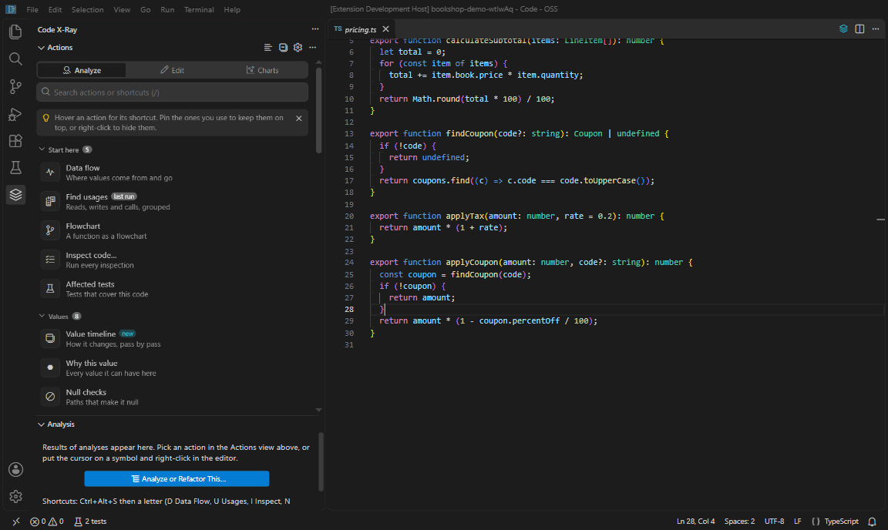

## Explain this code

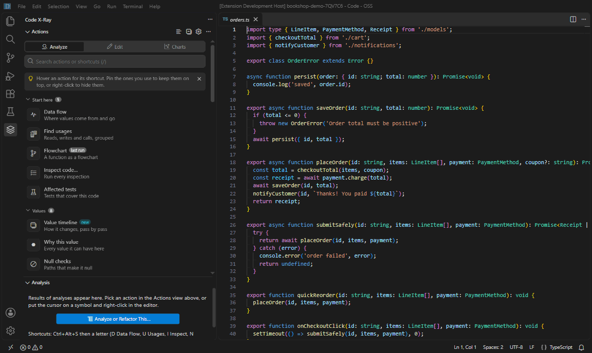

Highlight code, or just a function or method name, and choose **Explain this code**. A page beside the editor says, in plain sentences:

- **What it is and what it is for**: *placeOrder is an async function that takes the id, the items, the payment and the coupon and returns a Receipt.* *Places the order.*
- **Takes**: each parameter, with its type and its default, or that it can be left out.
- **Gives back**: the return type, whether it comes later, and what its `return`s give back.
- **Changes outside itself**: fields, arguments, module state, the console, the network, and the calls it makes only for what they do.
- **Step by step**, in the order it runs.

A name works where the function is declared and where it is called, even in another file. **Generate video** turns the steps into a short narrated video on the function's flowchart:

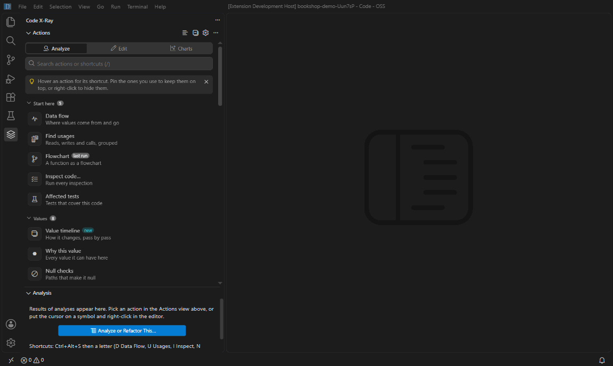

## Data flow

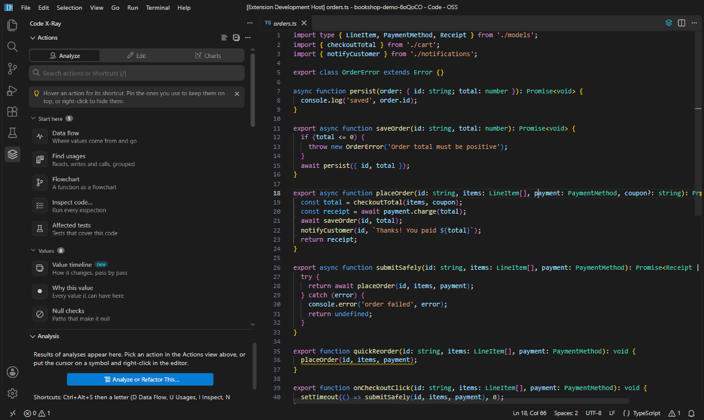

Put the cursor on a variable or parameter and press `Ctrl+Alt+S D`: every value that flows in, every place it changes, and where it goes next, across files. **Draw as chart** shows the same flow as a chart you can fold, search and export:

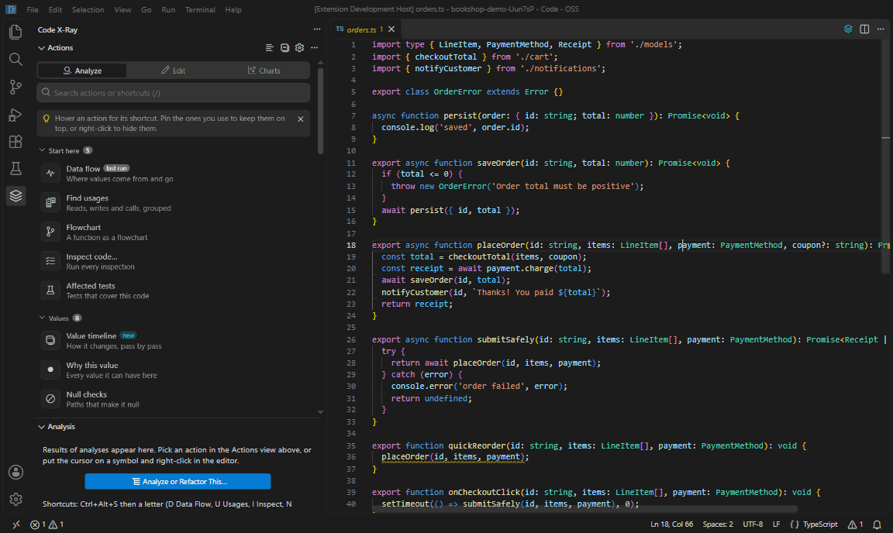

## Flowchart

Put the cursor in a function and press `Ctrl+Alt+S 1`. Every decision, loop, return and throw becomes a box, and the **Paths** list shows each route through the function. Click a path to light it up, Shift+click another to compare, and save the chart as Mermaid, SVG or PNG.

**Flowchart vs last commit** (`Ctrl+Alt+S Shift+1`) outlines the boxes you added or changed since your last commit, saved or not:

## The code model in charts (optional)

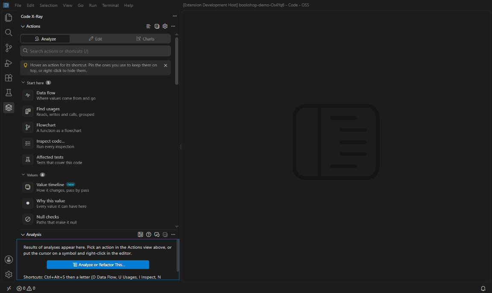

Press the **wand** button in any chart or flowchart to turn on the code model (all-MiniLM-L6-v2, 23 MB, downloaded once if you agree, run on your computer). Each box gets a pill saying what it is for (*File*, *Network*, *Logged*, *Stored*…), and **Find** matches by meaning: *where is it saved* finds the file write.

## Git reel

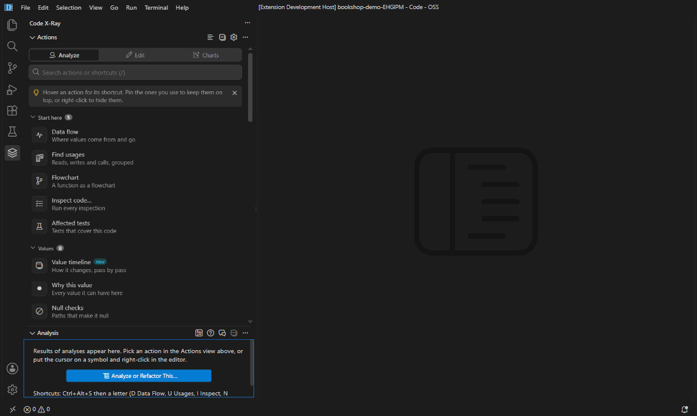

Run **Git reel** (the camera button in Source Control) to turn your changes into a short video: the key change in each file, framed and captioned in plain words (*applyCoupon now returns 0 early when the amount is at most 0*), tests last. Switch between 16:9 and 9:16, edit any caption, turn on a natural **voice-over**, and export MP4 or WebM. **Copy as Markdown** gives you a pull request description.

The voice-over uses a Kitten TTS voice model you choose the first time (Kitten Nano is recommended, 27.6 MB), or your computer's own voice.

## Find, test and refactor

| | |
|---|---|
| **Find usages** (`Alt+F7`): grouped into definitions, calls, reads, writes, imports and tests. | **Affected tests** (`Ctrl+Alt+S T`): every test that reaches this code, with the chain of calls to each. |
| 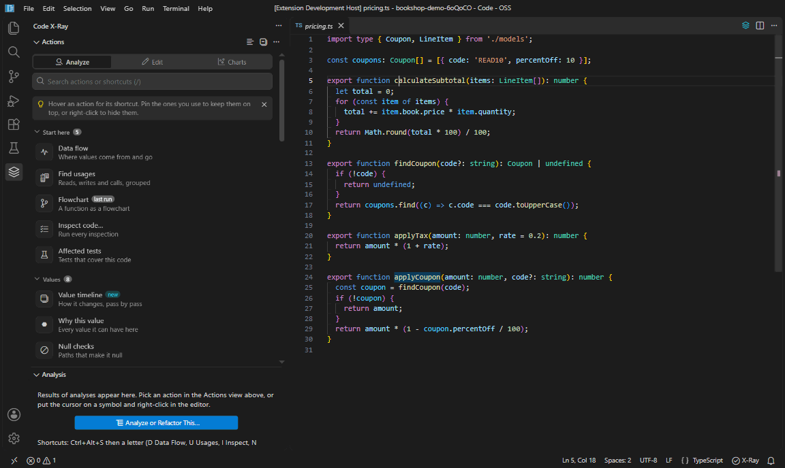 |  |
| **Change parameters** (`Ctrl+F6`): rename, add, remove and reorder parameters; every call is updated, with a preview first. | **Search by shape** (`Ctrl+Alt+S S`): find code by its structure and types, such as `$list$.find($callback$)` on a `LineItem[]`. |
|  | 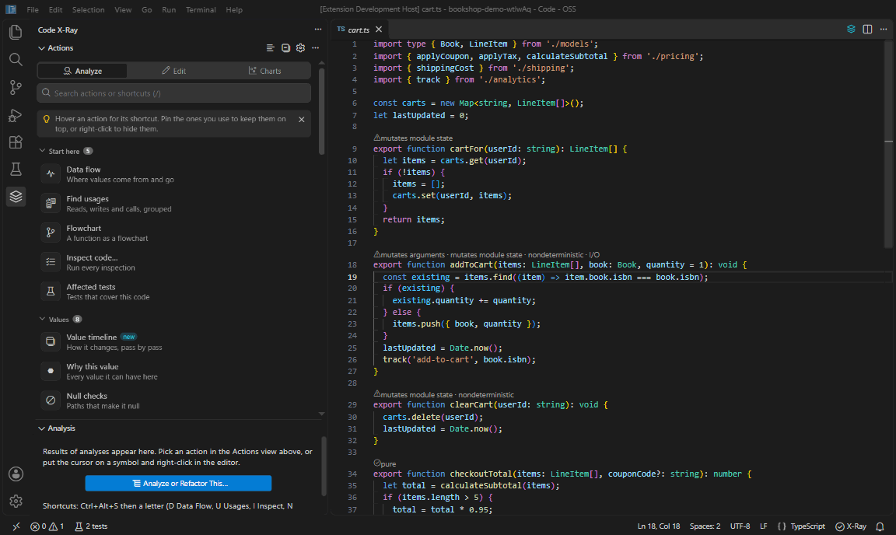 |

Also: **Delete safely**, **Move to another file**, 70 quick rewrites, **Callers and calls**, **Error paths**, **Side effects**, **Null checks**, **Mutations**, import loops and bundle weight.

## Catch problems as you type

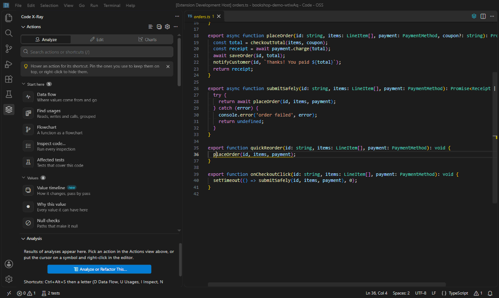

Inspections underline missing `await`s, unused exports, copied code and more (`Ctrl+Alt+S I` lists them all). **Pattern spotting** names the design patterns and architecture in a file, folder or the whole project, each with a link to learn more:

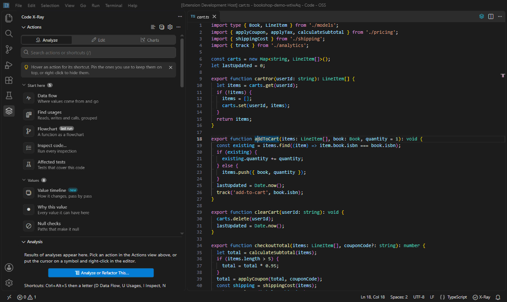

## C# and T-SQL

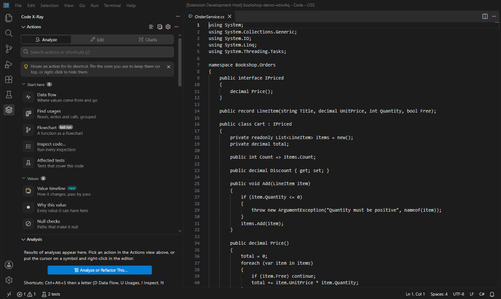

- **C#**: Explain this code (a method's name where it is declared or called, with what it takes, gives back and changes) and its video, Git reel, Flowchart, What depends on what, Data flow and its chart (with the code model's purpose pills), Error paths, Promise rejections, Changes to a variable, Family tree and inspections (empty `catch`, `throw ex`, `async void`…), with a bundled parser. Find usages, Callers and calls and Family tree use the C# extension when it is installed.
- **T-SQL**: Flowcharts of procedures, functions and triggers (`IF`, `WHILE`, `TRY`/`CATCH`, `GOTO`), Find usages of tables, columns and `@variables`, Callers and calls, and inspections (`UPDATE` without `WHERE`, `= NULL`, `SELECT *`…). No database connection needed.

## Settings

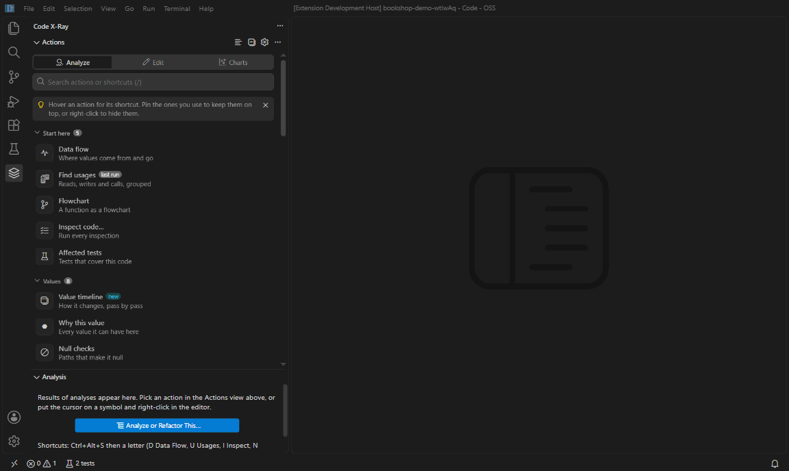

Run **Code X-Ray: Settings** (or the gear in the Code X-Ray view) to switch features on or off, choose animations, pick the voice and code models, and see the **Credits**. A new install starts with Affected tests and Data flow; **Turn all on** switches on the rest.

The full guide to every feature is in [docs/GUIDE.md](docs/GUIDE.md).

## Contributing

Want to fix something or add a feature? [CONTRIBUTING.md](https://github.com/RishiRajGujadhur/VSExtension/blob/main/CONTRIBUTING.md) explains how to set up the repository, the architecture and folder structure, the technologies used, and how to test and send a change.

## Privacy and size

Your code, captions and recordings never leave your computer, and the extension makes no network requests of its own. The only things that go online are links you click, and the models below, each only if you choose to download it.

| Bundled | License | Installed | Download |
|---|---|---|---|
| Code X-Ray: code, pages and icons | MIT | 2.4 MB | 1.0 MB |
| TypeScript compiler 6.0.3, for every TypeScript and JavaScript analysis | Apache-2.0 | 23.2 MB | 4.4 MB |
| tree-sitter and tree-sitter-c-sharp, for C# | MIT | 5.8 MB | 0.4 MB |
| ONNX Runtime Web 1.24.3, which runs the optional models | MIT | 11.9 MB | 3.0 MB |
| eSpeak NG via phonemizer.js 1.2.1, pronunciation for the voice-over | GPL-3.0, Apache-2.0 | 1.3 MB | 0.7 MB |
| **Total** | | **44.7 MB** | **9.5 MB** |

| Downloaded only if you choose it | License | Size |
|---|---|---|
| Voice model for the voice-over, one of: Kitten TTS Nano 0.8 int8 (recommended) | Apache-2.0 | 27.6 MB |
| Kitten TTS Micro 0.8 · Nano 0.8 full precision · Mini 0.8 | Apache-2.0 | 44.7 · 60.0 · 81.5 MB |
| Code model all-MiniLM-L6-v2 (int8): Git reel key changes, Explain this code, chart purpose pills and Find by meaning | Apache-2.0 | 23.2 MB |

**At the download step itself**, before anything is sent, a dialog tells you exactly how your data is used:

- **What is sent**: one HTTPS request to huggingface.co per file, carrying only the file's address, the client name `code-x-ray` and, as with any connection, your IP address.
- **What is never sent**: your code, file names, project or repository names, Git history, captions, recordings, settings, accounts, tokens or cookies. Code X-Ray collects no usage data or telemetry.
- **How Hugging Face may use it**: it may log each request (IP address, time, file) under [its privacy policy](https://huggingface.co/privacy), which the dialog opens in one click.
- **On your computer**: where the files are kept, and that each is checked against its published hash.
- **When it runs**: offline, what it reads and gives back, and what it keeps (the voice-over caches its spoken clips; the code model keeps nothing).
- **How to remove it.**

Nothing downloads unless you choose **Download** in that dialog, or set a model's setting to download without asking. The models then run offline, in a background thread. **Voice model** (`tsStructure.reel.voiceModel`), **Code model** (`tsStructure.reel.codeModel`) and **Charts: code model** (`tsStructure.charts.codeModel`) control them, and commands remove them to free the space.

## Credits

The voice-over speaks with [Kitten TTS](https://github.com/KittenML/KittenTTS) by KittenML / Stellon Labs (Apache-2.0), run with [ONNX Runtime Web](https://github.com/microsoft/onnxruntime) (MIT), with phonemes from [eSpeak NG](https://github.com/espeak-ng/espeak-ng) (GPL-3.0) via [phonemizer.js](https://github.com/xenova/phonemizer.js), run as a separate program; its licence and source notice are in the extension's `dist/kitten` folder. The code model is [all-MiniLM-L6-v2](https://huggingface.co/sentence-transformers/all-MiniLM-L6-v2) (Apache-2.0), converted to ONNX by [Xenova](https://huggingface.co/Xenova/all-MiniLM-L6-v2).

The button animations in the Code X-Ray view are recreated from [the motion language Jerry Liu shared](https://x.com/SloppyJ44/status/1846584501847142705) (@SloppyJ44) and named after his labels. They were written from scratch in CSS after watching his animation, and the design remains his work.

Every library and model is listed with its license on the **Credits** page of Code X-Ray Settings. Other credits are in the [guide](docs/GUIDE.md#credits), and licence notices are in [THIRD_PARTY_NOTICES.md](THIRD_PARTY_NOTICES.md).
