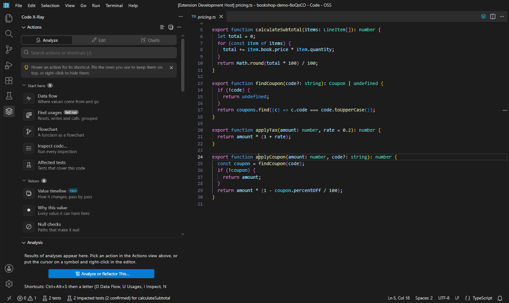
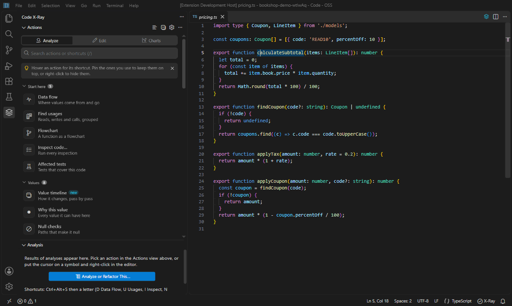
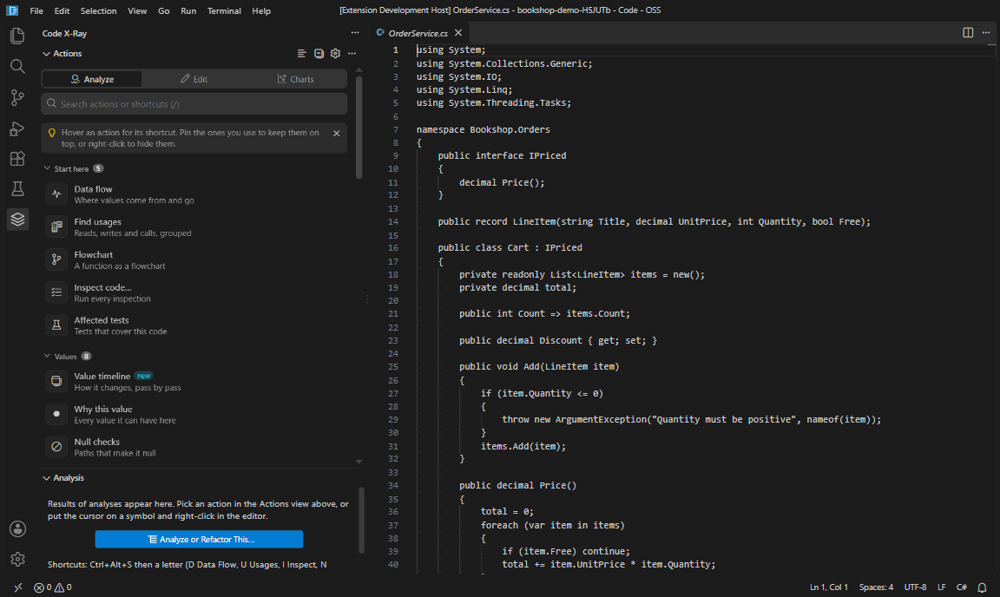

# Code X-Ray

See inside your TypeScript, JavaScript and React code. Put the cursor on something and ask where a value comes from, what a function can do, or what breaks if you change it.

Every answer comes from the TypeScript compiler on your machine. It works offline, uses no AI, and nothing leaves your computer. (Git reels can also use a small code model that runs on your computer, downloaded only if you agree: see [Size and privacy](#size-and-privacy).)

## Every action at the cursor

- Put the cursor on a symbol and press `Ctrl+Alt+Shift+T`, or right-click and choose **Analyze or refactor this…**.
- The **Code X-Ray** view in the Activity Bar lists every action with a search box. Pin the ones you use most.
- Press `Ctrl+Alt+S`, then a letter, to run one directly (`D` data flow, `U` usages, `1` flowchart). `Ctrl+Alt+S K` shows them all.
- Not sure which one you need? Run **Ask the rubber duck…** and pick a question.

## Actions for the highlighted code

- Highlight code in the editor. The **Code X-Ray** view then shows only the buttons that work with it, on every tab.
- Highlight a name to get its analyses (data flow, usages, changes). Highlight lines inside a function to get its charts (flowchart, what depends on what, error paths) and tools that take a range (find copies, inspect, search by shape). Highlight whole declarations to move them to another file.
- The banner above the buttons says what is highlighted and how many actions fit on each tab. **Show all** brings back the rest.

## Data flow

- Put the cursor on a variable or parameter and press `Ctrl+Alt+S D`.
- See every value that flows in, where it goes next, and the functions it reaches.
- Click a row to jump to that line. Open the chart to see the same flow as a diagram.

## Flowchart

- Put the cursor in a function and press `Ctrl+Alt+S 1`.
- Every decision, loop and return becomes a box. The **Paths** list shows each route through the function.
- Click a path to light it up, Shift+click another to compare them, or click a branch label to keep only the paths through it.
- Save the chart as Mermaid, SVG or PNG.
- Zoom, the minimap and undo/redo for moving around sit in the bottom-left corner. Click the map button (or press `M`) to open the minimap. `Ctrl+Z` takes you back to where you were.

## Flowchart vs last commit

- Put the cursor in a function and press `Ctrl+Alt+S Shift+1`, or click the commit button in the flowchart's toolbar (`V`).
- New boxes are outlined green and changed ones dashed amber. Hover a changed box to see its code before.
- Above the paths: removed boxes, and which paths are new or gone. Click a row to go to its box.
- It compares with your last commit (HEAD) and follows your edits as you type, saved or not. Works for TypeScript, JavaScript, C# and T-SQL.

## Git reel

- Run **Git reel** from the Command Palette or the camera button in the Source Control title bar, and pick what to compare with: your last commit, where your branch started, or any commit.
- It plays a video of your changes, up to two and a half minutes, in a player like YouTube's (chapters, captions, full screen): the title (no counts), then **the key change in each file**, shown large and framed with a callout (*Key change: early exit*), what the file or function is for (*Adds item to cart*, *Shows cart items*) and what the change does, then a summary.
- Captions explain what the code does, in plain words, not how much changed: *applyCoupon now returns 0 early when the amount is at most 0*, *This new file adds validateSettings, which validates the settings*. Turn on the **voice-over** and a natural voice reads them (Kitten TTS, bundled and run on your computer: eight voices, or your system voice), in the preview and in the exported video; it says "this file" rather than reading file names.
- Switch between 16:9 and 9:16, pick a theme, edit any caption, switch scenes off, open a scene's code, or **Copy as Markdown** for a pull request.
- **Export MP4** or **Export WebM** (`E`) saves it to `.codexray/reels/`. It is made on your machine from Git and Code X-Ray's own analysis, nothing uploaded. With the optional **code model** (offered the first time, a one-time 23.2 MB download from Hugging Face, run on your computer), the key change in each file is the part closest to what the change is about, and functions the rules cannot place get named (*applyCoupon* → *Works out coupon*).

## Explain this code

Highlight code and choose **Explain this code** (Actions view, right-click menu, Command Palette, or the hover card of a function in any chart): what it is, what it is for, and what it does step by step, in plain sentences, beside the editor. It is worked out on your computer; with the optional code model downloaded it also names what a function is for when the rules cannot tell. Before any download you are told what it sends (a file request that shows Hugging Face your IP address) and that none of your code is sent. **Generate video** plays the explanation in the Git reel's player: a scene per step on the function's flowchart, read aloud by the voice-over, ready to export.

## Find usages

- Turn on **Find usages** in Settings first (it is off on a new install).
- Press `Alt+F7` on a symbol.
- Usages are grouped by kind (definitions, calls, reads, writes, imports), with tests marked.
- Filter the list, or narrow it to the current file.

## Change parameters

- Turn on **Refactorings** in Settings first (it is off on a new install).
- Press `Ctrl+F6` on a function or method.
- Rename it, add, remove or reorder parameters, and change types and defaults.
- The new signature updates as you type. **Preview changes** shows every call that will be updated before you apply it.

## Affected tests

- Put the cursor on a function and press `Ctrl+Alt+S T`.
- See every test that reaches this code, and the chain of calls that connects them.
- Run a test from the list, or run **Tests for my changes** before you commit.

## C#

- **Flowchart** (`Ctrl+Alt+S 1`) and **What depends on what** chart any C# method, constructor, property accessor or lambda, with every path listed and impossible ones flagged.
- **Charts** work in C# files too: Data flow and its chart, Error paths, Promise rejections (tasks not awaited, `async void`), Changes to this variable, Arguments passed in, Family tree, Override reach and Who imports this, from the same shortcuts and the Charts tab.

- **Inspections** underline C# slips as you type: empty `catch`, `throw ex`, `async void`, assigning or comparing a value with itself, identical `if`/`else` branches and more.
- These two need nothing else installed: a C# parser ships with Code X-Ray.
- **Find usages** uses the C# extension's language server when it is installed, and otherwise finds the name in the workspace's `.cs` files (it says so). **Callers and calls** and **Family tree** need the **C# extension** (or C# Dev Kit).
- **Analyze or Refactor This…** (`Ctrl+Alt+Shift+T`) in a C# file lists what works there; a TypeScript-only action says so and offers those instead.
- The other features are TypeScript and JavaScript only for now.

## T-SQL

- **Flowchart** (`Ctrl+Alt+S 1`) and **What depends on what** chart stored procedures, functions, triggers and scripts: `IF`/`ELSE`, `WHILE` with `BREAK` and `CONTINUE`, `BEGIN TRY`/`BEGIN CATCH`, `RETURN`, `THROW` and `GOTO`, with every path and how `@variables` flow.
- **Find usages** (`Alt+F7`) of a table, column, procedure or `@variable`, across the workspace's `.sql` files, as definitions, calls, writes and reads.
- **Callers and calls** (`Ctrl+Alt+S Shift+C`): which procedures `EXEC` this one, and what it calls.
- **Inspections** as you type: `UPDATE`/`DELETE` without `WHERE`, `= NULL`, `SELECT *`, `NOLOCK`, `@@IDENTITY`, `TOP` without `ORDER BY`, empty `CATCH` and more.
- All from the code alone: no database connection and nothing else to install.

## Settings

- Run **Code X-Ray: Settings**, or press the gear in the Actions view's title bar.
- **Features**: switch each part of Code X-Ray on or off. A new install starts with Affected tests and Data flow; **Turn all on** switches on the rest (find usages, refactorings, quick rewrites, inspections, React state and more). With every edit feature off, the Edit tab of the Actions view is hidden.
- **Animations**: turn on the button effects in the Actions view (off by default), or turn off the charts' moving grid and flowing lines.
- Every other setting is there too, grouped and searchable (`Ctrl+F`), with a reset button on anything you changed.

## More

Most of these start off on a new install; switch them on in **Settings › Features**.

- Inspections that underline missing `await`s, unused exports, copied code and more (`Ctrl+Alt+S I`).
- Null checks, side effects, error paths, callers and calls, import loops and bundle weight.
- 70 quick rewrites, **Move to another file**, **Delete safely** and **Search by shape** (`Ctrl+Alt+S S`).
- Works with a keyboard, screen readers and high contrast themes.

All settings are on the **Code X-Ray: Settings** page, and under **Code X-Ray** in VS Code's settings (`tsStructure.*`).

The full guide to every feature is in [docs/GUIDE.md](docs/GUIDE.md).

## Size and privacy

Everything runs on your computer: no code, caption or recording is sent anywhere, and the extension makes no network
requests of its own (a test runs the voice-over with every network route blocked). The only things that go online are
links you click, such as a documentation page, which open in your browser, and the Git reel's **code model**, if you
agree to download it (below). What each part adds:

| Feature | Bundled component | Installed | Download |
|---|---|---|---|
| Extension code, pages and icons | Code X-Ray (MIT) | 2.2 MB | 1.0 MB |
| Analyses of TypeScript and JavaScript | TypeScript compiler 6.0.3 (Apache-2.0) | 23.2 MB | 4.4 MB |
| C# support | tree-sitter and tree-sitter-c-sharp (MIT) | 5.8 MB | 0.4 MB |
| Git reel natural voices: the voice model | Kitten TTS Nano 0.8 int8, by KittenML (Apache-2.0) | 23.2 MB | 19.6 MB |
| Git reel natural voices: the eight voices | Kitten TTS voices file (Apache-2.0) | 3.1 MB | 2.9 MB |
| Git reel natural voices: the model runtime | ONNX Runtime Web 1.24.3, by Microsoft (MIT) | 11.9 MB | 3.0 MB |
| Git reel natural voices: pronunciation | eSpeak NG via phonemizer.js 1.2.1 (GPL-3.0, Apache-2.0) | 1.3 MB | 0.7 MB |
| **Total** |  | **70.9 MB** | **32.0 MB** |

The Git reel natural voices are the last four rows: 39.5 MB installed, 26.2 MB of the download. Turn them off with
**Natural voices** in the Git reel settings (`tsStructure.reel.naturalVoices`); the voice-over then uses your
computer's own voice.

Not bundled, downloaded only if you agree:

| Feature | Component | On disk | Download |
|---|---|---|---|
| Git reel code model (key changes, what code is for) | all-MiniLM-L6-v2, int8 ONNX by Xenova (Apache-2.0) | 23.2 MB | 23.2 MB |

The first Git reel offers it (**Download**, **Not Now**, **Don't Ask Again**); the **Code model** setting
(`tsStructure.reel.codeModel`: ask, on, off) and the commands *Git reel: download the code model* and *Git reel: remove
the code model* control it. The download is two files from huggingface.co, pinned to one version and checked against
their hashes before they are kept; no code, name or token of yours is sent with it. The model then runs offline, in a
background thread, on the runtime already bundled for the voices.

## Credits

The button animations in the Actions view (Blinky, Glitch, Trail, Stroke-n-fill, Shuffle, Crash-n-blink, Slide-n-blink, Color flash and Build on) are recreated from [the motion language Jerry Liu shared](https://x.com/SloppyJ44/status/1846584501847142705) (@SloppyJ44), and named after his labels. They are written from scratch in CSS for Code X-Ray, after watching his animation; no code, frames or images are taken from it. The animation and its design remain his work.

The Git reel's voice-over speaks with [Kitten TTS](https://github.com/KittenML/KittenTTS) by KittenML / Stellon Labs (the Nano 0.8 int8 model, Apache-2.0), bundled and run on your computer with [ONNX Runtime Web](https://github.com/microsoft/onnxruntime) (MIT). Its phonemes come from [eSpeak NG](https://github.com/espeak-ng/espeak-ng) (GPL-3.0) via [phonemizer.js](https://github.com/xenova/phonemizer.js), run as a separate program, with its licence and source notice in the extension's `dist/kitten` folder.

Other credits (the animated chart grid, the Welcome page) are in the [guide](docs/GUIDE.md#credits), with licence notices in [THIRD_PARTY_NOTICES.md](THIRD_PARTY_NOTICES.md).
