# Code X-Ray guide

See inside your TypeScript, JavaScript and React code. Put the cursor on something and ask: where does this come from, what runs here, what breaks if I change it? Every answer comes from the TypeScript compiler on your machine: offline, no AI, and nothing leaves your computer.

**At a glance**, grouped the way the Actions view is:

- **Values**: Data flow, Why this value, Value timeline, What feeds this value, What this value feeds, Null checks, Changes to this variable and Race conditions.
- **Flow and errors**: a Flowchart of any function with every path listed, compared and filtered; What depends on what, Error paths, Async timeline, Promise rejections and Side effects.
- **Finding your way**: Find usages, Callers and calls, Arguments passed in, Family tree, Override reach and Re-export trail.
- **Imports**: Who imports this, Bundle weight, Why this import, Import loops and Import changes since.
- **Health check**: Inspect code, Type assertions, Déjà vu for copied code, Ghost exports, Pattern spotting and Shared state changes.
- **Tests**: Affected tests, and Tests for my changes before you commit.
- **Edit**: Change parameters, Make it a parameter, Move to another file, Delete safely, 70 quick rewrites, Search by shape and Your own checks.
- **Around it all**: an Actions view you can search, pin and trim, a shortcut for everything (the Cheat codes), Ask the rubber duck when you don't know which to pick, the Toolshed of optional tools, charts you can save as Mermaid, SVG or PNG, and screen reader, keyboard and high contrast support.

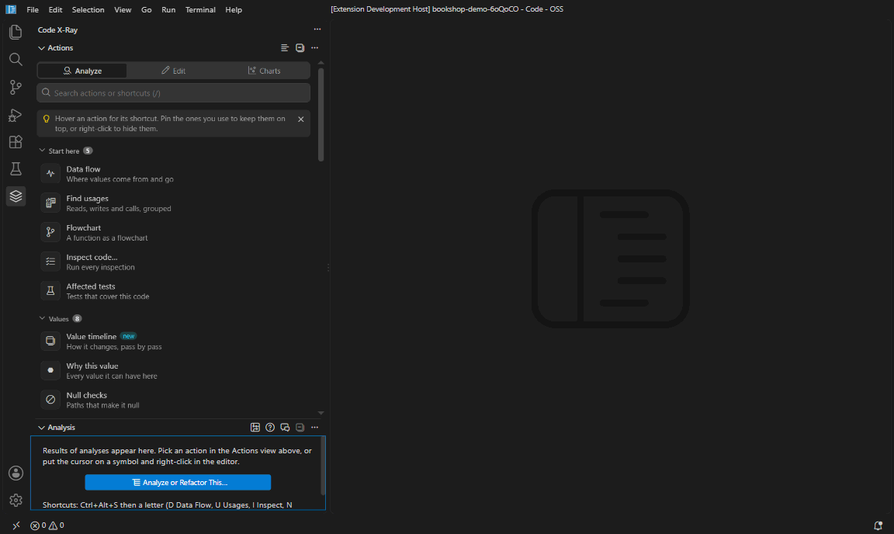

## Getting started

1. Open a TypeScript or JavaScript file and put the cursor on a symbol.
2. Right-click: **Find usages**, **Find usages in this file**, **Data flow** and **Analyze or refactor this…** are at the top of the menu. Everything else is under **Code X-Ray**.
3. Or open **Code X-Ray** in the Activity Bar: the **Actions** view at the top lists every analysis and edit in **Analyze** and **Edit** tabs, and every chart in the **Charts** tab (the Graph Explorer), with a search box, your **Pinned** and **Most used** actions first and the rest by category. Results open in the **Analysis** view below it.

**Actions for the highlighted code**

Highlight code in the editor and the Actions view shows only the actions that work with it, on every tab, under a banner that says what is highlighted (*Highlighted: code in applyCoupon()*) and how many actions fit here and on the other tabs:

- **A name** (one word): the analyses of what it names, the same as with the cursor on it (Data flow, Find usages, Changes to this variable…), the edits of its declaration (Change signature, Delete safely, Move to a file) and Affected tests.
- **Code inside a function**: the charts of that function (Flowchart, Flowchart vs last commit, What depends on what, Error paths, Side effects, and the async ones in an async function), the tools that take the highlighted range (Déjà vu finds its copies, Inspect code checks only it, Search by shape starts from it), **Introduce parameter** when it is exactly one expression, and the quick rewrites that apply there.
- **A whole function** (from its first to its last line): its charts and analyses, as on its name.
- **Whole declarations** at the top of a file: Move to a file, the range tools, and Ghost exports when they export something.
- In C# and T-SQL: names get the name analyses of the language, code its flowchart family.

**Show all** in the banner brings back every action while the code stays highlighted; a new highlight narrows the list again. Tabs with nothing for the highlight are dimmed. Search ignores the highlight.

**Arranging the Actions view**

- Hover an action, or move to it with the keyboard, to see its full shortcut (for example `Ctrl+Alt+S` then `1`) and its tools: **ⓘ** explains what it does, how often you used it and its shortcut; the pin keeps it at the top.
- Pin the actions you use and drag them into the order you like, or press `Alt+Up` and `Alt+Down`.
- Right-click an action (or press `Shift+F10`) to run, pin, move or hide it, change or add its shortcut, or copy its command ID. `Delete` hides the focused action; hidden actions wait in a folded **Hidden** section, ready to show again.
- Fold any section by its heading; the view's title bar folds them all, or hides the descriptions for a one-line list. Its **…** menu hides Most Used, shows every hidden action, or resets the view.
- Type anywhere in the list, or press `/` or `Ctrl+F`, to search. Search covers every tab, hidden actions and shortcuts (try `F7`), and marks the matching words.
- Every action remembers where you last ran it. Its menu offers **Run again on total (cart.ts:12)**, Alt+click on it does the same, and its info tip says where that was.
- With no file open, an action's message offers **Open a file…**: pick a file of the project (TypeScript files first, generated and tool folders last), then (for an action that starts from a variable, a function or a class) the symbol, and it runs there.
- Shortcuts you changed in your own keybindings are the ones shown. Your arrangement is kept across windows and synced with Settings Sync.
- The action whose result is on screen stands out: its row is raised with a colored bar on its left, its tab has a dot, and the action you ran before it says **last run**. It is cyan; pick pink or your theme's focus color with `tsStructure.actions.accentColor`.
- With **Button animations** on in Settings (off by default), hovering or clicking an action plays a short effect on its icon, picked at random from nine: blinky, glitch, trail, stroke-n-fill, shuffle, crash-n-blink, slide-n-blink, color flash and build on. The tabs fade smoothly on hover.
- In the charts, a box's card fades in when it opens and fades out when it closes; unpinning a card fades it out too.
- Menus, tips and legends fade in and out, and new content fades in: another tab of actions, an unfolded section, a new result card or a new chart (not the same one redrawn after an edit). Boxes faded by a picked path or a search don't open a card. Both stay still when your system asks for reduced motion.

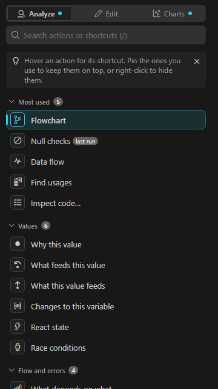

Not sure which analysis answers your question? Run **Ask the rubber duck…** (`Ctrl+Alt+S /`) and pick a question such as *Where does this value come from?*

The first time the extension starts, the **Welcome to Code X-Ray** page opens: the title in a pixel font over a moving field of ASCII characters, then eight short steps as panels, each with its buttons and a picture. A step is ticked once you try it. Reopen the page with **Guided tour** (the **?** in the view); VS Code's own walkthrough of the same steps is a button at the bottom, or **Guided tour in VS Code’s walkthrough** in the Command Palette. The animation stops while the tab is hidden and is a still picture when your system asks for reduced motion.

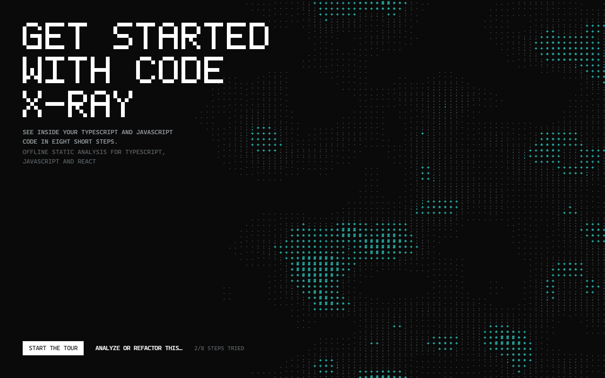

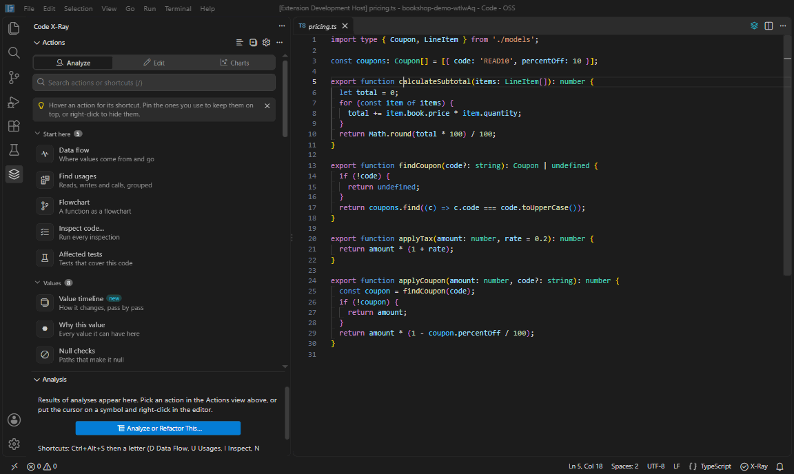

### Plain names

Everything is named the way you would say it: **Flowchart**, **Who imports this**, **Delete safely**, **What feeds this value**, in sentence case, without analysis jargon. The old, technical names still work in every search box, so typing *control flow graph* finds **Flowchart** and *safe delete* finds **Delete safely**.

A few side rooms have a playful name with a plain line under it: the **Toolshed** of optional tools, the **rubber duck** that answers *how do I…?*, the **Cheat codes** for shortcuts, **Ghost exports** that nothing uses and **Déjà vu** for copied code. And a few things are in no menu at all. Be nice to the duck.

## Shortcuts

Every analysis has a shortcut: `Ctrl+Alt+S` (`Cmd+Ctrl+S` on macOS), then a letter. **Cheat codes** (`Ctrl+Alt+S K`) lists them all; change any of them with **Keyboard shortcuts…**, or the keyboard button next to each entry in **Analyze or refactor this…**.

| Key | Runs | Key | Runs |
| --- | --- | --- | --- |
| `Space` | Analyze or refactor this… | `X` | Error paths |
| `D` | Data flow | `A` | Arguments passed in |
| `U` | Find usages (also `Alt+F7`; in the file `Shift+Alt+F7`) | `H` | Family tree |
| `N` | Null checks | `O` | Override reach |
| `E` | Side effects | `C` | Re-export trail |
| `M` | Shared state changes | `P` | Why this import |
| `R` | Promise rejections | `G` | Import changes since… |
| `Y` | Pattern spotting | `S` | Search by shape |
| `I` | Inspect code | `F` | Déjà vu |
| `T` | Affected tests | `Z` | Ghost exports |
| `V` | Results view | `L` | Run the last analysis again |
| `K` | Cheat codes | `/` | Ask the rubber duck… |
| `W` | Rewrites here | `B` | Move to another file |
| `J` | Who imports this | `Q` | Import loops |
| `2` | Type assertions | `3` | Shared state changes (project) |
| `4` | Tests for my changes | `5` | Next inspection problem |
| `6` | Changes to this variable | `7` | Race conditions |
| `1` | Flowchart | `0` | Why this value |
| `Shift+1` | Flowchart vs last commit | | |
| `8` | Data flow chart | `9` | Draw the results as a chart |
| `Escape` | Stop | | |

Refactorings: **Change parameters** `Ctrl+F6`, **Delete safely** `Alt+Delete`, **Make it a parameter** `Ctrl+Alt+P`.

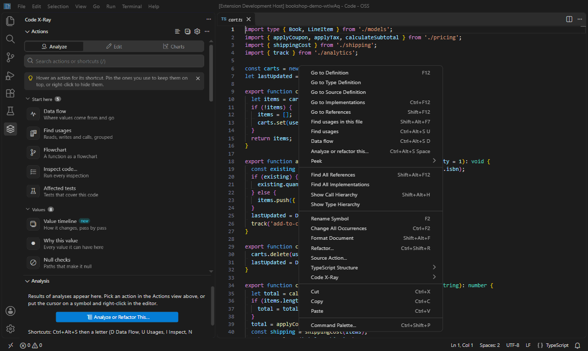

## Understand code

### Data flow

Where a variable, parameter or property comes from, every place it changes, and where it goes. **Design patterns** names the patterns the value passes through, such as a Strategy, Factory or Observer, recognized from the shape of the code. Hover a pattern for its **ⓘ** button (what it means) and its **Learn more** button, which opens the pattern on refactoring.guru, patterns.dev, react.dev, the TypeScript handbook or Martin Fowler's catalog. Click **Trace this value** on a row to follow the value into a called function. A pattern found in several places is one row, with the places below it.

The functions that write the value sit under **Flows in** and those that read it under **Flows out**, so each side folds away as one. **Flows in** also covers React state (the initial value and every `setCount(…)` call), destructured props and options (what each call site passes, or that it leaves them out), and flags incoming values that may be null or undefined. **Flows out** includes JSX props (`<Price amount={total} />`, which Trace This Value follows into the component), and each receiving variable shows, folded, where it sends the value next (**Group by function** in the **...** menu goes back to one group per function; `tsStructure.dataFlow.groupByDirection`).

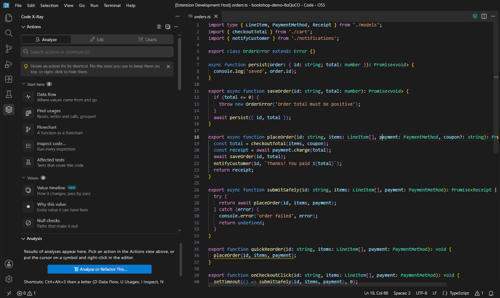

#### Data flow chart

**Data flow chart** (`Ctrl+Alt+S 8`) draws the same flow as a chart in the editor: the variable in a circle in the middle, with a port where values come in and one where they go out, where its values come from on the left and where they go on the right. Click a box to select it and Enter (or a double-click on the code of its hover card) to open its code, click its round button to fold or unfold what is behind it, drag to move around and scroll to zoom. Right-click a box to check it for null, find its usages, follow its data flow or run another analysis there. **Draw as chart** in the results view (`Ctrl+Alt+S 9`) draws any analysis this way, and the chart follows the results view as you run more. Large charts stay quick: only what is on screen is drawn, and a chart of more than 150 boxes opens with its deepest levels folded.

- Boxes are as wide as their text and carry the same icon as their row in the results view (a pencil for a write, an eye for a read, books for design patterns); the bar under the chart shows the whole text, file, line and line of code of the box under the mouse.
- Design patterns are purple hexagons on dotted lines, since they describe the code rather than carry the value. Boxes that only group others are dashed outlines.
- Boxes that read exactly the same, such as one call made on several lines, are stacked into one with a **×2** badge; unfold it to see each one with its line.
- Right-click the subject circle to animate every flow, fold or unfold everything, or fit; right-click the background for fitting, folding, the minimap and export. While lines flow, the ring around the subject runs with them: in at the left port, round both sides and out at the right.
- Double-click a box (or press `B`) to see only its branch; `Escape` shows the whole chart again. A minimap appears when the chart is bigger than the window.
- **Find** (`Ctrl+F`) highlights matching boxes and unfolds the ones hiding a match; `Enter` goes to the next.
- Boxes in test files (such as `cart.spec.tsx` or anything in `__tests__`) have a test tube and an outline in your theme's test colour, and boxes about arrow functions (callbacks, handlers) an arrow and an outline in your theme's orange.
- Big charts (more than 250 boxes) open lighter: the deepest groups fold until about 250 boxes show. Any chart or flowchart with more than 100 boxes has the animated grid and flow pulses off, and their sparkle and play buttons disabled, with the reason in their tooltip. Flow pulses are only drawn where lines are on screen, and stop on their own when very many lines are in view.
- Every chart marks what kind each box is, with a small pill on the box and a chip in the bar on top that hides it, shows only it (Alt+click) or lights it up (hover). The pills take your theme's chart colours: **async**, **entry**, **impl** and **recursive** in Callers and calls (repeats start hidden); **throws**, **unhandled**, **swallowed** and **handled** in Error paths and Promise rejections; **literal** and **on load** in Data flow and Arguments passed in; **after await**, **++** and **shared** or **argument** in Changes to a variable and Mutations; **state**, **ref**, **memo**, **effect**, **prop** and **missing dep** in React state; **abstract**, **interface** and **super** in the Family tree and Override reach, with **any impl** for calls through the base type; **type only**, **runtime**, **lazy** and **barrel** in the import charts, with direct and indirect importers; **maybe undefined** in Null checks; and **Tips** in every chart, to hide the how-to-fix rows. A pill that would sit on most boxes is left off; its chip stays.
- The Flowchart's bar lights up the boxes with a call you can open in place (ƒ+), turns on dependences, and then has a chip each for data arcs and control arcs.
- A box's hover card offers the edits that fit its code, one click away: **Rename**, **Delete safely**, **Change signature**, **Inline** (a variable) and **Move to a file** (a top-level declaration) for a declaration; **Rename ‘name’** for a name that refers to something else; and the editor's own edits at that code by name, such as **Extract to constant in enclosing scope**, **Extract to function in module scope**, quick fixes and Code X-Ray's rewrites (**Extract…** and **More edits…** appear only when the editor has nothing more specific). The file opens with the cursor on the right name and the edit starts. Flowchart boxes have them too. They sit in two rows: **Edit** (rename, change signature, rewrites such as **Infer return type**) and **File** (**Move to a file** with its ▾ for the other ways to move, export changes), with **Delete safely** apart at the far end; more than three in a row wait under **…**.
- The button of an analysis in the Actions view stays lit only while its result is on screen: closing its chart or clearing the results turns it off, and drawing the chart again or going back to the result turns it on again.
- A bar at the top lists the kinds of boxes in the chart: tests and arrow functions whenever there are any, and any other kind with at least three boxes (reads, writes, design patterns, files…), each with its count. Press one to hide or show those boxes. Test boxes start hidden, so the chart shows your code first; charts open with everything unfolded.
- The hover card shows a spinner while it reads a box's code, then the code.
- In the bar at the top, Alt+click a kind to show only that kind, point at one to light its boxes up, and **Show all** to bring everything back; `H` shows or hides tests. A box's menu has **Hide** and **Show only** for boxes like it, and hidden kinds stay hidden for the next chart of the same analysis.
- The Flowchart has a bar too: press a kind (decisions, loops, returns, code…, or Unreachable) to light those boxes up; Escape clears it. `R` goes to the next return or throw, `Ctrl+C` copies a box's code, and each path in the list says how many boxes it passes.
- Hover cards have a copy button, file:line opens the code, and a pinned card folds to its title with a double-click on its header.
- Resting the pointer on a box (or moving to it with the keyboard) opens its **hover card**: what it is, its file and line, its code with syntax colors (up to 12 lines, scrollable), the report's details, the way from the subject to it, and the keys that act on it. The card stays open while the pointer is on it, its pin keeps it open to compare boxes, and `Escape` closes it.
- Hovering a box highlights its way to the subject. Selecting a row in the results view marks its box, and clicking a box selects its row.
- Keys: `Tab` to the subject, arrow keys between boxes, `Enter` to open, `Space` to fold, `+` `−` to zoom, `0` to fit, `Home` to return.
- Zoom, position and folding are kept when the same analysis runs again.
- **Copy as Mermaid** copies the chart as a Mermaid flowchart for Markdown, GitHub issues and pull requests; **Save as SVG** and **Save as PNG** save it as an image.
- **?** explains the colors, arrows and keys.
- An animated dot grid sits behind the chart and bends around every box: it glows and moves aside around the pointer and the hovered box, and clicking a box sends a wave across it. Every line is a blue wire with soft cyan pulses travelling along it the way the value goes; clicking a box keeps the pulses to the lines between it and the subject (clicking the background brings them all back). Boxes are rounded cards with a soft shadow, their border brightening on hover. The **Grid** and **Flow** buttons turn each off; both stay still when your system asks for reduced motion. (The grid, the flowing lines and the box style are adapted from [robot-components](https://github.com/dashrobotco/robot-components); see Credits.)

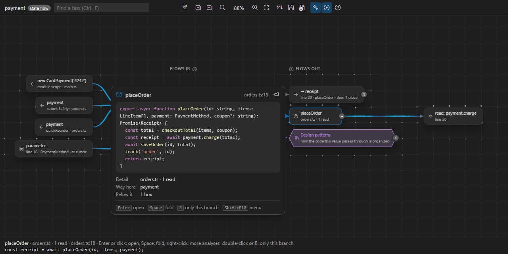

### Flowchart and path list

**Flowchart** (`Ctrl+Alt+S 1`) draws the function at the cursor as a flowchart beside the code: statements in the editor font, decisions as hexagons with **yes** and **no** edges, switch cases (including fall-through), loops with their way back, returns and throws, and code nothing reaches drawn dashed. Put the cursor on a call to draw the called function instead.

The **path list** lists every path through the function with the branches it takes, in words (*user.active → user.role is 'member' → not sensitive*), and what it returns. Pick a path to light up its route; click a branch label (yes, no, case…) to keep only the paths through it. Paths that test the same unchanged condition both ways cannot happen and are hidden unless you ask for them. Click a box to select it and animate the paths through it, and press Enter to open its code; the box your cursor is in is outlined, and the chart redraws as you edit.

**Why this value** (`Ctrl+Alt+S 0`) answers *why does this variable have this value here?*: every value it can have at the cursor, with the conditions that lead to each. At the final `return permission` of a permissions check it lists `'write'` (active admin), `'limited'` (active member, sensitive), `'read'` (active member, not sensitive) and `'none'` (anyone else).

The answer shows as a card in the panel at the bottom of the sidebar: each value on a timeline with how many ways lead to it and what has to be true, and how long the analysis took. Click a value to open its code; **Next** runs another analysis at the cursor.

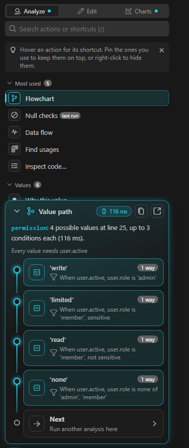

- **Expand calls in place**: a box that calls a function of your project has an **ƒ+** button. It splices the called function into the chart, in a labeled frame, with its returns leading on to what followed the call; paths then run through it.
- **Compare two paths**: Shift+click a second path. The shared route is purple, the first path's own branches blue and the second's orange, with a summary of where they part and how each ends.
- **Slices**: **What feeds this value** (backward slice) lights up the statements and decisions a variable depends on at the cursor; **What this value feeds** (forward slice) lights up everything it flows into or decides.
- **Export**: copy the chart as a Mermaid flowchart (with the picked path drawn thick) or save it as SVG or PNG.

Finding your way around a large function:

- **Start and end are circles**: start is a filled circle with a play mark and the function's name beside it, end a ring around a dot. Each box shows the line it starts on, and an icon for its kind: **?** for a decision, a loop arrow, a return arrow, an error mark for a throw. Yes and no labels carry a ✓ and ✕ as well as their color.
- **Right-click** a box to open its code, animate the paths through it, keep only the paths through it, zoom to it, expand or fold its calls, see what affects it or what it affects, run Data Flow, Find Usages or another analysis there, or copy its code. Right-click a branch label to filter by it or go to either end, a path in the list to pick, compare or copy it (as text or Mermaid), and the background to fit, expand or fold every call, go to unreachable code, or export.
- **The map dock**, in the bottom-left corner: zoom out, the zoom level (click it for 50%–200% or Fit) and zoom in; the **map** button, which opens the minimap in a card above it (`M`; the choice is kept), with the picked path lit up, where a click or drag moves the view; and **undo** and **redo** for moving around (`Ctrl+Z`, `Ctrl+Y`), which glide back to where the view was before the last drag, zoom or jump. A burst of wheel zooming counts as one move.
- **Find** (`Ctrl+F`) outlines the boxes whose code matches and fades the rest; `Enter` goes to the next match.
- **Hover cards** open under their box, so the boxes beside it stay clickable. In a small window the card gets smaller so the chart stays in sight: a compact card has a few lines of code, two edits with the rest under **…** and two facts; a tiny one only the code and its note (pin it for more: a pinned card is one size larger). With no room above or below a box, the card opens beside it. Double-click the code on a card to open it in the editor. The pin keeps one card open (pinning another box replaces it); drag it by its header to move it.
- **Hover cards**: rest the pointer on a box, or focus it, for a card with its kind, file and line, its whole code with syntax colors, how many paths pass through it, what it reads and sets, which boxes it controls, and when it runs (*switch (user.role) → case 'member'*), with the keys that act on it. Pin the card to keep it open; `Escape` closes it. The bar under the chart shows the same box in one line, and hovering a path in the list previews its route.
- **Long code**: long lines wrap instead of being cut off, and a box with more than four lines shows its first lines and a **+ N more lines** chip: click it, or press `U`, to unfold that box in place (its chip then folds it back). **Code in boxes** in the toolbar switches to **Show all code** in every box. Zoomed far out, each box shows one large line instead (*Decision*, *8 lines*) so the shape of the function stays readable.
- Keys: `Tab` to the chart, `↑` `↓` to follow the flow, `←` `→` along a row, `Enter` to open, `F` to animate, `T` to filter by the box, `Shift+F10` for its menu, `C` for the box at the editor's cursor, `P` to show or hide the path list, `Home` and `End` for start and end. Shift+wheel scrolls sideways, double-click zooms to a box, and **?** explains every shape, color and key.
- Zoom and position are kept per function, as is whether the path list is open.
- Paths that end the same way are grouped under that ending (*returns permission · 4 paths*); hover a group to see all its paths at once, open it to pick one. Hovering a box lights up the lines into and out of it; while lines flow, the rings around start and end run from top to bottom, the way the lines go.

Both charts:

- **Search the right-click menu**: the menu opens with a search field at the top. Type to filter its actions (every word counts, in any order: *dep sho* finds **What it depends on**), use the arrow keys to move, `Enter` to run the first match, `Escape` to clear the search and then to close. Shortcuts are listed on the right, the actions you used last come first under **Recent**, and a line at the bottom says where you are (*Line 16 · control.ts · 2 paths through*).

- You can't lose the chart: dragging, zooming and scrolling always keep part of it in the window. Double-click the background, or press `0`, to fit it again; the chart refits when you resize the tab, until you move it yourself.
- Zoom, the minimap and undo/redo sit in the map dock at the bottom left. Click the zoom level for 50%, 75%, 100%, 150%, 200% or Fit. Fit and moving to a box glide there (at once when your system asks for reduced motion).
- Click the background and use the arrow keys to pan (`Shift` for bigger steps); `M` opens or closes the minimap card, and the choice is kept; `Ctrl+Z` and `Ctrl+Y` undo and redo moves.
- Right-click a box for **Copy text** or **Copy location** (`file:line:column`).

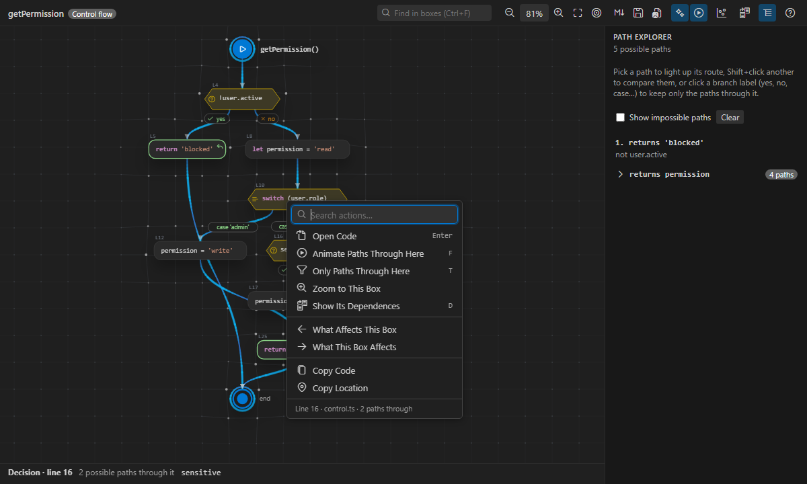

The chart has the same animated grid as the data flow chart, bending around every box, and clicking a box makes pulses flow along every possible path through it; a picked path pulses the same way. The **Grid** and **Flow** buttons turn each off, and both stay still when your system asks for reduced motion.

#### Flowchart vs last commit

**Flowchart vs last commit** (`Ctrl+Alt+S Shift+1`), or the commit button in the Flowchart's toolbar (`V`), compares the function on screen with the same function in your last commit (`HEAD`):

- **New boxes** are outlined green, **changed boxes** dashed amber; a changed box's hover card shows its code before.
- Above the paths, a line counts what changed (*Since the last commit: 2 new boxes, 1 changed · 3 new paths, 2 paths gone*), followed by the new and changed boxes (click one to go to it), the **removed boxes** with the line they were on, and the **paths gone**. Paths that are new carry a **new** badge in the list.
- The comparison follows your edits as you type, saved or not, until you turn it off with the same button.
- The function is found in the old version by its name, wherever it moved in the file; methods that share a name are told apart by their order. A function that is not in the last commit, or a file that is new, shows as new.
- Boxes are matched by their kind and code (spacing ignored); a box left over on each side with code alike enough is the same box changed. A path is the same path when it passes the same boxes and ends the same way. Calls expanded in place (ƒ+) are left out of the comparison.
- It works for TypeScript, JavaScript, C# and T-SQL, and needs the file in a git repository.

Each loop is taken zero or one times, and branches inside expressions (`&&`, `||`, `?:`) and exceptions thrown by called functions are not followed.

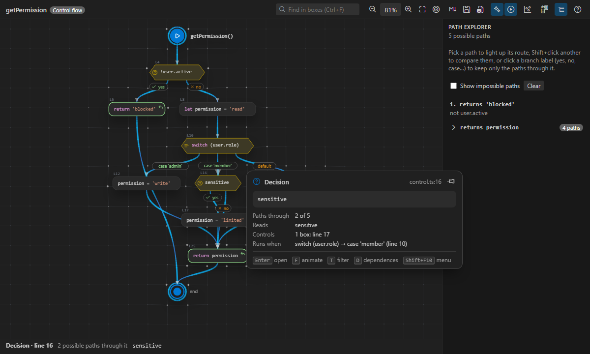

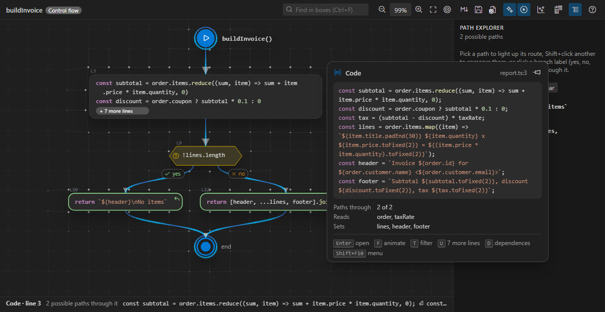

#### What depends on what

**What depends on what** (`Ctrl+Alt+S Shift+D`), or the **Dependences** button (`D`) in the Flowchart view, draws the function's dependences on its flowchart: purple arcs on the left run from where a variable is set to each place that value is read, named by the variable; orange dashed arcs on the right run from a decision to each statement that runs only for some of its branches. Together they answer *why can this line run, and where did its values come from?*

- **Levels**: **Calls expanded** in the toolbar (0 to 3) draws the functions it calls inside the chart, and their calls, so dependences follow values into them; the **ƒ+** buttons still expand single calls.
- Parameters come from the start circle (blue arcs). Changing a property (`x.a = 1`) or calling `push` changes a value without replacing it, so earlier assignments still reach later reads. Arcs that go back up a loop are dotted: the value is read the next time round.
- Hover or focus a box to keep only its arcs (in a large function they stay faint until you do), and the bar under the chart lists them in words: what it reads and from where, which decisions it depends on, and who reads its values. Right-click a box for **What it depends on**, or press `D` on it.
- Click an arc to light up both its boxes and read what it means; every arc has a tooltip. Search (`Ctrl+F`) for a variable to keep only its arcs. The background menu turns data or control arcs off, and **Copy as Mermaid** includes the arcs while they show.

### Callers and calls

**Callers and calls** (`Ctrl+Alt+S Shift+C`) draws the function at the cursor as a butterfly: who calls it on the left (and who calls them, further out), what it calls on the right (and what those call).

- **Levels** (1 to 5) and **Show** (Callers, Both, Callees) in the chart's toolbar, or the layers button of the results view, run it again deeper, shallower or one-sided. The starting depth is `tsStructure.callGraph.depth`.
- Calls are resolved with the type checker: methods, imported functions, React components rendered in JSX and functions passed through variables are followed, and a call through an interface or abstract method leads to each implementation that may run. A call made inside a callback, such as `setTimeout(() => submit())`, belongs to the function that set the callback up.
- Each box says where the function is, the line the call is on, how many calls there are, and whether it is async, a generator, a test, recursive or an implementation. Callees are listed in the order they are called; callers by how often they call.
- A function that appears again is drawn once and then marked *shown above*, so the chart doesn't repeat whole branches. The top of each chain is marked as an entry point, and a function nothing calls is flagged unless it is exported.
- Each side sums up its callers and callees and the files they are in; callers in test files have a beaker. Calls into libraries are counted in one box.

### React state

**React state** (`Ctrl+Alt+S Shift+R`) shows how a React component or hook fits together. Its props and context are on the left; on the right are its state (`useState`, `useReducer`), refs, memoized values and callbacks, custom hooks, effects, and the child components it renders.

- **Child levels** (0 to 3) in the toolbar shows the components it renders, the props it gives each (`title ← label`) and, a level further, what those render.
- For each value: where it is set (in which handler or effect), where it is read or rendered, which child component it is passed to and as which prop, and which effects and memos it triggers. `useReducer` dispatches list their action types (*dispatches 'add' in inline handler*).
- Each effect says when it runs (*when userId changes*, *after every render*, *once*), what it sets and reads, and whether it cleans up.
- It points out: dependencies an effect reads but doesn't list; dependencies it lists but doesn't read; functions or objects in a dependency list that are new on every render (so the effect runs every time); effects that only copy other values into state (compute them while rendering instead); state set while rendering; state that is never updated; `useState(compute())` that computes its initial value on every render; and `ref.current` read while rendering.

### Pattern spotting

The design patterns and architecture of a file, folder or the whole project, 75 in all, each recognized from the shape of the code, with a link to learn more about each:

- **Creating objects:** Singleton, module-level singleton, Factory, Abstract factory, Builder, Prototype, Object pool, Lazy initialization, Dependency injection, Service locator.
- **Structure:** Adapter, Bridge, Flyweight, Facade, Proxy, Decorator, Composite, Barrel module, Module pattern, Mixin, Value object, Null object, Fluent interface, layered folders.
- **Behavior:** Observer, Event bus, Mediator, Memento, Strategy, Strategy map, Command, State, State machine, Template method, Chain of responsibility, Visitor, Iterator, Specification, Plugin registry, Middleware.
- **Data and async:** Repository, Unit of work, API client, Reducer, Store, Result type, Memoization, Pipeline, Promise chain, Retry, Debounce or throttle, Circuit breaker, shared module state.
- **TypeScript:** Discriminated union, Type guard, Assertion function, Branded type, Constant object as enum, Exhaustive check.
- **React:** components with hooks, Custom hook, Context provider, Reducer with context, Higher-order component, Render props, Compound components, Container and presentational components, Controlled component, Error boundary, Memoized component, Lazy-loaded component, Portal, Forwarded ref, Polymorphic component, plus higher-order functions.

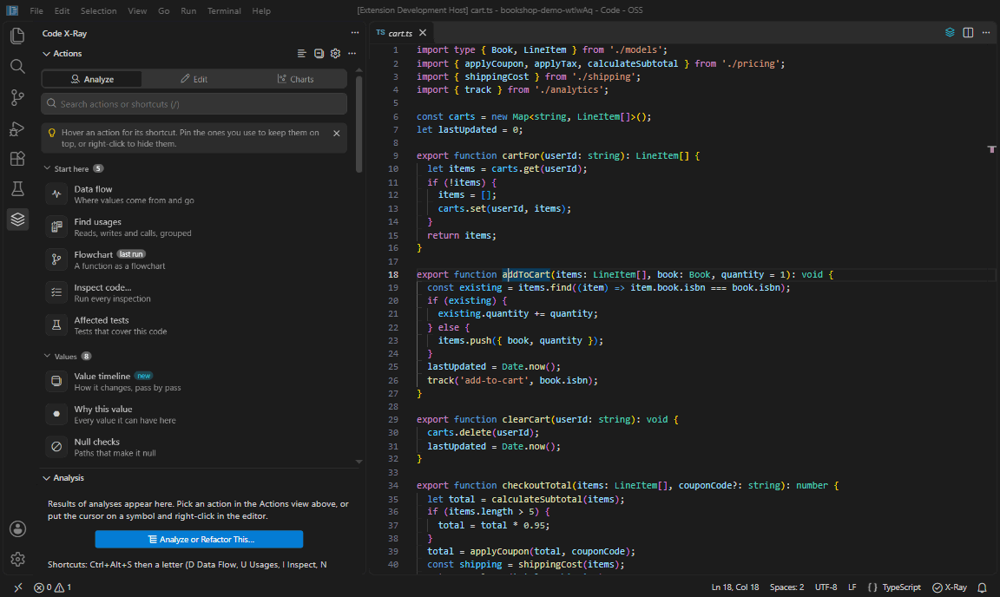

### Find usages

References grouped by what they do: definitions, calls, writes, reads, type references, imports and exports, per file, with test files marked. **Find usages in this file** shows only the usages in the file you are in.

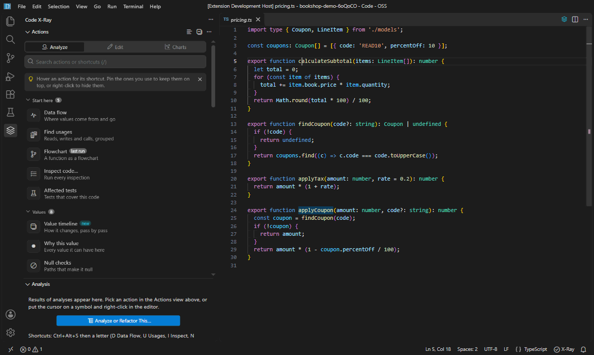

### Null checks, side effects, changes, errors and arguments

- **Value timeline**: every change to a variable in the order the code makes it, in phases: at the start, on every pass of a loop, and after it. Each change shows its line and the condition it waits for (*+= item.price when item.inStock*); each loop says what one pass hands to the next, and a counter shows how it steps (*start, then start − 1, start − 2, …*). A variable nothing changes says it could be `const`.
- **Async timeline**: what an async function does over time, step by step: each `await`, calls started together with `Promise.all`, waits inside a loop that run one after another (with how to start them together), promises started early and the line that waits for them, promises started on purpose with `void`, and promises nobody waits for, whose errors are lost.

| Analysis | Put the cursor on | Shows |
| --- | --- | --- |
| **Null checks** | a variable or call | whether it can be null or undefined there, every path that makes it so, and the uses that need a guard |
| **Side effects** | a function | what it changes besides its result: arguments, shared state, I/O, timers, randomness |
| **Shared state changes** | anywhere in a file | functions that change state they don't own, and who changes each piece of state. The first row explains what a mutation is |
| **Changes to this variable** | a variable or property | every function that changes it across the project, marking async functions, callbacks (setTimeout, then, event handlers) and changes after an `await` |
| **Race conditions** | a variable or property | whether an `await` falls between reading or checking shared state and writing it (`total += await price()`, `if (!cache) cache = await load()`), and whether several async writers replace it. Data Flow shows the same findings |
| **Promise rejections** | an async function | where its rejections are caught, handled or lost |
| **Error paths** | a function | what it can throw, and what each `catch` does with it |
| **Arguments passed in** | a parameter | every value that can arrive, and where it goes |

The **ⓘ** button in the results view explains the analysis on screen. Rows that name a language construct, such as *destructured*, `?.`, `||`, *narrowing* or *import type*, have a **?** button: a plain explanation, an example and a link to MDN, the TypeScript handbook or react.dev. Reports that find problems end with a **How to fix** group. Each report ends with a **Next** group: click a row to run a related analysis on the same symbol, such as Nullability after Data Flow. When an analysis doesn't fit the symbol, the error offers one that does.

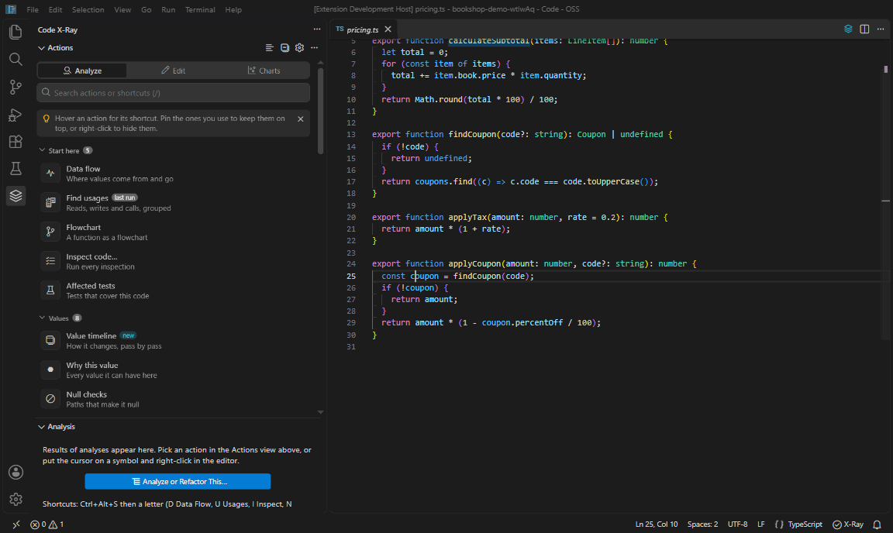
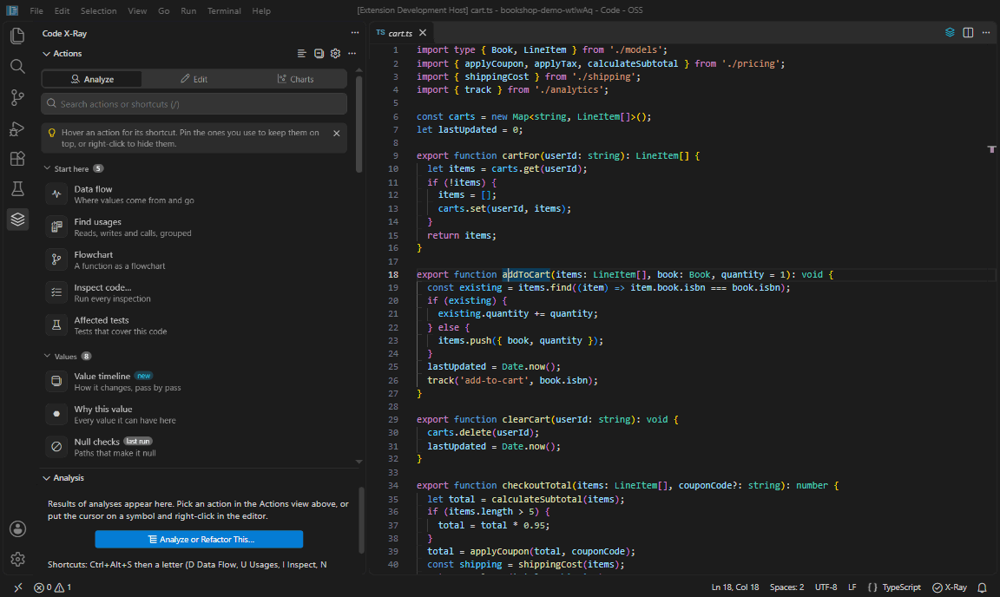
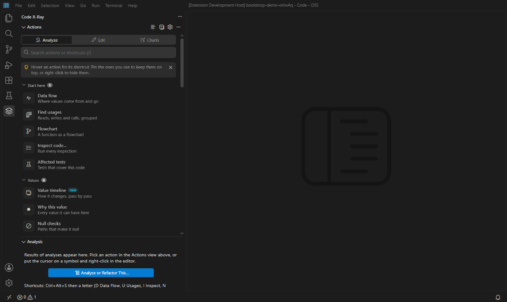

### Git reel

**Git reel** (Command Palette, or the camera button in the Source Control title bar) turns your changes into a short video to share in a pull request or a chat. Pick what to compare with (your last commit, where the branch started, a recent commit or branch, or any revision), and it opens in its own tab:

- **Scenes**: an **overview** (the branch and what it is compared with, a title from the branch name or the latest commit, additions, deletions and files); for each changed **function**, its **code** (lines added and removed, and inside a line changed in place, the words that changed marked stronger) and then its **flowchart** on its own: the whole chart first, then the view glides to the boxes that changed (new ones green, changed ones dashed amber) at a size you can read, from one group of changes to the next; a scene per **file** for code outside functions and for other languages; **other files** when there are more changes than scenes; and a **summary**.
- **What the code does**, explained in plain words (never counts of lines, boxes or changes). Code X-Ray reads the code itself: names become verbs (*validateSettingsExport* → *validates the settings export*), conditions become clauses (*!items.length* → *there are no items*, *amount <= 0* → *the amount is at most 0*), calls become what they do (*fs.writeFileSync* → *writes a file*, *addEventListener("resize")* → *listens for resize events*), loops become *goes through each field in the fields*. So a changed function reads *applyCoupon now returns 0 early when the amount is at most 0. It also uses 0.8 instead of 0.9 for the discount.*; a new one *validatePayment is new: it validates the payment.*; a new file by what it holds (*This new file adds validateSettings, which validates the settings*, *This new test file checks "rejects an empty cart"*, *This new stylesheet styles the timeline*), and a changed one by what it now uses or offers. Anything that would still read as code is left out rather than read out. The words come from rules, not a model: the same change is always explained the same way, offline.
- **Captions** as YouTube shows them: white text on a dark box behind each line, centred at the bottom, two lines at a time, timed through the scene; **CC** (or `C`) turns them off, in the preview and in the export. Edit any caption in the list under the player (it is marked **Edited**, **Reset** brings the generated one back); edited captions are kept for that change, even after **Refresh**.
- **Voice-over** (the speaker button, or `V` or `M`): your computer's own voice reads each caption. File names are never read aloud (they are easy to get wrong): the caption shows the name, and the voice says *this file* (Windows' built-in voices, `say` on macOS, espeak on Linux), with a voice picker when there are several. Scenes stretch to fit what is said, an edited caption is read again, and the voice is in the exported video too. Nothing is downloaded or sent; recorded clips are kept, so turning the voice on again is quick.
- **Player**, in the style of YouTube's: click the video (or Space or `K`) to play or pause; the red bar is split into chapters, one per scene, and shows the chapter and time where you hover; ← and → move a second (Shift for five), `J` and `L` ten; Home and End. The controls hide while it plays and come back when you move the pointer. The gear holds the theme (**Midnight**, **Graphite**, **Paper**), the shape (**16:9** for pull requests and slides, **9:16** for phones, with its own layout and bigger type) and the voice. **Full screen** (the button, `F`, or double-click the video): VS Code turns on Zen Mode and the reel fills the window; `F` or Escape comes back.
- **Scenes list**: untick a scene to leave it out of the reel and the export (kept for that change); **Open** shows its code in the editor at the change.
- **Copy as Markdown** (in the title bar): the title, the totals and what each change does, ready for a pull request description.
- **Export MP4** (when your editor can make MP4) or **Export WebM**, or `E` for the first of them, records the reel as it plays, in real time, with a progress bar and **Cancel**; keep its tab in view until it is saved. It goes to `.codexray/reels/` in the repository by default, and the first time you can add `.codexray/` to `.gitignore`.
- What it leaves out: lock files, build output, minified and generated files, source maps, binaries and `.env` and key files. Values that look like secrets (passwords, tokens, API keys, private keys) are masked in the code it shows. The biggest changes get scenes (functions first), at most eight; the reel lasts at most a minute.
- Everything comes from Git and Code X-Ray's own analysis on your machine: the same change gives the same reel, and nothing is sent anywhere. TypeScript, JavaScript, C# and T-SQL functions get flowcharts; other files show their diff.

### Types, modules and tests

- **Family tree** and **Override reach**: supertypes, subtypes and overrides, and what a change to a member reaches.
- **Re-export trail**: follow a name through barrel files to its declaration.
- **Why this import**: why one module imports another. **Who imports this**: every module that imports it, directly or through others, nearest first. **Import loops**: every group of modules that import each other at run time. **Import changes since…**: how imports changed since a Git revision, including new cycles.
- **Bundle weight**: what a file pulls in when it runs. Its imports are followed through the project and every module is weighed by its source size, heaviest first, with the import chain that pulls it in. Each import line of the file says how much it brings in and how much *only* it brings in: what cutting that line would save, so you know which import to change. Packages are listed with the size of the file they load first (Node's own modules weigh nothing), `import()` calls show what they would load later, and type-only imports are listed as free. Right-click a file in the Explorer, or run it from the **Imports** group.
- **Affected tests**: the tests that depend on a symbol or file, to run only those. The status bar shows how many. Cancel in the progress notification stops it. **Tests for my changes** finds the tests for every uncommitted change; **Open affected test files** opens them. It understands Jest, Vitest, Mocha, Playwright, `node:test`, Bun, AVA, tape, Deno, Cypress and Jasmine, and runs tests with pnpm, yarn or bun when the project uses them.

**What the analyses recognize.** Side effects knows browser APIs (storage, workers, notifications, messaging), Node modules, and packages for HTTP, databases, cloud SDKs, email, logging, telemetry, queues and payments. Exception Flow knows which library calls throw, including methods judged by their receiver's type, such as `reduce()` on an empty array or `toISOString()` on an invalid date. Nullability says why a library call can be empty, such as *undefined when nothing matches* for `find()`. Dead Exports treats framework entry points as used: Next.js pages and app routes, Remix, SvelteKit and Nuxt routes, Storybook stories, config files, test setup files and workers.

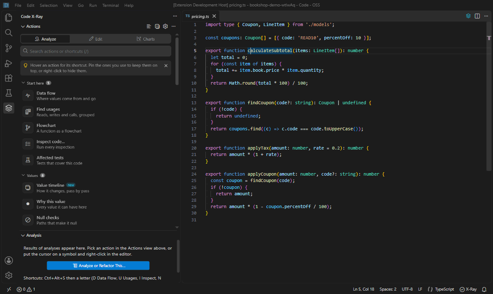
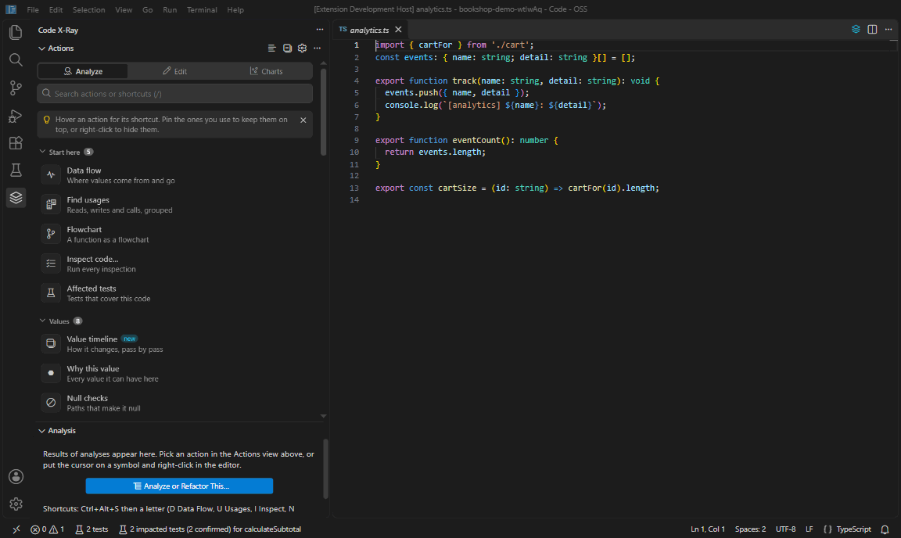

## Refactor

- **Change parameters** (`Ctrl+F6`): rename, add, remove and reorder parameters, updating every call. Problems are flagged as you type, the preview shows the signature before and after, `Ctrl+Enter` previews the edits and `Ctrl+Delete` removes a parameter.
- **Delete safely** (`Alt+Delete`): deletes after checking every usage, or lists what still uses it (and copies their locations). Select several files in the Explorer to delete them one after another.
- **Make it a parameter** (`Ctrl+Alt+P`): turns the selected expression into a parameter; **Make it an optional parameter** skips the question.
- **Move to another file** (`Ctrl+Alt+S B`): moves declarations to another file and fixes imports.
- **Intention actions** in the lightbulb (`Ctrl+.`), or all at once with **Rewrites here** (`Ctrl+Alt+S W`): 70 rewrites, each offered only where it keeps the behavior. Some examples:
  - `a != null ? a : b` to `a ?? b`, and `user && user.name` to `user?.name` in conditions.
  - `indexOf(x) !== -1` to `includes(x)`, and `let` to `const`.
  - `switch` to an `if` chain and back, early returns, and two independent `await`s into `Promise.all`.
  - JSX: self-closing tags, `&&` and `?: null`, and string attributes.

Changes open in VS Code's Refactor Preview first (`tsStructure.previewRefactorings`); `Ctrl+Z` undoes them.

**Every Edit feature works the same way.** Features that ask questions in the command box show one title, such as *Move to another file: cart.ts · step 2 of 3*, with a **?** button that explains the feature, **Back** from the second step on, and steps that stay open while you click into the code. Features that open a panel (Change parameters, Search by shape) share a header with the feature, its subject and **?** (also `F1`), a line of their keys, sections that fold and stay folded, a bar of main buttons that stays in view, and a banner with **Reload** when the file changes underneath. When an edit is done, one message says what changed, with **Undo** and **Show changes**.

- **Change parameters**: running it again on the same function brings back its panel; the tab follows the name you type; **Duplicate** (`Ctrl+D`) copies a parameter; the type fields suggest types; names typed with spaces become camelCase; `Enter` moves down a column; removing a parameter offers **Undo**; each problem is a link to the field it is about.
- **Make it a parameter**: with nothing selected, the expression at the cursor is used; the bulb button offers other names (from the type, from the expression); spaces become camelCase; a reserved or taken name gets a free alternative; your last choice is marked; the last step can switch the Refactor Preview on or off for this edit.
- **Move to another file**: declarations are grouped as exported or only used in the file, with their line range and size; buttons tick every exported one or none; a new file gets the right extension and an existing one is said so; the last target and choice are marked; the preview can be switched for this move.
- **Delete safely**: one list for every case, no dialog; moving through the usages shows each in the editor, `Enter` opens one and keeps the list, and a button opens it to the side; usages are grouped by file; what goes with it (imports, tests, being exported) is said on the Delete choice; when only tests use it, the first test is one click away.
- **Rewrites here**: the new code shows faintly beside the line as you move through the list; a button applies one and keeps the list open for the next; rewrites are grouped, and the last one used comes first; the gear opens Choose rewrites.
- **Choose rewrites**: the title counts what is on as you tick; buttons keep only the condition rewrites, only the ones that apply at the cursor, or go back to how it was.
- **Search by shape**: results are grouped by file (a click folds a file), with a filter, **Copy results**, **Clear**, arrow keys to move and the time taken; `F5` searches again; the pattern and replacement boxes grow with their text; Constraints, Replace with and Save as inspection fold.
- **Your own checks**: each shows how often it reports now and its severity; buttons run it on the whole project, duplicate it, turn it off or delete it (with **Undo**); all can be turned on or off, copied as JSON and added from JSON; with code selected, a new check starts from it.
- **Inspection settings**: each inspection shows its severity as an icon, with buttons to turn it off (or back to its default) and to go to where it reports in this file; a filter keeps only the ones reporting here; **Undo** reverses changes one at a time; the list keeps its place, and the severity step has **Back**.
- **Next problem** and the new **Previous problem** (`Ctrl+Alt+S Shift+5`): the problem lights up for a moment where the cursor lands; the message counts errors and warnings and how many fixes there are; past the last problem it moves on to the next open file that has some.

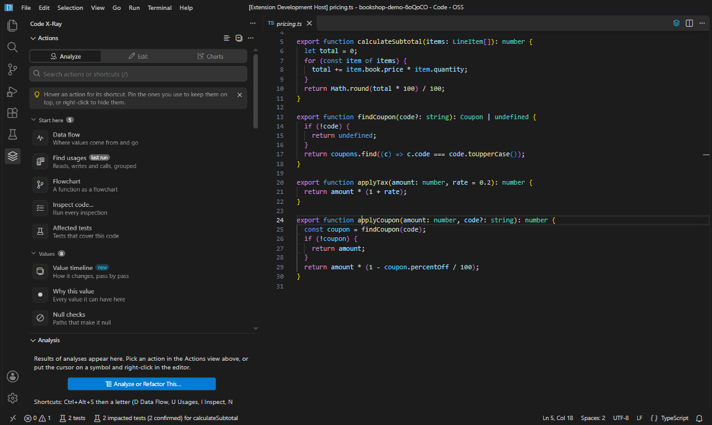

## Find problems

- **Live inspections** report problems in the Problems panel, with quick fixes. Besides missing `await`s and risky type assertions, 55 smaller checks catch slips, such as:
  - `x === NaN`, `typeof x === 'strng'`, `if (x = 1)`, a repeated `else if` condition;
  - a loop counting the wrong way, `replaceAll(/a/)` without `g`, numbers sorted without a compare function;
  - a `map()` callback that never returns, a list item without a `key`, an async `useEffect`;
  - `JSON.stringify` of a Map, `throw 'text'`, `delete` on an array.

  Style checks such as `console.log`, `==` and `await` in loops are off until you turn them on in **Inspection settings…**. The status bar shows error, warning and info counts; click it for the file's problems and a menu. `Ctrl+Alt+S 5` jumps to the next one, and **Copy problems in this file** copies them.
- **Inspect code…** runs every inspection over a scope you choose; **Fix all** fixes a whole group. **Inspect changed files** and **Inspect open files** skip the scope question.
- **Ghost exports**, **Déjà vu** and **Type assertions** clean up a project or folder.
- **Search by shape** finds code by shape with `$placeholders$`, and can save a pattern as your own inspection.

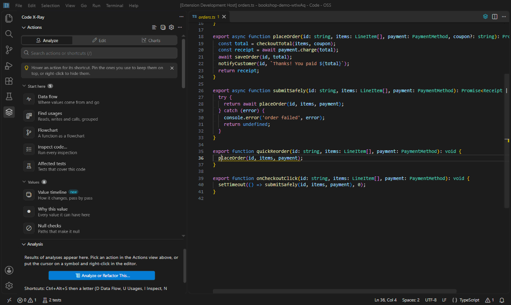
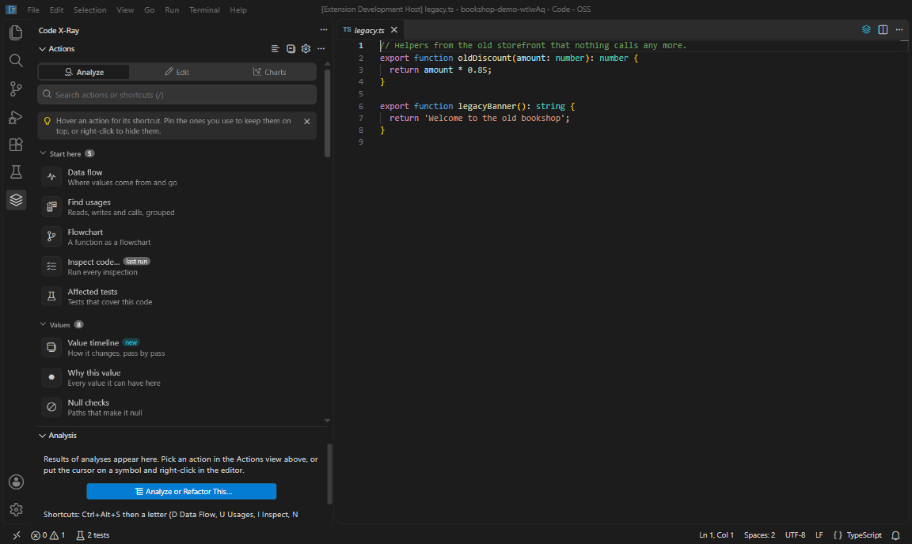
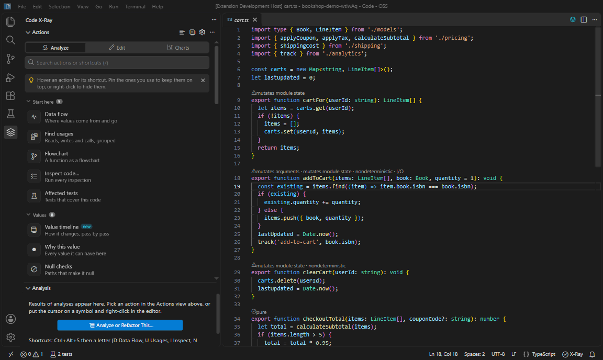

Analyses over many files ask where to look: the whole project, a folder, the open editors, the changed files, the current file, function or selection. While one runs, the results view shows a progress bar and a stop button (`Ctrl+Alt+S Escape`). In the Explorer, right-click folders to analyze only those.

### Charts tab

The **Charts** tab of the Actions view (**Charts tab**) lists every chart Code X-Ray draws, by what it shows: **How it runs** (Flowchart, Callers and calls, Error paths, Promise rejections), **How values move** (Data flow, What depends on what, Changes to a variable, Arguments passed in, React state) and **How it is built** (Family tree, Override reach, Who imports this, Why this import). Each one starts from the cursor and opens as a chart, with the same rows in the results view.

- **For the cursor** at the top lists the graphs that fit what the cursor is on, and follows it as you move.
- Each graph's tooltip says what it starts from and, for graphs that go deeper, what its levels control. With no source file open, the tab says what to open.
- **Open a chart…** (`Ctrl+Alt+S Shift+G`) picks one from the Command Palette, those that fit the cursor first.
- **Other charts** (`G`) in a chart's toolbar draws the same subject another way, such as the call graph of the function whose control flow is on screen.
- An analysis in the Analyze tab that can be drawn has **Open as chart** in its menu.

## Working with results

- Every result shows as a **card** at the bottom of the sidebar: the analysis and its subject, the summary and how long it took, then its groups as steps on a timeline, each with its first rows (click **+ N more** for the rest, the arrows for rows inside rows, a row to open its code). **Next** runs another analysis at the cursor, and the card says when files changed since it ran. The list button switches to the **Results** list, with its filters, history and row menus, and keeps it until **Show as card** in the list's title bar.
- The card numbers its steps on a line: the analysis and its subject on top with how many issues it found, a **Status** line, a filter, then each group as a numbered step. Steps that open code are drawn in the accent colour; read-only ones are plain. Code in a step shows as a coloured chip, rows hang off their step on a tree line with their verdict in colour (**line 27 → safe**), and the bottom has **Next steps** (other analyses of the same subject, one click each) and **Options** (copy, chart, list, run again, and how long it took).
- The card has a filter box (`/`), **Expand all** and **Fold all**, **Draw as chart**, and the time it ran on its timing chip; rows in tests have a test tube, long groups say how many rows they show, and running the same analysis again keeps open what you opened.
- **Clear** (the orange button) goes back to the start page. Too many buttons? **Fewer buttons** in the **...** menu keeps only the essentials (`tsStructure.results.toolbar`), or right-click the title bar to hide single buttons.
- **Back and forward** through earlier reports, **re-run** (`F5`, or `Ctrl+Alt+S L` from anywhere; the button turns into a warning when files changed).
- **Filter** rows (`Ctrl+F`): text, `file:cart` for rows in matching files, `is:warning` (or `is:error`, `is:info`) by tone, `-test` to drop matches. Also **Only in…** and **Groups…**; `Escape` shows every row again.
- `F4` / `Shift+F4` walk through the results; the selected row follows your cursor.
- `Ctrl+C` copies rows; right-click a row for **Find usages here**, **Data flow here**, **Null checks here**, and **More here** (Changes to this variable, Race conditions, Side effects, Error paths, Arguments passed in).
- Green checks mark what was found safe, such as a value that is never null or undefined.
- Graphs that can go deeper have a **Levels and options…** button (layers icon) in the title bar.
- **Draw as chart** in the title bar is a switch: turn it on and every new result also opens as a chart, until you turn it off (`tsStructure.results.alwaysShowDiagram`). `Ctrl+Alt+S 9` shows a single result as a chart.
- Each report puts what matters first: Find usages starts with the file you are in and the busiest files, in line order, and says how many functions use it, which calls are recursive, and when only tests use it; Inspect Code starts with the files with the most problems and names the most common one; unsafe Nullability uses, unhandled rejections and new import cycles come first. Rows in test files are marked across reports.
- The list of symbols to start from has sort buttons in its title bar: grouped by kind, by line from the top or the bottom, by complexity (most complex first, with each function's complexity shown), by size (longest first) or by name. The order stays for the rest of the session.
- Fewer clicks: with no file open, an action goes straight to a list of the project's files (where it last ran first, then open files, then the likeliest ones, such as components for React state), and then to the symbols it can start from; when only one fits, it runs on that one without asking. With the cursor off the symbol, the only fitting one on the cursor's line or in the file is used. With a chart or the output in front, the TypeScript file beside it is used. Inspect code with no file open inspects the workspace.
- Long messages show in full: their fixes come as buttons, and VS Code never folds a notification with buttons. Short ones keep the fixes as links in front.
- When an analysis can't start, the message says why and offers the way forward as links before the text, so the notification never hides them: **Choose a variable…** (or a function, class or parameter, whichever the analysis needs) lists the file's declarations that fit; another analysis that does fit the symbol at the cursor is offered by name; **Go to syntax error** appears when broken code is the likely cause; a library symbol offers **Go to definition**; a file outside the project offers its tsconfig.json; and unexpected failures offer **Log**, **Copy details** and **Report issue**.
- Copy or export a report as Markdown, CSV or JSON, open it as a Markdown preview, or **Copy all locations**. Remove reports from **History…** with their trash button.

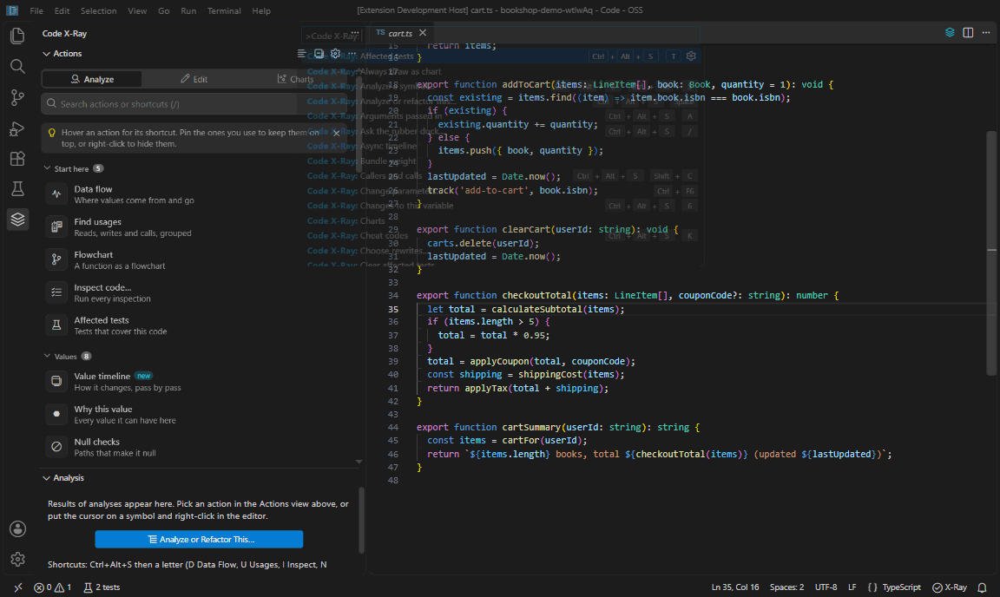

## Accessibility

The extension follows the W3C's Web Content Accessibility Guidelines (WCAG 2.2) where it draws its own interface:

- **Screen readers** hear what colors and icons show: result rows say "Warning:", "Safe:" or "Problem:", their file and line, and whether a fix or an explanation is available; Test Impact rows say whether a test is confirmed or possible; the status bar items read as counts with their kind.
- **The charts** work with screen readers such as NVDA: Tab and Shift+Tab move through every box in reading order (also boxes scrolled out of view), the arrow keys follow the flow or the branches, Enter opens the code, Space folds and Shift+F10 opens the menu. Each box is a button with a spoken label and a description that says where it sits, how many paths pass it and which keys act on it, and the chart is marked as an application so NVDA passes those keys to it; toned boxes also show a symbol (✓ ! ✕ i), fold buttons are 24 pixels, and Windows high contrast uses system colors.
- **Change parameters** and **Search by shape** name every field, mark invalid input, announce problems and result counts without interrupting, keep keyboard focus when rows move, and open search results with Enter.
- Animations stop when your system asks for reduced motion.

## C#

Find usages, Callers and calls and Family tree work in C# files too. They ask the C# language server (from the **C# extension** or C# Dev Kit) through VS Code's standard reference, call hierarchy and type hierarchy providers, so the answers are the compiler's own, and nothing leaves your computer. The reports look the same as for TypeScript:

- **Find usages**: Definitions, Calls (including `new`), Writes (`=`, `+=`, `++`, `out`, `ref`) and Reads, by file, with the method each usage is in and test projects marked.
- **Callers and calls**: the call hierarchy a few levels each way, as a chart, with the same Levels and Show controls.
- **Family tree**: supertypes and interfaces, subtypes and implementations, and the type's members.

With no C# extension, or before it has loaded the solution, Find usages finds the name instead: every identifier with that name in the workspace's `.cs` files, from the bundled parser, filed the same way (declarations as definitions), with a note that same-named symbols elsewhere are included. Callers and calls and Family tree say they need the C# extension, with a button to install it.

The charts work in C# files as well, from the bundled parser (names matched as text across the workspace's `.cs` files, so same-named symbols elsewhere can be included; each report says so):

- **Data flow** and **Data flow chart**: a local or parameter within its method, a field or property across the class; flows in (declaration, assignments, updates, the parameter) and flows out (passed to a call, returned, into another variable, deciding a branch).
- **Error paths**: what the method throws and whether a catch around it handles it or it escapes, what its calls into the workspace can throw, and each catch clause (handles it, swallows it, throws again).
- **Promise rejections**: awaited tasks and where their errors go, tasks not awaited (their errors are lost), and `async void`.
- **Changes to this variable**: every write, by method.
- **Arguments passed in**: the value each call (or `new`) passes to the parameter at the cursor, named arguments and defaults included, across files.
- **Family tree** and **Callers and calls**: from the C# extension when it answers, otherwise by name: base types and interfaces, subtypes, members; callers and callees a few levels each way, library calls marked.
- **Override reach**: what the member overrides or implements, its overrides (and `new` members hiding it) in subtypes, and its call sites.
- **Who imports this**: the files using the file's namespace (a `using` or the same namespace) and naming its types.

Why this import… (a chain of imports between two files) and React state are TypeScript and JavaScript only.

In a C# or T-SQL file, **Analyze or Refactor This…** lists the actions that work there, and an action that is TypeScript and JavaScript only (Data flow, Null checks…) says so and offers those instead of looking for a TypeScript file. All Code X-Ray shortcuts work in C# and T-SQL editors for that reason. The demo project has a C# sample to try them on: `docs/demo/csharp/OrderService.cs`.

Two more work with nothing else installed, from a C# parser (tree-sitter's C# grammar, as WebAssembly) that ships with Code X-Ray:

- **Flowchart** and **What depends on what**: any method, constructor, property accessor (an expression-bodied property is its getter), local function or lambda. Decisions, `for`/`foreach`/`while`/`do` loops, `switch` sections with patterns and `when` clauses, `try`/`catch`/`finally` (with filters), `using` and `lock` blocks, `break`, `continue`, `return` and `throw` become boxes and edges as in TypeScript, with every path listed, impossible ones flagged (the same condition taken both ways with nothing changed in between), and data and control dependences. Calls are not expanded in place, and boxes have no quick edits, since the parser sees syntax only, not types.
- **Inspections** in the Problems panel as you type: empty catch block, `throw ex;` that resets the stack trace, `async void` outside event handlers, assignment to itself, comparison with itself, identical `if` and `else` branches, `if (…);` and constant conditions. They follow the same switches as the TypeScript ones (Inspections: Enabled, the delay, and each one's severity or `off` in Inspections: Severity, by ids such as `csharpEmptyCatch`).

The rest of Code X-Ray is TypeScript and JavaScript only for now.

## T-SQL

Code X-Ray reads T-SQL itself (its own tokenizer and statement reader, no database connection), in files VS Code opens as SQL:

- **Flowchart** and **What depends on what**: a `CREATE`/`ALTER` `PROCEDURE`, `FUNCTION` or `TRIGGER`, or the statements of a script batch (batches split at `GO`). `IF … ELSE`, `WHILE` (with `BREAK` and `CONTINUE`), `BEGIN … END`, `BEGIN TRY … END TRY BEGIN CATCH … END CATCH`, `RETURN`, `THROW`, labels and `GOTO` become boxes and edges; every path is listed, impossible ones flagged, and dependences follow the `@variables` (set by `SET`, `SELECT @x =`, `DECLARE … =`, `FETCH … INTO` and `EXEC … OUTPUT`) from the parameters on. Statements need no semicolons: one ends where the next statement keyword starts, so `INSERT … SELECT`, `… UNION SELECT`, `UPDATE … SET`, a CTE's `WITH … SELECT` and `CASE … END` stay whole. `RAISERROR` is a plain step (it only stops the batch inside `TRY` at severity 11 or more).
- **Find usages**: a table, view, column, procedure or function by name across the workspace's `.sql` files (case-insensitive, with or without `[brackets]` and schema), filed as definitions (`CREATE`, `DECLARE`), calls (`EXEC`, `schema.fn(…)`), writes (`INSERT INTO`, `UPDATE`, `DELETE FROM`, `MERGE INTO`, `TRUNCATE TABLE`, `UPDATE … SET column =`) and reads. A `@variable` is found within its routine. Names are matched by text, so two tables of the same name in different schemas are only told apart where the code writes the schema.
- **Callers and calls**: the procedures that `EXEC` this one (or call this function), and what it calls, a few levels each way; procedures not in the workspace (`sp_who`) are listed as such.
- **Inspections** as you type: `UPDATE` or `DELETE` without `WHERE` (table variables and temp tables excepted), `= NULL` or `<> NULL` in a condition, empty `CATCH`, `NOLOCK` and `READ UNCOMMITTED`, `@@IDENTITY`, `SELECT *` (not inside `EXISTS`), `TOP` without `ORDER BY`, the deprecated `ntext` and `image` types, and, as a hint, a procedure without `SET NOCOUNT ON`. Ids such as `tsqlSelectStar` set their severity in Inspections: Severity.

## Settings

**Code X-Ray: Settings** (the gear in the Actions view's title bar, or **Settings** at the bottom of the view) opens one page with every setting:

- **Features** first: a switch for each part of Code X-Ray, with **Turn all on** and **Core only** (the parts on when the extension is first installed: Affected tests, and Data flow and changes). **React state** has its own switch. A tab of the Actions view with no actions left (Edit, when every edit feature is off) is hidden.
- **Animations**: **Button animations** (the effects hovering or clicking an action plays; off by default) and **Chart animations** (the moving grid and flowing lines). A chart with animations off says so on its sparkle and play buttons.
- Then **General**, **Scope**, **Inspections** and the rest, as switches, lists and fields. Lists and objects open in VS Code's settings.
- Search across all of them from the box at the top (`Ctrl+F` or `/`). A dot marks a setting you changed, the arrow resets it, and **This workspace** marks one set for this workspace only.
- **Inspections › Severity** lists every inspection (TypeScript and JavaScript, C#, T-SQL) with a choice of Default, Error, Warning, Info, Hint or Off, grouped by language; search finds a single inspection by name.
- **Changed only** (top of the sidebar) shows every setting you changed, across sections; **Reset section** puts a section's changed settings back to their defaults.
- A list setting says under it what the chosen option does; a number field shows its range and keeps a value outside it unsaved, saying why. Each row's copy button copies the setting's ID. Up and down move between sections.
- **Open in VS Code settings** shows the same settings in VS Code's own editor.

The ones you are most likely to change:

| Setting | Default | |
| --- | --- | --- |
| `tsStructure.features.<name>` | Affected tests and Data flow on | turn features on or off, also with **Toolshed…** |
| `tsStructure.include` / `exclude` | | files left out of analysis; right-click **Leave out of Code X-Ray** in the Explorer |
| `tsStructure.askForScope` | `true` | ask where to look before project-wide analyses |
| `tsStructure.contextMenu.topLevel` | `true` | the common analyses at the top of the right-click menu |
| `tsStructure.results.progress` | `statusBar` | or `notification` |
| `tsStructure.lightbulbAnalyses` | `true` | analyses in the lightbulb's refactor menu |
| `tsStructure.results.alwaysShowDiagram` | `false` | every new result also opens as a chart |
| `tsStructure.animations.buttons` / `charts` | `false` / `true` | the Actions view's button effects / the charts' moving grid and flowing lines |
| `tsStructure.actions.accentColor` | `cyan` | the color of the action on screen and the Value path card in the Actions view: `cyan`, `pink` or `theme` |

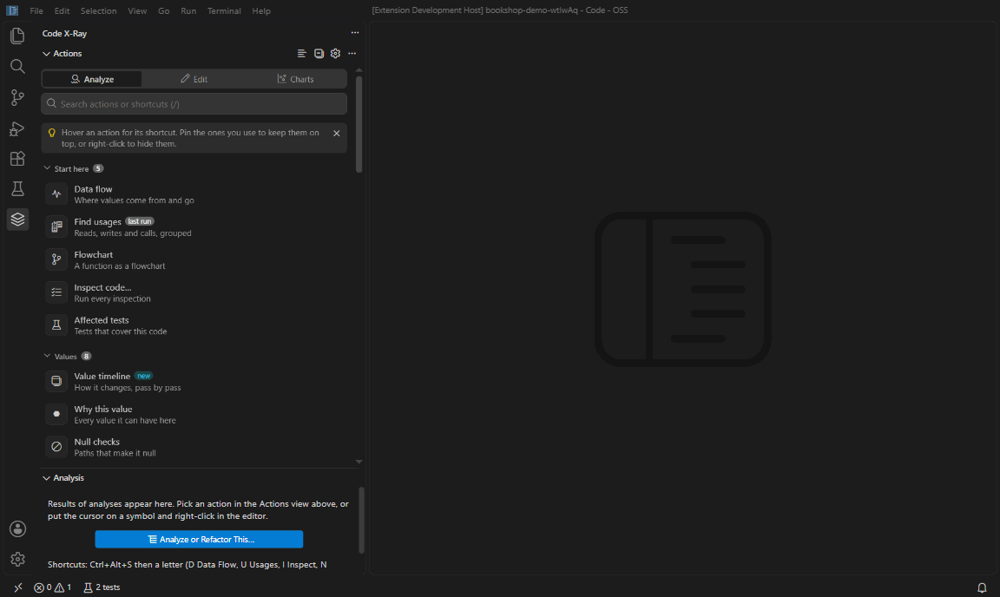

## Speed

The first analysis of a project parses all its files. Code X-Ray does this in the background a moment after you open a TypeScript or JavaScript file (`tsStructure.warmUp`), and every feature (analyses, live inspections, test impact, the CodeLens) shares that one parse, so later analyses start at once and only re-read files that changed.

## Development

```bash
npm install
npm test                  # compile and run the unit tests
npm run bundle            # bundle the extension into dist/extension.js (packaging does this, minified)
VSCODE_EXECUTABLE="/path/to/Code.exe" npm run test:integration   # run inside a real VS Code
VSCODE_EXECUTABLE="/path/to/Code.exe" npm run screenshots        # record the docs/images GIFs from docs/demo
```

The analysis engine (`src/analysis`, `src/refactor`, `src/intentions`, `src/inspect`, `src/navigate`, `src/search`, `src/structure`) has no `vscode` dependency and is unit-tested directly; `src/ui` is the VS Code layer. The extension ships as one esbuild bundle (`scripts/bundle.js`), with TypeScript kept as its own dependency, so it loads in a fraction of the time of the compiled files.

## Credits

The button animations in the Actions view (Blinky, Glitch, Trail, Stroke-n-fill, Shuffle, Crash-n-blink, Slide-n-blink, Color flash and Build on) are recreated from [the motion language Jerry Liu shared](https://x.com/SloppyJ44/status/1846584501847142705) (@SloppyJ44), and named after his labels. They are written from scratch in CSS for Code X-Ray, after watching his animation; no code, frames or images are taken from it. The animation and its design remain his work.

The Welcome page's ASCII field and pixel-font title are original code and glyphs written for Code X-Ray in the style of Framer University's ASCII Shader component (no code or font taken from it).

The animated graphs (the dot grid behind the charts, the flowing lines and the box style) are adapted from the node grid demo of [robot-components](https://github.com/dashrobotco/robot-components) by Robot FZCO, used under the MIT License. Its copyright and license notice is in [THIRD_PARTY_NOTICES.md](THIRD_PARTY_NOTICES.md), which ships with the extension.
